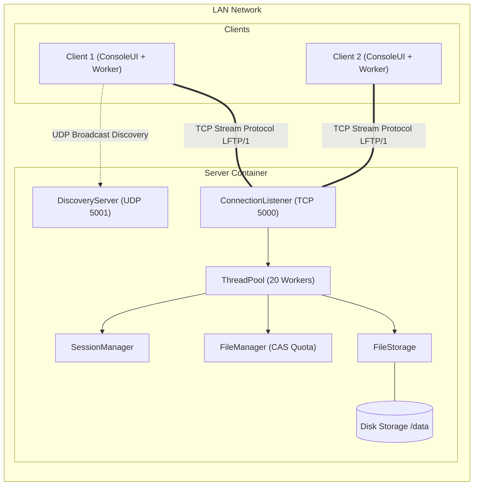

# LFTP/1 — LAN File Transfer Protocol

> **Course:** Network Programming (INT1433) · PTIT · Instructor: Dr. Hung N. Dang
>
> *Hệ thống truyền tệp tin cậy dung lượng lớn trong mạng cục bộ (LAN) sử dụng Java TCP/UDP Socket với cơ chế băm lũy tiến SHA-256 tức thì và khôi phục truyền tải khi đứt mạng (Resume).*

👋 **Tài liệu hướng dẫn:** [`docs/student-guide.md`](docs/student-guide.md) · 📜 Quy định & Chấm điểm: [`INSTRUCTION.md`](INSTRUCTION.md) · 🚀 Khởi động nhanh: [`GETTING_STARTED.md`](GETTING_STARTED.md)

---

## 1. Team (mandatory)

| # | Full name | Student ID | Class | GitHub | Role |
|:-:|-----------|:----------:|:-----:|--------|------|
| 1 | Nguyễn Trung Tường | B23DCCN909 | D23CQCN01-B | @tuongnt | Trưởng nhóm, kiến trúc Server, Thread Pool, FileStorage & FileManager |
| 2 | Bùi Văn Đạt | B23DCCN126 | D23CQCN01-B | @datbv | Thiết kế giao thức nhị phân LFTP/1, MessageIO, SessionManager & SHA-256 Streaming |
| 3 | Nguyễn Đình Khải | B23DCCN420 | D23CQCN01-B | @khaind | Ứng dụng Client đa luồng (UI & Worker), UDP Broadcast Discovery & ResumeManager |

**Topic:** *Xây dựng ứng dụng truyền tệp trong mạng nội bộ sử dụng Java TCP Socket (Reliable File Transfer Protocol)*

---

## 2. Problem & Idea (mandatory)

- **Problem:** Hai nhân viên trong cùng văn phòng kết nối chung mạng LAN nội bộ cần truyền các tệp dữ liệu lớn (bản dựng phần mềm, video kiểm thử, cơ sở dữ liệu nội bộ dung lượng từ 500 MB đến 2 GB). Việc đưa lên Google Drive gây phụ thuộc Internet, tốc độ chậm và tiềm ẩn rủi ro rò rỉ dữ liệu nội bộ ra bên thứ ba.
- **Our idea:** Xây dựng hệ thống Client-Server chạy trực tiếp trong mạng LAN bằng Java Socket. Tận dụng tối đa băng thông dây cáp nội bộ (tốc độ tới 100 MB/s), tự động tìm kiếm server qua UDP Broadcast, truyền mảng byte thô với khung nhị phân và kiểm tra toàn vẹn bằng SHA-256 lũy tiến.
- **What makes it non-trivial:**
  1. *Lỗi dính gói / xé gói trong TCP:* Phải thiết kế khung nhị phân Length-prefixed 12-byte header để phân định ranh giới gói tin.
  2. *Tránh nghẽn I/O khi xác thực file lớn:* Áp dụng giải thuật băm lũy tiến (Streaming Hash) theo từng khối 64 KiB ngay trong RAM để bước chốt hoàn tất diễn ra tức thì, không làm quá hạn Socket Timeout (60s).
  3. *Khôi phục khi đứt mạng (Resume):* Lưu điểm kiểm soát theo kích thước thực tế trên đĩa (`actualDiskSize`) và khôi phục trạng thái bộ băm `MessageDigest` từ file tạm.
  4. *Đồng bộ và phòng chống Deadlock:* Khống chế 20 worker threads bằng `ThreadPoolExecutor`, sắp xếp thứ bậc khóa 1 chiều và dùng giải thuật CAS không khóa (`AtomicLong`) cho Quota lưu trữ 10 GiB.
- **Out of scope:** Không hỗ trợ mạng ngoài Internet; chưa mã hóa TLS/SSL kênh truyền; không hỗ trợ truyền thư mục lồng nhau.

Full proposal: [`docs/proposal.md`](docs/proposal.md)

---

## 3. Features

- [x] **Connection & session:** Bắt tay `OP_HELLO`, đàm phán cấu hình, cấp phát `uploadId` và mã bí mật 128-bit `resumeToken`.
- [x] **Custom protocol:** Giao thức nhị phân LFTP/1 đặc tả chi tiết tại [`docs/protocol-design.md`](docs/protocol-design.md).
- [x] **Concurrency:** Phục vụ song song tối đa 20 client bằng `ThreadPoolExecutor`, quản lý Quota bằng `AtomicLong` CAS không khóa.
- [x] **Robustness:** Chống dính gói TCP bằng 4 byte length, xử lý rớt mạng đột ngột, đa tầng timeout (Connect 5s, Handshake 10s, Frame 15s, Read 60s).
- [x] **Streaming Hash (SHA-256):** Băm lũy tiến song song khi nhận dữ liệu vào RAM, xác thực tức thì tại bước Commit.
- [x] **Checkpoint & Resume:** Tiếp tục tải lên/tải xuống từ vị trí ngắt quãng, lưu vết trạng thái hoàn tất 24 giờ (Idempotency).
- [x] **UDP Broadcast Discovery:** Client tự động quét và kết nối tới Server trong LAN (Cổng 5001) mà không cần gõ IP thủ công.
- [x] **Mô hình Client 2 luồng:** Tách biệt luồng UI và luồng Worker ngầm, cho phép người dùng Pause, Resume, Cancel bất cứ lúc nào.

---

## 4. Architecture



| Khía cạnh kiến trúc | Lựa chọn của nhóm | Lý do cốt lõi |
|---|---|---|
| Ngôn ngữ | **Java 21 (Eclipse Temurin)** | Tận dụng thư viện Java Socket chuẩn (`ServerSocket`, `Socket`, `DataInputStream/DataOutputStream`) |
| Tầng vận chuyển | **TCP (5000) & UDP (5001)** | TCP đảm bảo thứ tự byte và độ tin cậy của file; UDP Broadcast giúp client tự tìm thấy server trong LAN |
| Đóng gói khung (Framing) | **Length-prefixed Binary Framing** | Tiền tố độ dài 4 byte + 12 byte Header cố định; giải quyết triệt để lỗi dính gói TCP, không cần Base64 |
| Mô hình đa luồng Server | **ThreadPoolExecutor (20 luồng)** | Khống chế bộ nhớ Native OS Thread Stack ở mức 20 MB, chống sập máy chủ do cạn kiệt tài nguyên |
| Mô hình Client | **2 Luồng (UI & Worker)** | Luồng bàn phím không bị đơ khi truyền file lớn, hỗ trợ pause/resume/cancel tức thì bằng cờ `volatile` |
| Quản lý Quota | **Lock-free CAS (`AtomicLong`)** | Kiểm tra và dành chỗ dung lượng 10 GiB bằng lệnh phần cứng vi xử lý, không bao giờ bị Deadlock |

Chi tiết kiến trúc: [`docs/architecture.md`](docs/architecture.md)

---

## 5. Quick Start

### Cách 1: Chạy bằng Docker Compose (Khuyên dùng)

```bash
# 1. Khởi tạo cấu hình môi trường
cp .env.example .env

# 2. Khởi chạy Server trong luồng nền
docker compose up --build -d

# 3. Mở một Client tương tác (có thể mở nhiều cửa sổ terminal để chạy nhiều client)
docker compose run --rm client

# 4. Dừng hệ thống khi kết thúc
docker compose down
```

### Cách 2: Chạy trực tiếp (Natively với Java SDK)

```bash
# --- Phía Server ---
cd server
mkdir -p bin
javac -encoding UTF-8 -d bin $(find src -name "*.java")
java -cp bin Server

# --- Phía Client (ở terminal khác) ---
cd client
mkdir -p bin
javac -encoding UTF-8 -d bin $(find src -name "*.java")
java -cp bin Client
```

---

## 6. Demo & Test Evidence

Hệ thống đã vượt qua bộ kiểm thử tích hợp tự động toàn diện:
- Kiểm thử bắt tay kết nối TCP và đàm phán thông số.
- Kiểm thử tải lên tệp mẫu 2 MB với mã băm SHA-256.
- Kiểm thử phân trang danh mục `LIST_FILES`.
- Kiểm thử tải xuống và xác minh mã băm khớp 100%.
- Kiểm thử tính năng ngắt kết nối và Resume thành công.

Chi tiết quy trình kiểm thử: [`docs/testing-guide.md`](docs/testing-guide.md).

---

## 7. Documentation

| Tài liệu | Nội dung chi tiết |
|---|---|
| [`docs/proposal.md`](docs/proposal.md) | M1 — Vấn đề, giải pháp, phạm vi, kế hoạch phân công |
| [`docs/protocol-design.md`](docs/protocol-design.md) | Đặc tả chi tiết giao thức nhị phân LFTP/1 (Header, Opcodes, Status Codes, Sequence Diagrams) |
| [`docs/architecture.md`](docs/architecture.md) | Mô hình đa luồng, thứ tự khóa chống Deadlock, sơ đồ thành phần và vòng đời kết nối |
| [`docs/key-word.md`](docs/key-word.md) | 17 từ khóa kỹ thuật cốt lõi và các quyết định thiết kế nổi bật để vấn đáp |
| [`docs/note.md`](docs/note.md) | Sổ tay phân tích chuyên sâu các cơ chế bộ nhớ, volatile, streaming hash và phục hồi lỗi |

---

## 8. AI Disclosure (mandatory)

### 8.1 Summary

| Tool / model | Used by | Used for | Files / modules | Level |
|---|---|---|---|---|
| Gemini / Claude | Cả nhóm | Tham khảo thiết kế giao thức, rà soát logic đa luồng và deadlock | `docs/protocol-design.md`, `SessionManager.java` | Co-write |
| GitHub Copilot | Nguyễn Trung Tường | Hỗ trợ gợi ý cú pháp boilerplate Java I/O | `server/src/lftp/server/` | Assist |
| Claude | Bùi Văn Đạt | Rà soát thuật toán băm lũy tiến SHA-256 | `HashUtils.java`, `UploadManager.java` | Assist |

### 8.2 Decisions we made ourselves
- Chọn giao thức nhị phân thuần túy với Header cố định 12 byte thay vì JSON/Base64 để tối ưu băng thông cáp mạng LAN.
- Tự thiết kế phương thức `writeString` 4 byte độ dài UTF-8 thay vì dùng `DataOutputStream.writeUTF()` của Java để tránh giới hạn trần 64 KiB.
- Quyết định dùng giải thuật CAS với `AtomicLong` cho Quota thay vì khóa `synchronized` bao trùm để loại trừ triệt để nguy cơ Deadlock.
- Quyết định lưu thông tin phiên hoàn tất trong RAM 24 giờ để xử lý bài toán rớt mạng đúng lúc commit ở vạch đích (Idempotency).

### 8.3 Where AI was wrong — and how we found out
- **Lỗi 1 (Deadlock do lồng khóa):** Ban đầu AI gợi ý dùng `synchronized` bao trùm lên toàn bộ các phương thức của `SessionManager`, `TransferSession` và `FileManager`. Nhóm phát hiện khi luồng upload giữ khóa Session gọi sang FileManager, trong khi luồng ConnectionWatcher giữ khóa FileManager gọi sang Session sẽ gây Deadlock. Nhóm đã tự thiết kế lại mô hình khóa phân bậc 1 chiều và dùng kỹ thuật Snapshot trích xuất dữ liệu tạm để nhả khóa ngay.
- **Lỗi 2 (Quên gán digest khi Resume):** Trong phương thức khôi phục băm khi Resume, biến `resumedDigest` được tính từ file tạm nhưng không được gán ngược lại vào `TransferSession` do thuộc tính bị để `final`. Nhóm đã phát hiện khi kiểm tra lại luồng băm và bổ sung phương thức `setSha256Digest()` vào `TransferSession`.

---

## 9. Contribution (mandatory)

| Member | Owns (modules / documents) | Key PRs / commits | AI-assisted parts | Contribution % |
|---|---|---|---|:---:|
| Nguyễn Trung Tường | Kiến trúc Server, ConnectionListener, ThreadPool, FileStorage, FileManager, CAS Quota, `docs/architecture.md` | Core Server commits | Quota CAS review — Assist | 34% |
| Bùi Văn Đạt | Giao thức LFTP/1, MessageIO, SessionManager, UploadManager, DownloadManager, Streaming Hash SHA-256, `docs/protocol-design.md`, `docs/proposal.md` | Protocol, Transfer & Session commits | Protocol frame design — Co-write | 33% |
| Nguyễn Đình Khải | Ứng dụng Client, ConsoleUI, TransferClient, UDP Broadcast Discovery, ResumeManager, kịch bản kiểm thử | Client & Discovery commits | UI state flow — Assist | 33% |

Xác nhận bảng đóng góp:
- [x] Nguyễn Trung Tường
- [x] Bùi Văn Đạt
- [x] Nguyễn Đình Khải
