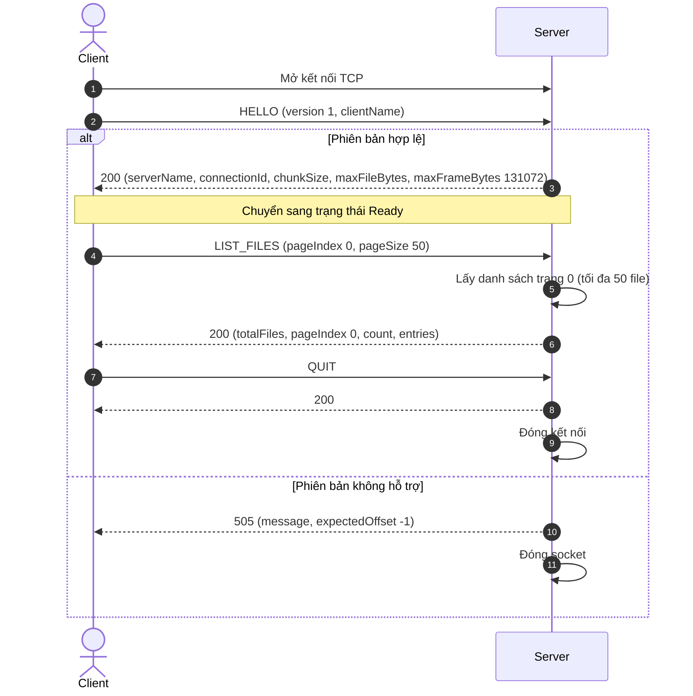
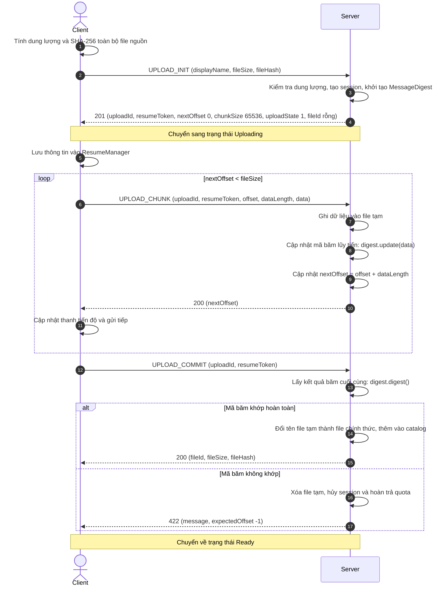
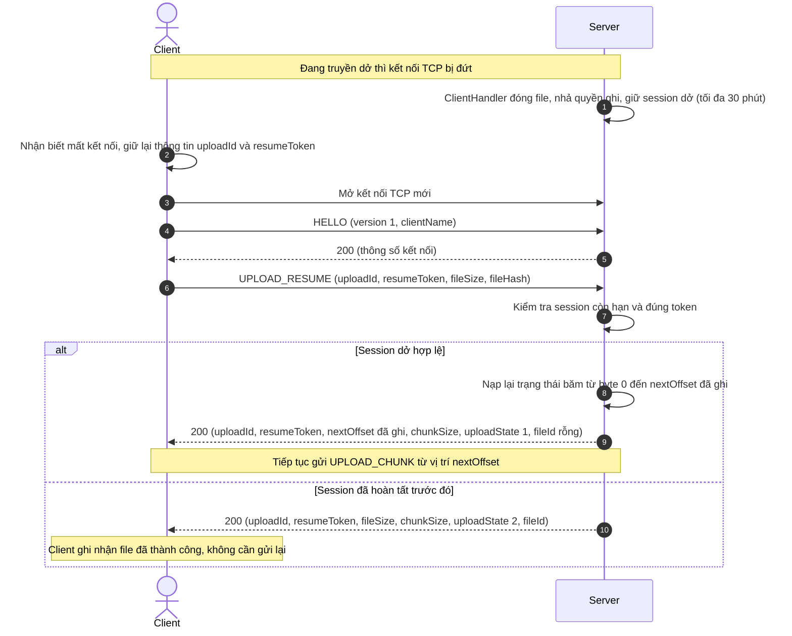
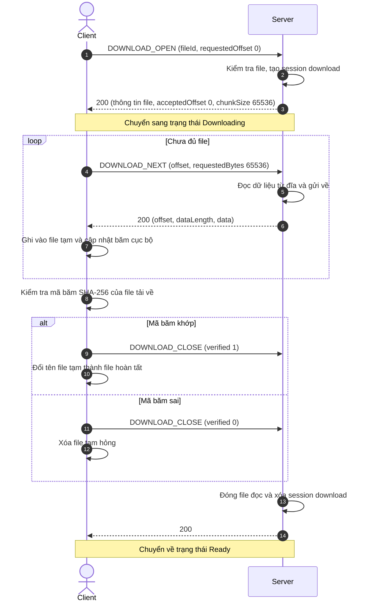

# Application Protocol Specification

## 1. Overview

| Thuộc tính | Lựa chọn của nhóm | Lý do lựa chọn |
|---|---|---|
| Tên và phiên bản giao thức | LAN File Transfer Protocol, LFTP/1. Trường version có giá trị 1 | Hai bên cần biết có đang hiểu cùng một cách đọc thông điệp hay không |
| Tầng vận chuyển (Transport) | TCP cổng 5000 cho truyền file, UDP cổng 5001 cho tìm kiếm server | TCP đảm bảo thứ tự byte và độ tin cậy của file, UDP Broadcast giúp client tự tìm thấy server trong mạng nội bộ |
| Cổng mặc định | TCP: 5000, UDP: 5001, có thể cấu hình | Cho phép chạy nhiều server hoặc thay đổi cổng khi cần |
| Khung thông điệp (Framing) | Ghi độ dài bằng 4 byte rồi ghi đúng số byte nội dung, giới hạn tối đa 128 KiB | Bên nhận biết thông điệp kết thúc ở đâu, đồng thời khống chế bộ đệm RAM để tránh bị cạn kiệt bộ nhớ |
| Định dạng dữ liệu | Nhị phân. Số dùng DataOutputStream và DataInputStream, dữ liệu file giữ nguyên dạng byte | Phù hợp kiến thức luồng vào ra trong Java, không cần đổi nội dung file thành chuỗi và xử lý nhanh |
| Quản lý phiên (Session model) | Server quản lý session theo thời gian thực, SessionManager tạo và giữ session | Upload dở được giữ tối đa 30 phút để tải tiếp. Download bị ngắt thì client lưu vị trí và yêu cầu lượt mới từ vị trí đó |
| Mã hóa ký tự | UTF-8 chuẩn cho tên file và thông báo, nội dung file không đổi mã | Hỗ trợ tốt tiếng Việt có dấu và giữ nguyên vẹn nội dung byte của file nguồn |

---

## 2. Message Framing

TCP truyền dữ liệu dưới dạng một luồng byte liên tục. Một thông điệp có thể phải đọc nhiều lần mới đủ, hoặc nhiều thông điệp cũng có thể đến dính liền nhau. Vì vậy, bên nhận không được coi mỗi lần đọc socket là nhận xong một thông điệp hoàn chỉnh.

- **Cách dùng ký tự ngăn cách (Delimiter-based):** Kết thúc mỗi thông điệp bằng ký tự xuống dòng `\n`. Nhóm không dùng cách này vì dữ liệu nhị phân của file có thể chứa chính byte của ký tự đó, dẫn đến việc cắt nhầm thông điệp.
- **Cách dùng tiền tố độ dài (Length-prefixed):** Đặt một số nguyên 4 byte ở đầu mỗi thông điệp để thông báo độ dài phần dữ liệu theo sau. Nhóm chọn cách này.

```text
[frameLength: 4 byte][version, opcode, requestId, status, body]
```

**Quy định khung của nhóm:**
Mỗi thông điệp bắt đầu bằng trường `frameLength` (4 byte ghi số nguyên int theo thứ tự byte cao trước). Giá trị này không tính chính 4 byte ghi độ dài và phải nằm trong khoảng từ **12 đến 131072 byte (128 KiB)**.
Bên nhận trước tiên đọc đúng 4 byte độ dài, kiểm tra xem có nằm trong giới hạn từ 12 đến 131072 byte hay không, sau đó mới cấp phát bộ đệm để đọc đủ `frameLength` byte còn lại. 

Việc giới hạn tối đa 128 KiB giúp server kiểm soát chặt chẽ bộ nhớ Heap được cấp phát cho mỗi kết nối, ngăn chặn các yêu cầu gửi độ dài ảo gây cạn kiệt RAM. Chỉ khi nhận đủ và kiểm tra thông điệp hợp lệ thì mới xử lý yêu cầu hoặc ghi dữ liệu vào file. Nếu độ dài vượt quá giới hạn hoặc mất kết nối giữa chừng, bên nhận đóng kết nối ngay lập tức và hủy phần thông điệp đang nhận dở.

---

## 3. Message Format

### 3.1 Ví dụ minh họa định dạng JSON (dùng để đối chiếu)
Yêu cầu:
```json
{
  "version": 1,
  "opcode": 1,
  "requestId": 1,
  "status": 0,
  "body": { "clientName": "may-A" }
}
```

Phản hồi:
```json
{
  "version": 1,
  "opcode": 1,
  "requestId": 1,
  "status": 200,
  "body": {
    "serverName": "TKD-server",
    "connectionId": "550e8400-e29b-41d4-a716-446655440000",
    "chunkSize": 65536,
    "maxFileBytes": 2147483648,
    "maxFrameBytes": 131072
  }
}
```

### 3.2 Ví dụ định dạng dạng văn bản (SMTP / Redis style)
```text
Yêu cầu: HELLO, requestId = 1, clientName = may-A
Phản hồi: HELLO, requestId = 1, status = 200, chunkSize = 65536
```

### 3.3 Định dạng nhị phân chính thức của nhóm
Cả yêu cầu và phản hồi đều có các trường dưới đây theo thứ tự cố định. Các trường trước phần body có kích thước cố định tổng cộng là 12 byte. Server trả phản hồi luôn có cùng `opcode` và `requestId` với yêu cầu để client đối chiếu.

| Trường | Kiểu và kích thước | Ý nghĩa |
|---|---|---|
| frameLength | int, 4 byte | Độ dài từ version đến hết body (tối thiểu 12, tối đa 131072) |
| version | u8, 1 byte | Phiên bản giao thức, hiện tại có giá trị là 1 |
| opcode | u8, 1 byte | Mã lệnh xử lý ở mục 4 |
| requestId | long, 8 byte | Mã yêu cầu dương, tăng dần trên từng kết nối để đối chiếu phản hồi |
| status | u16, 2 byte | Phía yêu cầu đặt bằng 0, phía phản hồi dùng mã trạng thái ở mục 5 |
| body | frameLength - 12 byte | Dữ liệu riêng của từng lệnh, không cần ghi thêm độ dài body |

**Quy định các kiểu dữ liệu và cách đọc ghi:**
Mọi số nguyên nhiều byte đều được ghi theo thứ tự byte cao trước (Big-Endian).

| Kiểu | Cách ghi và đọc | Quy định chi tiết |
|---|---|---|
| u8 | writeByte và readUnsignedByte | Số nguyên không dấu 1 byte (0 đến 255) |
| u16 | writeShort và readUnsignedShort | Số nguyên không dấu 2 byte (0 đến 65535) |
| int | writeInt và readInt | Số nguyên có dấu 4 byte, phải kiểm tra giới hạn trước khi dùng làm kích thước |
| long | writeLong và readLong | Số nguyên có dấu 8 byte. Dung lượng và vị trí không được âm (riêng expectedOffset dùng -1 khi không có vị trí) |
| str | int ghi số byte UTF-8 rồi đến đúng số byte đó | Chuỗi ký tự UTF-8 chuẩn. Không dùng writeUTF/readUTF của Java để tránh dùng Modified UTF-8 và tránh giới hạn 65535 byte |
| hash32 | Đúng 32 byte | Mã băm SHA-256 dạng byte nhị phân của toàn bộ file |
| data[n] | Đúng n byte | Dữ liệu nhị phân của file, đọc ghi trực tiếp bằng mảng byte, không đổi thành chuỗi |

---

## 4. Command Reference

Ký hiệu: C là Client, S là Server.

| Lệnh và mã | Chiều gửi | Dữ liệu gửi (Parameters) | Phản hồi từ Server | Mô tả chi tiết |
|---|:---:|---|---|---|
| HELLO, opcode 1 | C → S | clientName: str | 200 với serverName: str, connectionId: str, chunkSize: int, maxFileBytes: long, maxFrameBytes: int | Bắt đầu làm việc, client và server thống nhất các thông số giới hạn |
| LIST_FILES, opcode 2 | C → S | pageIndex: int, pageSize: int | 200 với totalFiles: int, pageIndex: int, count: int, entries[count]<br><br>Trong đó:<br>- totalFiles là tổng số file hoàn tất trên server.<br>- pageIndex là số thứ tự trang (bắt đầu từ 0).<br>- count là số lượng file trả về trong trang này.<br>- Mỗi phần tử entries gồm: fileId: str, displayName: str, fileSize: long, fileHash: hash32, createdAtEpochMillis: long.<br>- Áp dụng phân trang để thông điệp không vượt quá giới hạn 128 KiB | Xem danh sách file đã hoàn tất theo từng trang |
| QUIT, opcode 3 | C → S | Body rỗng | 200 với body rỗng rồi đóng kết nối | Kết thúc làm việc và đóng socket một cách chủ động |
| UPLOAD_INIT, opcode 16 | C → S | displayName: str, fileSize: long, fileHash: hash32 | 201 với uploadId: str, resumeToken: str, nextOffset: long, chunkSize: int, uploadState: u8, fileId: str<br><br>Trong đó:<br>- nextOffset = 0 là bắt đầu nhận từ đầu file.<br>- uploadState = 1 là lượt tải dở chưa xong.<br>- fileId rỗng vì chưa hoàn tất | Khởi tạo lượt tải lên mới, kiểm tra quota và dành chỗ |
| UPLOAD_RESUME, opcode 17 | C → S | uploadId: str, resumeToken: str, fileSize: long, fileHash: hash32 | 200 với uploadId: str, resumeToken: str, nextOffset: long, chunkSize: int, uploadState: u8, fileId: str<br><br>Trong đó:<br>- uploadState = 1: lượt còn dở, gửi tiếp từ nextOffset đã ghi.<br>- uploadState = 2: lượt đã hoàn tất trước đó, client không cần gửi lại | Yêu cầu tiếp tục lượt tải lên sau khi bị ngắt kết nối |
| UPLOAD_CHUNK, opcode 18 | C → S | uploadId: str, resumeToken: str, offset: long, dataLength: int, data[dataLength] | 200 với nextOffset: long<br><br>Trong đó:<br>- nextOffset = offset + dataLength sau khi server đã ghi đủ và cập nhật mã băm lũy tiến. | Gửi một phần dữ liệu file lên server |
| UPLOAD_COMMIT, opcode 19 | C → S | uploadId: str, resumeToken: str | 200 với fileId: str, fileSize: long, fileHash: hash32 | Hoàn tất file, server kiểm tra mã băm SHA-256 lũy tiến và lưu file chính thức |
| DOWNLOAD_OPEN, opcode 32 | C → S | fileId: str, requestedOffset: long | 200 với fileId: str, displayName: str, fileSize: long, fileHash: hash32, acceptedOffset: long, chunkSize: int | Mở lượt tải xuống mới hoặc tiếp tục từ vị trí client đã có |
| DOWNLOAD_NEXT, opcode 33 | C → S | offset: long, requestedBytes: int | 200 với offset: long, dataLength: int, data[dataLength]<br><br>Trong đó:<br>- offset bằng vị trí client yêu cầu đọc.<br>- dataLength là số byte đọc được từ đĩa gửi về client. | Yêu cầu đọc phần dữ liệu tiếp theo của file |
| DOWNLOAD_CLOSE, opcode 34 | C → S | verified: u8 | 200 với body rỗng<br><br>Trong đó:<br>- verified = 1 nếu client đã kiểm tra SHA-256 khớp.<br>- verified = 0 nếu client đóng mà chưa xác minh được | Đóng lượt tải xuống và báo kết quả xác minh |

### Cơ chế tự tìm Server trong LAN (UDP Broadcast Discovery - Cổng 5001)
Để người dùng không cần nhập địa chỉ IP thủ công:
1. Client gửi một gói tin UDP Broadcast tới địa chỉ `255.255.255.255:5001` với chuỗi nội dung UTF-8: `"LFTP_DISCOVER"`.
2. Server lắng nghe trên cổng UDP 5001 nhận được gói tin sẽ phản hồi trực tiếp về IP và cổng của client với chuỗi: `"LFTP_OFFER <serverName> <tcpPort>"`.
3. Client nhận phản hồi, tự động lấy địa chỉ IP của server và kết nối TCP tới cổng được cung cấp.

---

## 5. Status Codes & Errors

| Mã | Tên mã | Ý nghĩa và trường hợp sử dụng |
|:---:|---|---|
| 200 | OK | Yêu cầu được xử lý thành công |
| 201 | CREATED | Tạo lượt tải lên mới thành công |
| 400 | BAD_REQUEST | Sai cấu trúc thông điệp, trường dữ liệu không hợp lệ hoặc dữ liệu vượt quá giới hạn cho phép |
| 403 | FORBIDDEN | Sai resumeToken của lượt tải lên, không cho phép truy cập |
| 404 | NOT_FOUND | Không tìm thấy fileId hoặc session tải lên không tồn tại/đã hết hạn |
| 409 | CONFLICT | Lệch vị trí offset, trạng thái không hợp lệ, hoặc lượt tải lên đang có kết nối khác phụ trách |
| 413 | TOO_LARGE | Dung lượng file khai báo vượt quá giới hạn tối đa cho phép (2 GiB) |
| 422 | HASH_MISMATCH | Mã băm SHA-256 tính được không khớp với mã băm file nguồn do client cung cấp |
| 500 | INTERNAL_ERROR | Lỗi nội bộ không lường trước phía server |
| 501 | UNKNOWN_COMMAND | Mã opcode chưa được hỗ trợ |
| 505 | UNSUPPORTED_VERSION | Phiên bản giao thức không tương thích |
| 507 | STORAGE_UNAVAILABLE | Hết hạn ngạch lưu trữ, hết số lượng file quản lý, hoặc lỗi đọc/ghi ổ đĩa |

Khi có lỗi từ 400 trở lên, phần body của phản hồi chứa:
`message: str` (thông báo lỗi ngắn gọn bằng tiếng Việt UTF-8) rồi đến `expectedOffset: long` (vị trí byte server đang chờ, đặt bằng -1 nếu không áp dụng).

---

## 6. Sequence Diagrams

### 6.1 Bắt tay, xem danh sách có phân trang và thoát



### 6.2 Luồng tải lên và tính SHA-256 lũy tiến



### 6.3 Luồng tiếp tục tải lên khi bị ngắt kết nối giữa chừng



### 6.4 Luồng tải xuống từ Server



---

## 7. Limits, Timeouts & Safety

| Quy định giới hạn | Giá trị áp dụng | Lý do và mục đích an toàn |
|---|---|---|
| Độ dài thông điệp tối đa | 131072 byte (128 KiB), không tính 4 byte độ dài | Khống chế kích thước bộ đệm cấp phát trong RAM, ngăn chặn DoS cạn kiệt bộ nhớ Heap |
| Kích thước chunk truyền | CHUNK_SIZE = 65536 byte (64 KiB), cấu hình 1 KiB đến 64 KiB | Giữ bộ đệm I/O cố định, truyền từng phần mà không cần nạp cả file vào RAM |
| Dung lượng file tối đa | 2147483648 byte (2 GiB) | Giới hạn dung lượng theo đề bài, dùng kiểu `long` cho vị trí và kích thước |
| Hạn ngạch lưu trữ | 10737418240 byte (10 GiB) | Kiểm soát tổng dung lượng ổ đĩa của server, bảo đảm an toàn hệ điều hành |
| Số kết nối tối đa | MAX_CLIENTS = 20 kết nối | Khống chế số lượng luồng worker chạy đồng thời trong Thread Pool của server |
| Số file tối đa | MAX_CATALOG_FILES = 10000 | Giới hạn danh mục file để danh sách không tăng vô hạn |
| Thời gian giữ lượt dở | 30 phút (kể từ khi mất kết nối) | Hạn chế tình trạng giữ chỗ ảo dung lượng quá lâu, sau 30 phút không kết nối lại sẽ xóa file tạm và hoàn trả quota |
| Thời gian giữ kết quả hoàn tất | 24 giờ | Cho phép client hỏi lại kết quả hoàn tất nếu bị mất kết nối ở bước commit cuối |
| Dọn dẹp lúc khởi động | Tự động quét và xóa file tạm `.tmp` | Tránh tích tụ file rác trên đĩa server khi server bị tắt hoặc khởi động lại đột ngột |
| Thời gian chờ đọc dữ liệu | 60000 ms (60 giây) | Tự ngắt kết nối nếu phía bên kia ngừng gửi dữ liệu mạng |
| Thời gian chờ nhận đủ khung | 15000 ms (15 giây) | Tránh việc client giữ kết nối mở mà chỉ gửi từng byte chậm chạp (Slowloris attack) |
| Thời gian chờ bắt tay HELLO | 10000 ms (10 giây) | Yêu cầu client phải gửi lệnh HELLO ngay sau khi kết nối TCP thành công |

---

## 8. Design Rationale

1. **Vì sao chọn TCP cho truyền file và UDP cho tìm server:**
   - Dữ liệu file đòi hỏi tính chính xác tuyệt đối và bảo đảm thứ tự byte. TCP cung cấp sẵn cơ chế truyền tin cậy, sắp xếp byte và truyền lại gói tin mất ở tầng transport.
   - Ngược lại, việc tìm kiếm server trong mạng nội bộ chỉ cần một gói tin hỏi đáp đơn giản. UDP Broadcast giúp client tìm thấy server mà không cần cấu hình IP thủ công.

2. **Vì sao nhóm không dùng `writeUTF` và `readUTF` có sẵn của Java:**
   - Phương thức `writeUTF` của Java sử dụng chuẩn Modified UTF-8 (chuỗi null được mã hóa thành 2 byte, khác chuẩn UTF-8 chuẩn).
   - Quan trọng hơn, `writeUTF` dùng 2 byte unsigned short để lưu độ dài chuỗi, nên chuỗi chỉ dài tối đa 65535 byte. Nhóm tự ghi 4 byte int độ dài rồi ghi mảng byte UTF-8 tiêu chuẩn để tránh lỗi tràn độ dài và bảo đảm tính tương thích.

3. **Vì sao chia nhỏ danh sách file theo phân trang (Pagination):**
   - Nếu gom toàn bộ 10.000 file vào một phản hồi `LIST_FILES`, thông điệp có thể phình to tới vài Megabyte, buộc hệ thống phải nới trần kích thước khung lên rất lớn.
   - Bằng cách phân trang (mỗi trang tối đa 50-100 file), kích thước mỗi phản hồi chỉ còn khoảng vài Kilobyte. Nhờ đó, trần thông điệp toàn hệ thống được giữ ở mức an toàn **128 KiB**, tránh việc server phải cấp phát bộ đệm quá lớn trên bộ nhớ RAM khi có nhiều client cùng kết nối.

4. **Vì sao tính SHA-256 lũy tiến (Streaming Hash):**
   - Với file lớn tới 2 GiB, việc đọc lại toàn bộ file từ đầu lúc hoàn tất (commit) sẽ khiến ổ đĩa bị nghẽn I/O và luồng xử lý bị chặn lâu, dễ làm socket bị quá hạn thời gian chờ (`SocketTimeoutException` theo mốc 60 giây).
   - Việc tính lũy tiến bằng `MessageDigest.update()` theo từng chunk nhận được giúp bước hoàn tất file diễn ra tức thì ngay trong bộ nhớ RAM mà không cần đọc lại đĩa cứng, đồng thời kiểm tra được toàn vẹn dữ liệu ngay trong quá trình nhận.

5. **Vì sao rút ngắn thời gian giữ lượt dở xuống 30 phút:**
   - Khi một client bắt đầu tải lên, server phải dành trước dung lượng (reserve space). Nếu client bị mất kết nối và bỏ dở, việc giữ chỗ suốt 24 giờ sẽ làm kẹt hạn ngạch của hệ thống.
   - Nhóm rút ngắn thời gian chờ kết nối lại xuống 30 phút. Quá thời gian này, server tự động giải phóng hạn ngạch và xóa file tạm để phục vụ những người dùng khác.
