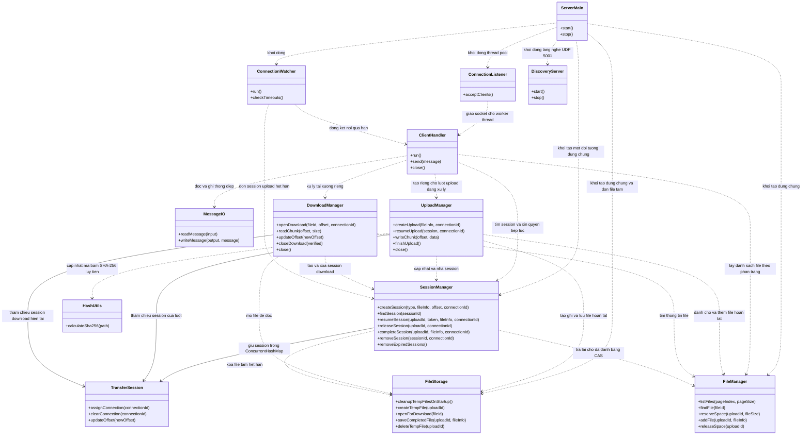
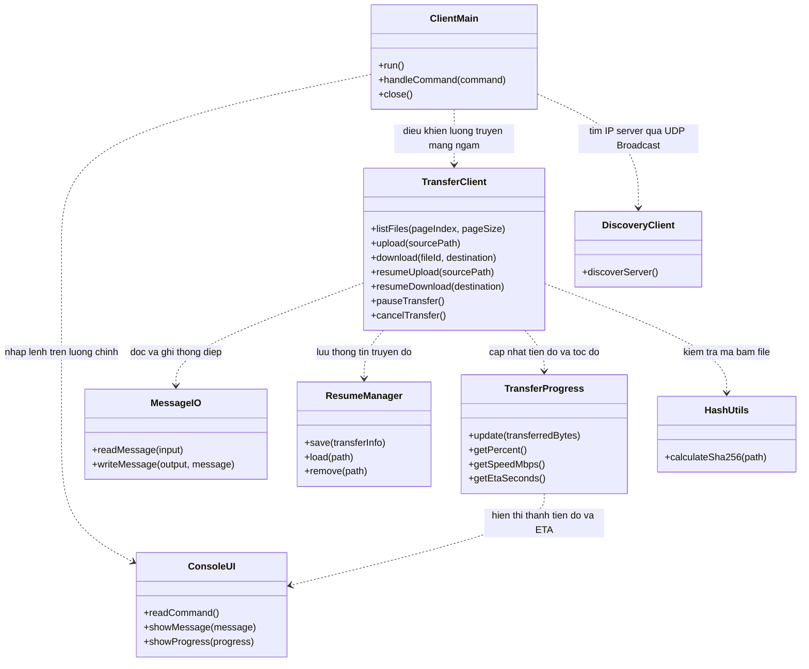
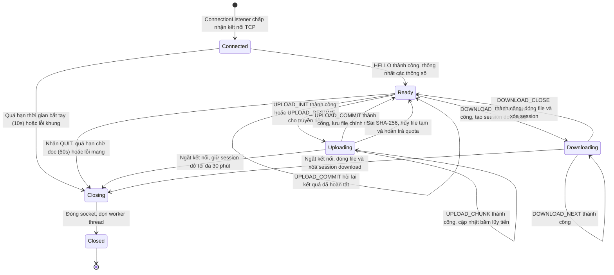

# System Architecture

## 1. Concurrency Model — Mô hình nhóm lựa chọn

### 1.1. Phía Server: Thread Pool có giới hạn (ThreadPoolExecutor)
Server sử dụng mô hình Thread Pool (`ThreadPoolExecutor`) với số lượng tối đa 20 worker threads (`MAX_CLIENTS = 20`) và một hàng đợi có chặn (`ArrayBlockingQueue`). Luồng `ConnectionListener` liên tục chờ nhận kết nối TCP từ `ServerSocket.accept()`. Khi có client kết nối tới, server kiểm tra số kết nối đang phục vụ; nếu chưa vượt quá giới hạn thì giao socket cho một worker thread trong pool xử lý thông qua `ClientHandler`. Nếu đã đạt tối đa 20 kết nối, server từ chối và đóng socket ngay để bảo vệ hệ thống.

**Lý do nhóm lựa chọn:**
- Trong Java, mỗi Thread ánh xạ tới một native thread của hệ điều hành và tiêu tốn một phần bộ nhớ stack riêng (~1 MB). Nếu tạo luồng tự do (`new Thread()`) cho mỗi kết nối thì khi có nhiều kết nối dồn dập hoặc client kết nối liên tục, server sẽ bị cạn kiệt bộ nhớ và gặp lỗi `OutOfMemoryError: unable to create new native thread`.
- Việc dùng `ThreadPoolExecutor` giúp nhóm khống chế chính xác mức tiêu thụ bộ nhớ của server trên các máy cấu hình vừa phải trong mạng nội bộ, đồng thời vẫn giữ được sự đơn giản của kỹ thuật đọc ghi tuần tự (Blocking I/O qua InputStream/OutputStream) đã học trên lớp. Nhờ vậy, khi một client đang truyền file thì các client khác vẫn được xử lý song song trên các worker thread riêng biệt.

### 1.2. Phía Client: Mô hình 2 luồng (UI và Network Worker)
Client áp dụng mô hình 2 luồng:
- Luồng chính (`ConsoleUI`): Chịu trách nhiệm nhận lệnh từ bàn phím của người dùng và in thông tin lên màn hình.
- Luồng phụ (`TransferClient`): Chạy ngầm để thực hiện các thao tác gửi nhận thông điệp và truyền dữ liệu qua Socket.

**Lý do nhóm lựa chọn:**
Nếu client chỉ dùng một luồng duy nhất thì khi đang truyền file dung lượng lớn (lên tới 2 GiB), luồng đó sẽ bị chặn hoàn toàn bởi I/O mạng và người dùng không thể can thiệp được. Việc tách thành 2 luồng cho phép người dùng có thể gõ lệnh tạm dừng (`pause`), tiếp tục (`resume`) hoặc hủy bỏ (`cancel`) lượt truyền bất cứ lúc nào mà không làm treo giao diện.

---

## 2. Components — Các thành phần

### 2.1. Sơ đồ các thành phần

**Phía server**



**Phía client**



### 2.2. Trách nhiệm và phân công công việc

| Thành phần | Vai trò và quan hệ với lớp khác | Người phụ trách |
|---|---|---|
| ServerMain | Khởi động và dừng server; tạo SessionManager, FileManager, FileStorage dùng chung; gọi dọn file tạm mồ côi lúc bật máy; khởi động ConnectionListener (Thread Pool), ConnectionWatcher và DiscoveryServer | Nguyễn Trung Tường |
| ConnectionListener | Lắng nghe kết nối TCP trên cổng 5000, kiểm tra giới hạn MAX_CLIENTS = 20 và chuyển socket cho worker thread trong Thread Pool thực thi qua ClientHandler | Nguyễn Trung Tường |
| ClientHandler | Tiếp nhận yêu cầu và gửi phản hồi cho client bằng MessageIO. Tạo UploadManager và DownloadManager riêng cho từng lượt truyền; gọi SessionManager để kiểm tra session và gán kết nối phụ trách; gọi FileManager để lấy danh sách file theo phân trang | Nguyễn Trung Tường |
| FileStorage | Quản lý việc tạo file tạm, ghi dữ liệu, lưu file chính thức cho UploadManager và mở file đọc cho DownloadManager; tự động dọn dẹp các file `.tmp` mồ côi khi server khởi động | Nguyễn Trung Tường |
| FileManager | Quản lý danh mục file hoàn tất và hạn ngạch dung lượng lưu trữ; sử dụng biến AtomicLong để kiểm tra và cập nhật dung lượng theo cơ chế CAS không khóa, chống deadlock | Nguyễn Trung Tường |
| ConnectionWatcher | Luồng chạy định kỳ để phát hiện các kết nối không hoạt động quá thời gian chờ, yêu cầu ClientHandler đóng socket và gọi SessionManager dọn dẹp session upload dở quá 30 phút | Nguyễn Trung Tường |
| MessageIO | Đọc và ghi thông điệp nhị phân theo quy định khung (giới hạn tối đa 128 KiB); kiểm tra độ dài và tính hợp lệ của khung byte trước khi xử lý, dùng chung cho cả server và client | Bùi Văn Đạt |
| SessionManager | Quản lý bảng session bằng ConcurrentHashMap; cấp phát và kiểm tra resumeToken; chỉ cho phép một kết nối ghi vào session dở tại một thời điểm; dọn dẹp file tạm và hoàn trả dung lượng khi session dở hết hạn | Bùi Văn Đạt |
| UploadManager | Xử lý một lượt tải lên: ghi dữ liệu vào file tạm, tính toán mã băm SHA-256 lũy tiến bằng MessageDigest theo từng chunk nhận được; cập nhật vị trí và lưu file chính thức khi nhận COMMIT | Bùi Văn Đạt |
| DownloadManager | Xử lý lượt tải xuống: mở file đọc riêng, theo dõi vị trí đã đọc và gửi từng chunk dữ liệu cho client; đóng file và giải phóng tài nguyên khi hoàn tất hoặc mất kết nối | Bùi Văn Đạt |
| TransferSession | Đối tượng lưu trữ trạng thái của một lượt truyền (vị trí offset, token, kết nối phụ trách, thời điểm hoạt động cuối); được bảo vệ bằng synchronized hoặc ReentrantLock riêng biệt | Bùi Văn Đạt |
| HashUtils | Hỗ trợ tính toán mã băm SHA-256 toàn bộ file hoặc cập nhật mã băm lũy tiến; chuyển đổi giữa mảng 32 byte nhị phân và chuỗi 64 ký tự hex | Bùi Văn Đạt |
| ResumeManager | Lưu trữ thông tin truyền dở xuống đĩa máy client (`CLIENT_STATE_DIR`) để nạp lại và tiếp tục truyền khi client kết nối lại | Bùi Văn Đạt |
| ClientMain | Quản lý ứng dụng client đa luồng; khởi chạy luồng nền TransferClient và tiếp nhận các lệnh từ người dùng qua ConsoleUI để điều khiển luồng truyền (tạm dừng, tiếp tục, hủy) | Nguyễn Đình Khải |
| ConsoleUI | Nhận lệnh bàn phím từ người dùng trên luồng chính; hiển thị bảng menu, danh sách file theo trang, thông báo lỗi và tiến độ truyền | Nguyễn Đình Khải |
| TransferClient | Thực hiện kết nối mạng và gửi nhận thông điệp qua MessageIO trên luồng phụ; hỗ trợ các chức năng xem danh sách có phân trang, tải lên, tải về, tạm dừng và hủy truyền | Nguyễn Đình Khải |
| TransferProgress | Theo dõi dung lượng đã truyền, tính toán phần trăm, tốc độ truyền hiện tại (MB/s) sử dụng giải thuật trung bình trượt và ước lượng thời gian còn lại (ETA) | Nguyễn Đình Khải |
| DiscoveryClient & DiscoveryServer | Triển khai cơ chế tự động tìm server trong LAN qua UDP Broadcast trên cổng 5001: Server phản hồi IP/cổng, Client tự nhận diện để kết nối mà không cần nhập IP thủ công | Nguyễn Đình Khải |

---

## 3. Shared State, Thread Safety & Phòng chống Deadlock

### 3.1. Phân chia thứ tự lấy khóa để tránh Deadlock
Để tránh trường hợp hai luồng cùng chờ khóa của nhau dẫn tới bế tắc (Deadlock), nhóm quy định một thứ tự lấy khóa cố định một chiều trong toàn bộ hệ thống:

$$\text{SessionManager (Khóa ngoài cùng)} \;\longrightarrow\; \text{TransferSession (Khóa ở giữa)} \;\longrightarrow\; \text{FileManager (Khóa trong cùng)}$$

- Khi một thao tác cần dùng nhiều khóa, luồng luôn phải lấy khóa lần lượt từ ngoài vào trong: trước hết khóa `SessionManager`, sau đó tới `TransferSession`, và cuối cùng mới tới `FileManager`.
- Nhóm tuyệt đối không cho phép các hàm trong `FileManager` gọi ngược lại các hàm có khóa của `TransferSession` hay `SessionManager`.
- Ví dụ khi luồng `ConnectionWatcher` đi dọn dẹp các phiên hết hạn, luồng cũng tuân thủ đúng một chiều: khóa `SessionManager` để tìm phiên $\rightarrow$ khóa `TransferSession` để đổi trạng thái $\rightarrow$ rồi mới gọi `FileManager` để trả lại dung lượng. Việc đi theo một chiều cố định giúp các luồng không bao giờ bị chờ chéo nhau.

### 3.2. Trích xuất dữ liệu ra danh sách tạm rồi nhả khóa ngay (Tránh lồng khóa)
Nhóm áp dụng cách làm là hạn chế tối đa việc vừa giữ khóa của đối tượng này vừa gọi sang đối tượng khác:
- **Khi hoàn tất tải lên (Commit):** Luồng chỉ giữ khóa `TransferSession` trong chốc lát để đổi trạng thái sang hoàn tất và lấy thông tin file (`FileInfo`) ra biến riêng. Sau đó luồng **nhả khóa của Session ngay lập tức**, rồi mới gọi sang `fileManager.addFile(completedInfo)`. Nhờ vậy hai khóa không bao giờ bị giữ lồng vào nhau.
- **Khi dọn dẹp session quá hạn:** Luồng `ConnectionWatcher` chỉ khóa bảng session một chút để lọc các session quá hạn ra một danh sách tạm (`List<TransferSession>`), sau đó nhả khóa ra ngay. Tiếp theo, luồng mới duyệt danh sách tạm này để xóa file trên đĩa và trả lại dung lượng, không giữ khóa bảng session trong suốt quá trình xóa file.

### 3.3. Dùng ConcurrentHashMap và biến AtomicLong để hạn chế nghẽn
- **Bảng Session:** Trong `SessionManager`, nhóm dùng `ConcurrentHashMap<String, TransferSession>` để lưu danh sách các lượt truyền. Nhờ đó các client có thể tìm session hay kiểm tra token cùng lúc mà không cần phải khóa cả bảng, giúp server phục vụ mượt hơn.
- **Quản lý dung lượng (Quota):** Để kiểm tra và dành chỗ lưu file, nhóm dùng hai biến `AtomicLong` là `usedBytes` (dung lượng file hoàn tất) và `reservedBytes` (dung lượng đang tải dở). Nhóm dùng vòng lặp với hàm `compareAndSet` (CAS):
  ```java
  while (true) {
      long currentReserved = reservedBytes.get();
      long currentUsed = usedBytes.get();
      if (currentUsed + currentReserved + bytes > STORAGE_QUOTA_BYTES) {
          throw new RequestException(Protocol.STATUS_STORAGE_UNAVAILABLE, "Het dung luong luu tru!");
      }
      if (reservedBytes.compareAndSet(currentReserved, currentReserved + bytes)) {
          break; // Dành chỗ thành công mà không cần dùng bất kỳ khóa nào!
      }
  }
  ```
  Nhờ dùng biến nguyên tử và không cần dùng `synchronized` cho phần kiểm tra dung lượng này, các luồng có thể kiểm tra chỗ trống đồng thời mà không lo bị kẹt hay gây deadlock.

### 3.4. Bảng chi tiết bảo vệ dữ liệu chia sẻ

| Dữ liệu chia sẻ | Thành phần truy cập | Cách thức bảo vệ |
|---|---|---|
| Danh sách kết nối hiện tại | ConnectionListener thêm, ClientHandler xóa, ConnectionWatcher theo dõi | Dùng `Collections.synchronizedMap` hoặc `ConcurrentHashMap`. Việc kiểm tra số kết nối tối đa (`MAX_CLIENTS = 20`) và thêm kết nối mới được thực hiện trong cùng một khối đồng bộ |
| Bảng session trong SessionManager | SessionManager quản lý; UploadManager, DownloadManager tra cứu; ConnectionWatcher dọn dẹp | Dùng `ConcurrentHashMap`. Khi tạo session upload mới, kiểm tra số lượng session dưới khóa riêng để không vượt quá `MAX_UPLOAD_SESSIONS` |
| TransferSession loại UPLOAD | SessionManager cấp/nhả quyền, UploadManager cập nhật vị trí và trạng thái | Dùng `synchronized` trên chính đối tượng session đó. Kiểm tra quyền phụ trách và cập nhật vị trí `nextOffset` được bọc kín dưới khóa |
| Danh mục file hoàn tất | FileManager quản lý; ClientHandler đọc phân trang, UploadManager thêm file | Dùng khóa đồng bộ nội bộ của `FileManager` khi cập nhật danh sách; khi lấy danh sách theo trang, tạo bản sao (snapshot) rồi mới sắp xếp và trả về |
| Dung lượng đã dùng và dành trước | FileManager quản lý | Dùng `AtomicLong` với giải thuật CAS không khóa (lock-free), loại bỏ hoàn toàn nguy cơ deadlock |
| Trạng thái đóng/mở của Socket | ClientHandler đọc ghi, ConnectionWatcher yêu cầu đóng khi timeout | Biến trạng thái dùng `volatile`. Phương thức `close()` sử dụng cờ `AtomicBoolean closed` để bảo đảm chỉ đóng socket và giải phóng tài nguyên một lần duy nhất, tránh lỗi gọi đóng trùng lặp |
| File tạm đang ghi | UploadManager và FileStorage | Mỗi lượt upload có một file tạm riêng. Thao tác ghi đĩa diễn ra ngoài khối khóa của session để không giữ khóa lâu |
| Thông tin truyền dở ở client | TransferClient và ResumeManager | Lưu vào thư mục `CLIENT_STATE_DIR` trên đĩa client, chỉ luồng phụ `TransferClient` đọc ghi |

---

## 4. Connection Lifecycle



- **Connected:** Client vừa kết nối TCP tới server. Client phải gửi lệnh `HELLO` trong vòng 10 giây (`HANDSHAKE_TIMEOUT_MS`). Nếu hợp lệ, server trả các giới hạn và chuyển sang `Ready`. Nếu quá hạn hoặc gửi sai thông điệp, server đóng socket ngay.
- **Ready:** Kết nối sẵn sàng nhận lệnh mới. Client có thể gọi `LIST_FILES` để xem từng trang danh sách file. Bắt đầu tải lên thì chuyển sang `Uploading`; mở tải xuống thì chuyển sang `Downloading`. Nhận lệnh `QUIT` hoặc quá thời gian chờ (60s) thì chuyển sang `Closing`.
- **Uploading:** Đang nhận dữ liệu file tải lên. Mỗi chunk nhận được sẽ được ghi vào file tạm và cập nhật mã băm SHA-256 lũy tiến. Khi nhận `UPLOAD_COMMIT`, server chỉ việc lấy kết quả băm cuối cùng đối chiếu; nếu đúng thì công bố file và về `Ready`. Nếu mất kết nối, server nhả quyền ghi và giữ session dở tối đa 30 phút để client có thể kết nối lại resume.
- **Downloading:** Đang gửi dữ liệu file về client. Server đọc từng chunk gửi đi. Khi client tải xong và gửi `DOWNLOAD_CLOSE`, server đóng file đọc, xóa session và về `Ready`.
- **Closing & Closed:** Server đóng socket, hoàn trả worker thread về Thread Pool. Nếu client muốn tiếp tục làm việc thì phải mở một kết nối TCP mới.

---

## 5. Deployment & Configuration

| Tên cấu hình | Giá trị mặc định | Ý nghĩa và mục đích |
|---|---|---|
| SERVER_HOST / SERVER_PORT | 0.0.0.0 / 5000 | Địa chỉ lắng nghe và cổng TCP nhận dữ liệu chính của server |
| UDP_DISCOVERY_PORT | 5001 | Cổng UDP dùng để client tự động tìm kiếm server trong mạng LAN |
| STORAGE_DIR | ./storage (trực tiếp) hoặc /data (Docker) | Thư mục lưu trữ file hoàn tất và file tạm trên server |
| CLIENT_STATE_DIR | ./client-state | Thư mục lưu thông tin lượt truyền dở trên máy client |
| MAX_CLIENTS | 20 | Số lượng kết nối đồng thời tối đa server chấp nhận (khớp với số worker threads trong Thread Pool) |
| CHUNK_SIZE | 65536 byte (64 KiB) | Kích thước mỗi phần dữ liệu file truyền qua mạng; có thể cấu hình từ 1024 đến 65536 byte |
| MAX_FRAME_BYTES | Cố định 131072 byte (128 KiB) | Kích thước tối đa của một thông điệp (chưa tính 4 byte độ dài); khống chế RAM đệm của server |
| MAX_FILE_BYTES | 2147483648 byte (2 GiB) | Dung lượng tối đa của một file cho phép tải lên |
| STORAGE_QUOTA_BYTES | 10737418240 byte (10 GiB) | Hạn ngạch dung lượng tối đa cho toàn bộ file hoàn tất và phần dành trước |
| MAX_CATALOG_FILES | 10000 | Tổng số file hoàn tất tối đa trong danh mục server |
| MAX_UPLOAD_SESSIONS | 1000 | Số lượng session upload tối đa được quản lý trong bộ nhớ server |
| INACTIVE_UPLOAD_TTL_MINUTES | 30 phút | Thời gian tối đa giữ một lượt tải lên dở bị mất kết nối; quá 30 phút sẽ xóa file tạm và nhả quota |
| COMPLETED_UPLOAD_TTL_HOURS | 24 giờ | Thời gian giữ kết quả hoàn tất để client hỏi lại nếu bị mất kết nối ở bước commit cuối |
| CONNECT_TIMEOUT_MS | 5000 ms (5 giây) | Thời gian client chờ kết nối TCP tới server |
| HANDSHAKE_TIMEOUT_MS | 10000 ms (10 giây) | Thời gian server chờ client gửi lệnh HELLO sau khi accept |
| READ_TIMEOUT_MS | 60000 ms (60 giây) | Thời gian chờ đọc dữ liệu trên socket; quá 60 giây không có byte mới sẽ ngắt kết nối |
| FRAME_TIMEOUT_MS | 15000 ms (15 giây) | Thời gian tối đa để nhận trọn vẹn một thông điệp tính từ byte đầu tiên |

---

## 6. Design Decisions

| Lựa chọn của nhóm | Phương án khác có thể dùng | Lý do nhóm lựa chọn |
|---|---|---|
| Dùng Thread Pool với số luồng cố định (20) | Tạo luồng tự do cho mỗi kết nối (`new Thread`) | Khống chế chính xác mức tiêu thụ bộ nhớ stack của hệ thống (~1 MB/luồng), tránh nguy cơ bị cạn kiệt tài nguyên native thread gây lỗi `OutOfMemoryError` khi có nhiều client kết nối |
| Client dùng 2 luồng riêng biệt | Client chỉ dùng 1 luồng duy nhất | Tách luồng mạng chạy ngầm và luồng giao diện bàn phím giúp người dùng có thể gõ lệnh tạm dừng (`pause`) hoặc hủy (`cancel`) bất cứ lúc nào mà không bị kẹt I/O mạng |
| Giới hạn khung tối đa 128 KiB và chia nhỏ danh sách file theo trang | Gom toàn bộ danh sách 10.000 file vào một thông điệp lớn | Giúp server kiểm soát được bộ nhớ đệm cấp cho mỗi kết nối, tránh việc client gửi yêu cầu quá lớn làm cạn kiệt bộ nhớ Heap của server |
| Tính SHA-256 lũy tiến (`streaming hash`) theo từng chunk | Đọc lại toàn bộ file 2 GiB từ đầu lúc nhận lệnh COMMIT | Nếu đợi tải xong 2 GiB mới đọc lại từ đầu thì ổ đĩa sẽ bị nghẽn và luồng xử lý bị chặn lâu, dễ làm socket bị timeout (quá 60s); tính lũy tiến từng chunk ngay khi dữ liệu vào RAM giúp bước chốt commit diễn ra tức thì mà không cần đọc lại đĩa cứng |
| Sắp xếp thứ tự lấy khóa và dùng biến AtomicLong | Dùng `synchronized` bao trùm khắp các lớp | Việc quy định rõ thứ tự lấy khóa từ SessionManager đến TransferSession rồi đến FileManager giúp các luồng không bị chờ chéo nhau; kết hợp với `AtomicLong` cho phần kiểm tra dung lượng giúp tránh bị deadlock khi nhiều client cùng thao tác |
| Tự tìm server bằng UDP Broadcast (cổng 5001) | Bắt người dùng phải nhớ và nhập IP thủ công | Giúp nâng cao trải nghiệm người dùng trong mạng nội bộ, client tự phát hiện server đang chạy và kết nối nhanh chóng |
| Rút ngắn thời gian giữ lượt dở xuống 30 phút | Giữ session dở suốt 24 giờ | Tránh tình trạng các kết nối bị ngắt chiếm giữ chỗ dung lượng ảo quá lâu làm cạn kiệt 10 GiB hạn ngạch lưu trữ của server; trong mạng LAN người dùng thường kết nối lại ngay |
| Tự động dọn file tạm khi khởi động server | Để nguyên file tạm cũ trên đĩa | Khi server bị tắt đột ngột, bảng session trong RAM bị mất. Việc tự quét và xóa sạch các file `.tmp` mồ côi lúc khởi động giúp giải phóng dung lượng đĩa và tránh rác ổ cứng |
| Ghi độ dài bằng 4 byte trước mỗi thông điệp | Dùng ký tự xuống dòng `\n` để kết thúc | Dữ liệu nhị phân của file có thể chứa chính ký tự `\n`, dùng tiền tố độ dài giúp bên nhận biết chính xác số byte cần đọc |
| Tự ghi 4 byte độ dài cho chuỗi UTF-8 | Dùng `writeUTF` và `readUTF` có sẵn của Java | `writeUTF` của Java dùng chuẩn Modified UTF-8 và bị giới hạn độ dài chuỗi tối đa 65535 byte do lưu độ dài bằng 2 byte short; nhóm tự ghi độ dài bằng int (4 byte) để tương thích chuẩn UTF-8 và không bị giới hạn |
| Dùng TCP cho truyền file | Dùng UDP | TCP bảo đảm truyền dữ liệu tin cậy, đúng thứ tự byte và tự động truyền lại gói tin mất ở tầng transport, giúp nhóm tập trung xây dựng logic nghiệp vụ và cơ chế resume |
| Ghi vào file tạm, kiểm tra xong mới đưa vào danh sách | Cho tải ngay khi server đang nhận dở | Tránh việc người khác tải về một file chưa hoàn chỉnh; chỉ khi file được nhận đủ byte và mã SHA-256 trùng khớp mới đổi tên thành file chính thức và đưa vào danh mục |
