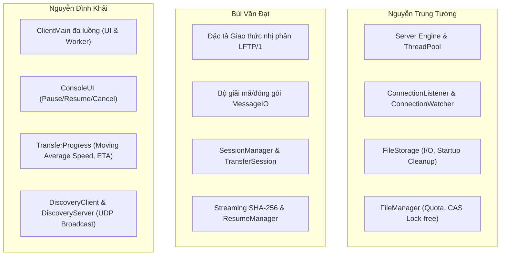
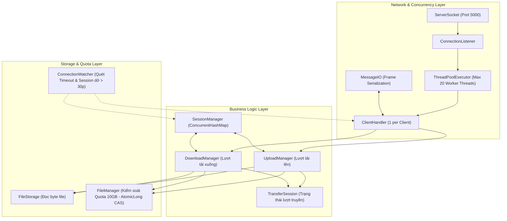
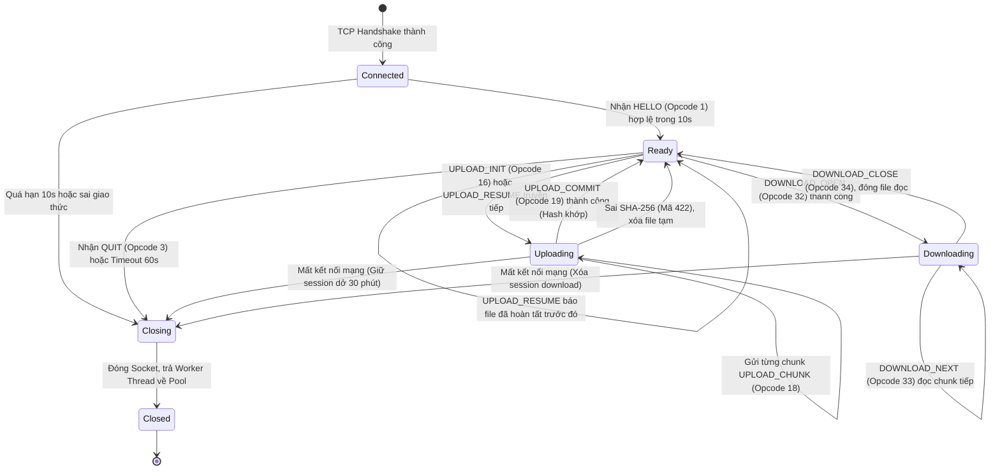
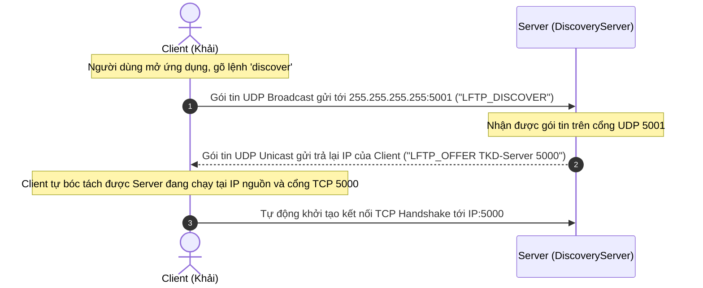

# BÁCH KHOA TOÀN THƯ KIẾN TRÚC & GIAO THỨC LFTP/1
## TỪ BÀI TOÁN THỰC TẾ (PROPOSAL) ĐẾN THIẾT KẾ HỆ THỐNG (ARCHITECTURE) VÀ ĐẶC TẢ GIAO THỨC (PROTOCOL)
**Tài liệu giảng dạy chuyên sâu môn Lập trình Mạng**
*Biên soạn: Giảng viên hướng dẫn*
*Đối tượng: Nhóm TKD (Nguyễn Trung Tường — Bùi Văn Đạt — Nguyễn Đình Khải)*

---

> [!IMPORTANT]
> **Lời tựa của Giảng viên:**
> Một kỹ sư phần mềm giỏi không bao giờ xem một dự án là những mảnh ghép rời rạc. Mã nguồn không tự nhiên sinh ra; giao thức không phải là sản phẩm ngẫu hứng; và kiến trúc không phải là những chiếc hộp vẽ cho đẹp trên giấy.
> 
> Mọi dòng mã các em viết, mọi byte trong giao thức, mọi lớp trong kiến trúc đều bắt nguồn từ **một nhu cầu nghiệp vụ cụ thể** trong bản Proposal. Bản giáo trình toàn diện này được thiết kế để kết nối toàn bộ chuỗi mắt xích đó:
> 
> $$\mathbf{Vấn\;đề\;thực\;tế} \;\implies\; \mathbf{Phạm\;vi\;(Scope)} \;\implies\; \mathbf{Kiến\;trúc\;(Architecture)} \;\implies\; \mathbf{Giao\;thức\;(Protocol)} \;\implies\; \mathbf{Mã\;nguồn\;thực\;thi}$$
> 
> Hãy học tài liệu này với tư duy của một **System Architect** thực thụ.

---

# PHẦN 1: BÀI TOÁN THỰC TẾ & TƯ DUY LẬP ĐỀ XUẤT (PROPOSAL DEEP DIVE)

## 1.1. Bản chất của bài toán văn phòng & Tại sao Cloud thất bại?
Hãy nhìn lại tình huống được mô tả trong [proposal.md](file:///d:/project/BTL%20LTM/proposal.md): Hai nhân viên $A$ và $B$ ngồi cạnh nhau trong cùng một mạng LAN nội bộ, cần chuyển một file dữ liệu lớn (ví dụ bản dựng phần mềm, video quay thử nghiệm, cơ sở dữ liệu nội bộ dung lượng từ 500 MB đến 2 GB).

### Vì sao thói quen dùng Google Drive / OneDrive lại bộc lộ hạn chế nghiêm trọng?
1. **Nghịch lý băng thông & "Bình thông nhau" Internet:**
   - Băng thông mạng LAN văn phòng (Ethernet / Wi-Fi 6) thường đạt từ **1 Gbps đến 10 Gbps** (tương đương tốc độ lý thuyết 125 MB/s – 1250 MB/s).
   - Trong khi đó, băng thông Internet đi ra ngoài (Uplink/Downlink quốc tế hoặc nội địa) thường bị bóp nghẽn ở mức 50 Mbps – 200 Mbps (tương đương 6 MB/s – 25 MB/s).
   - Khi $A$ đẩy lên Drive và $B$ kéo về, gói tin phải đi một vòng qua ISP ra máy chủ đám mây rồi mới quay ngược lại. Tốc độ truyền bị trói chặt vào mắt xích yếu nhất là cổng Internet, biến hạ tầng mạng LAN đắt tiền thành vô dụng!
2. **Nguy cơ rò rỉ dữ liệu nội bộ (Data Exfiltration & Privacy):**
   - Tài liệu mật, bản vẽ thiết kế, mã nguồn công ty bị đưa lên máy chủ của bên thứ ba (Google, Microsoft) mà không có sự kiểm soát của bộ phận IT. Nếu tài khoản cá nhân bị lộ lọt, dữ liệu công ty bị xâm phạm.
3. **Độ trễ và Sự phụ thuộc:**
   - Nếu đường truyền cáp quang biển bị đứt, văn phòng không thể làm việc dù hệ thống switch và cáp mạng nội bộ vẫn hoạt động hoàn hảo 100%.

$$\implies \mathbf{Ý\;tưởng\;cốt\;lõi:}\;\text{Xây dựng giải pháp lưu trữ và truyền tệp cục bộ (Local Client-Server) khai thác tối đa băng thông LAN, độc lập hoàn toàn với Internet.}$$

---

## 1.2. Phân tích các phương án thay thế (Trade-off Analysis)

Tại sao lại chọn Client-Server mà không chọn Peer-to-Peer (P2P)? Tại sao dùng TCP mà không dùng UDP? Đây là những câu hỏi mà bất kỳ hội đồng bảo vệ nào cũng sẽ xoáy vào:

| Phương án cân nhắc | Lựa chọn của nhóm | Phân tích ưu / nhược điểm kỹ thuật (Trade-offs) |
|---|:---:|---|
| **Truyền qua Server LAN vs Truyền trực tiếp P2P** | **Server LAN** | - **P2P:** Cả máy gửi và máy nhận phải cùng online tại một thời điểm; nếu máy $A$ tắt máy thì máy $B$ không thể tải được. Rất khó quản lý danh mục file và bảo mật.<br>- **Server LAN:** Đóng vai trò là trạm trung chuyển bất đồng bộ (Asynchronous Hub). $A$ tải lên lúc 8h sáng, tắt máy đi họp; $B$ đến công ty lúc 10h vẫn vào server tải được. Server giúp quản lý hạn ngạch (Quota), kiểm soát danh mục tập trung và demo bảo vệ dễ dàng hơn. |
| **Giao thức TCP vs UDP** | **TCP** | - **UDP:** Nhanh, tiêu hao ít tài nguyên (overhead thấp), nhưng không có cơ chế sửa sai, không bảo đảm thứ tự byte và không kiểm soát tắc nghẽn. Nếu truyền file 2 GB qua UDP, nhóm sẽ phải tự viết lại toàn bộ cơ chế ACK, Sequence Number, Sliding Window và Packet Reordering (tự viết lại TCP trên UDP $\rightarrow$ quá sức và dễ sinh lỗi nghiêm trọng).<br>- **TCP:** Cung cấp sẵn luồng byte tin cậy (*Reliable Byte Stream*), tự sắp xếp gói tin và tự truyền lại gói mất. Nhóm tận dụng sức mạnh này của hệ điều hành để tập trung giải quyết bài toán ứng dụng: Framing, Resume, Hash và Concurrency. |
| **Giao diện CLI vs GUI** | **CLI trước** | Xây dựng GUI (Java Swing / JavaFX) tốn rất nhiều thời gian vào việc vẽ giao diện, canh chỉnh tọa độ mà không đem lại nhiều giá trị về mặt kiến thức **Lập trình Mạng**. CLI buộc các em phải xử lý trực tiếp các tương tác dòng lệnh, quản lý luồng bàn phím bất đồng bộ và kiểm soát mã lỗi tường minh. |

---

## 1.3. Nghệ thuật Phân định Phạm vi (Scoping)
Nhóm định nghĩa 3 ranh giới rõ ràng trong [proposal.md](file:///d:/project/BTL%20LTM/proposal.md):
- **Must Have (Bắt buộc phải có để đỗ đồ án):**
  - Truyền nhận file hoàn chỉnh trong LAN qua CLI.
  - Xử lý dính/cắt gói TCP bằng Framing nhị phân.
  - Server đa luồng phục vụ nhiều client cùng lúc.
  - Cơ chế tiếp tục truyền khi mất kết nối (Resume transfer).
  - Tự động phát hiện server qua UDP Broadcast.
  - Kiểm tra toàn vẹn bằng SHA-256 lũy tiến.
  - Cơ chế Timeout ngắt kết nối treo.
- **Nice to Have (Làm được thì điểm tối đa):**
  - Giao diện đồ họa (GUI).
  - Hệ thống tài khoản đăng nhập (Authentication) và phân quyền (RBAC).
- **Out of Scope (Từ chối làm để tránh "vỡ tiến độ"):**
  - Không truyền thư mục (chỉ truyền từng file đơn lẻ).
  - Không hỗ trợ NAT Traversal ra ngoài Internet (chỉ hoạt động trong cùng Subnet LAN).
  - Chưa mã hóa TLS/SSL trên đường truyền LAN.

---

## 1.4. Phân chia trách nhiệm theo "Lát cắt dọc" (Vertical Slices)
Một sai lầm phổ biến của sinh viên là: *"Tường code, Đạt viết báo cáo, Khải làm slide"*. Đây là cách làm việc bị hội đồng đánh trượt ngay lập tức!
Bảng phân công của nhóm đã được điều chỉnh theo **nguyên tắc module hóa chức năng độc lập**:



---

# PHẦN 2: KIẾN TRÚC HỆ THỐNG CHUYÊN SÂU (ARCHITECTURE DEEP DIVE)

Nhìn vào [architectureV2.md](file:///d:/project/BTL%20LTM/architectureV2.md), chúng ta thấy một kiến trúc phân lớp chuẩn mực (*Layered Architecture*) với các nguyên lý thiết kế vững chắc:



---

## 2.1. Giải phẫu Chi tiết các Thành phần Server

### 1. `ConnectionListener` & `ThreadPoolExecutor`
- **Nhiệm vụ:** Luồng lắng nghe chính, gọi `serverSocket.accept()`.
- **Cơ chế cốt tử:** Không bao giờ gọi `new Thread()` tự do. Khi có một Socket mới, `ConnectionListener` kiểm tra số kết nối đang hoạt động trong bảng quản lý. Nếu số lượng $\ge 20$ (`MAX_CLIENTS`), socket bị đóng ngay lập tức. Nếu còn chỗ, socket được bọc trong một đối tượng `ClientHandler` và nộp vào `ThreadPoolExecutor`.
- **Vì sao dùng Thread Pool?** 
  - Tránh chi phí cấp phát và hủy luồng liên tục của hệ điều hành.
  - Bảo vệ bộ nhớ Heap và Stack của JVM không bao giờ bị vượt ngưỡng kiểm soát.

### 2. `ClientHandler`
- **Nhiệm vụ:** Đại diện cho phiên làm việc của một kết nối TCP cụ thể.
- Chạy trên một worker thread của pool, thực hiện vòng lặp đọc thông điệp:
  `MessageIO.readMessage() -> Xử lý Opcode -> MessageIO.writeMessage()`.
- **Tính độc lập:** Mỗi `ClientHandler` có bộ đệm riêng, không chia sẻ Socket hay stream với bất kỳ handler nào khác.

### 3. `UploadManager` và `DownloadManager`
- **Vì sao không nhét hết code vào `ClientHandler`?**
  - Áp dụng nguyên lý **Đơn trách nhiệm (Single Responsibility Principle - SRP)**.
  - `ClientHandler` chỉ làm nhiệm vụ điều phối mạng (Network Dispatcher).
  - Toàn bộ logic ghi file tạm, kiểm tra offset, gọi băm SHA-256 lũy tiến được giao cho `UploadManager`.
  - Logic đọc file, chia chunk gửi về client được giao cho `DownloadManager`.
  - Khi cần bảo trì hoặc kiểm thử unit test việc ghi file, ta chỉ cần mock `UploadManager` mà không cần chạy socket thật.

### 4. `SessionManager` & `TransferSession`
- **Nhiệm vụ:** Lưu giữ trạng thái của các lượt truyền file (UploadId, ResumeToken, NextOffset, Thời gian hoạt động cuối).
- **Tính chất kỹ thuật:** Sử dụng `ConcurrentHashMap<String, TransferSession>`.
  - Tra cứu và đọc trạng thái diễn ra lock-free.
  - Cung cấp phương thức dọn dẹp các session bị bỏ rơi (quá 30 phút không hoạt động).

### 5. `FileManager` & `FileStorage`
- `FileStorage`: Làm việc trực tiếp với hệ thống tập tin đĩa cứng (`java.nio.file.Path`, `RandomAccessFile`). Quản lý hai thư mục riêng biệt:
  - Thư mục file tạm: `storage/temp/` (chứa các file `.tmp` đang ghi dở).
  - Thư mục file hoàn tất: `storage/files/` (chứa các file đã xác minh SHA-256 thành công).
- `FileManager`: Lưu giữ mục lục danh sách file và quản lý hạn ngạch dung lượng lưu trữ (**10 GB**).

### 6. `ConnectionWatcher`
- **Nhiệm vụ:** Luồng chạy nền độc lập (*Daemon Thread*), định kỳ mỗi 5 giây quét một lần:
  1. Kiểm tra các kết nối TCP bị "đóng băng" (không có byte gửi nhận trong suốt 60 giây) $\rightarrow$ Yêu cầu `ClientHandler` đóng socket.
  2. Kiểm tra các session upload dở bị mất kết nối quá **30 phút** $\rightarrow$ Yêu cầu `SessionManager` xóa file tạm và hoàn trả dung lượng lưu trữ.

---

## 2.2. Nghệ thuật Phòng chống Deadlock & Thread Safety (Mục 3 Architecture)

Đây là phần "ăn điểm" tuyệt đối trước hội đồng. Các em phải chỉ ra được **3 tầng bảo vệ đồng bộ hóa**:

### Tầng 1: Phá bỏ Circular Wait bằng Cây thứ bậc khóa (Strict Lock Hierarchy)
Bế tắc chỉ xảy ra khi có sự phụ thuộc vòng tròn giữa các khóa. Nhóm đã đặt ra một luật thép:

$$\mathbf{Level\;1:\;SessionManager} \;\longrightarrow\; \mathbf{Level\;2:\;TransferSession} \;\longrightarrow\; \mathbf{Level\;3:\;FileManager}$$

- Luồng muốn nắm giữ nhiều khóa **bắt buộc phải xin khóa theo thứ tự từ Level 1 đến Level 3**.
- Tuyệt đối không một hàm nào trong `FileManager` (Level 3) được phép gọi ngược lại phương thức có khóa của `TransferSession` hay `SessionManager`. 
- **Hệ quả toán học:** Không thể tồn tại chu kỳ đồ thị có hướng (Directed Cycle) trong biểu đồ cấp phát tài nguyên $\implies$ **Không thể xảy ra Deadlock!**

### Tầng 2: Nguyên tắc Snapshot (Loại bỏ lồng khóa)
Giữ khóa càng lâu thì xác suất nghẽn và deadlock càng cao. Nhóm áp dụng nguyên tắc: **Lấy bản sao dữ liệu (Snapshot) $\rightarrow$ Nhả khóa ngay lập tức $\rightarrow$ Xử lý bước tiếp theo.**

*Minh họa trong phương thức hoàn tất Upload (Commit):*
```java
// BƯỚC 1: Khóa Session trong 0.001ms để đổi trạng thái và sao chép thông tin
FileInfo completedSnapshot;
synchronized (session) {
    session.markCompleted();
    completedSnapshot = new FileInfo(session.getFileId(), session.getFileName(), 
                                     session.getFileSize(), session.getFileHash());
} // KHÓA CỦA SESSION ĐƯỢC GIẢI PHÓNG HOÀN TOÀN TẠI ĐÂY!

// BƯỚC 2: Thao tác độc lập với FileManager, KHÔNG CÓ LỒNG KHÓA
fileManager.addFile(completedSnapshot);
```

### Tầng 3: Kiểm soát Dung lượng không dùng khóa (Lock-free Quota bằng `AtomicLong`)
Thay vì dùng `synchronized` bao trùm cả class `FileManager`, nhóm dùng kỹ thuật **CAS (Compare-And-Swap)** được hỗ trợ trực tiếp từ tầng phần cứng CPU thông qua `AtomicLong`:

```java
private final AtomicLong usedStorageBytes = new AtomicLong(0);
private final AtomicLong reservedStorageBytes = new AtomicLong(0);

public boolean reserveSpace(String uploadId, long fileSize) {
    while (true) {
        long currentReserved = reservedStorageBytes.get();
        long currentUsed = usedStorageBytes.get();
        
        // Kiểm tra hạn ngạch 10GB
        if (currentUsed + currentReserved + fileSize > STORAGE_QUOTA_BYTES) {
            return false; // Hết hạn ngạch
        }
        
        // Cập nhật nguyên tử: Nếu reservedBytes vẫn giữ giá trị cũ thì mới cộng thêm fileSize
        if (reservedStorageBytes.compareAndSet(currentReserved, currentReserved + fileSize)) {
            return true; // Dành chỗ thành công - HOÀN TOÀN KHÔNG DÙNG KHÓA!
        }
        // Nếu CAS thất bại (do có luồng khác vừa chen ngang), vòng lặp while(true) sẽ thử lại ngay
    }
}
```

---

## 2.3. Máy trạng thái Vòng đời Kết nối (Connection Lifecycle State Machine)

Kết nối của mỗi client trải qua một máy trạng thái hữu hạn (**FSM - Finite State Machine**) rất nghiêm ngặt:



* **Trạng thái `Connected`:** Mới bắt tay TCP xong, chưa biết client là ai. Phải nhận được `HELLO` trong 10 giây (`HANDSHAKE_TIMEOUT_MS`). Nếu client kết nối tới mà im lặng, server ngắt kết nối để chống tấn công chiếm giữ socket.
* **Trạng thái `Ready`:** Đã xác thực phiên bản LFTP/1. Tại đây client có thể xem danh sách file hoặc bắt đầu truyền tải.
* **Trạng thái `Uploading` / `Downloading`:** Đang xử lý truyền dòng byte. Mọi thông điệp không liên quan đều bị từ chối bằng mã `409 CONFLICT`.

---

# PHẦN 3: THIẾT KẾ GIAO THỨC ỨNG DỤNG LFTP/1 (PROTOCOL DEEP DIVE)

Nhìn vào [protocol-design.md](file:///d:/project/BTL%20LTM/protocol-design.md), đây là nơi chuyển hóa toàn bộ kiến trúc thành các quy chuẩn byte cụ thể trên đường truyền mạng.

## 3.1. Cấu trúc Khung Nhị phân & Đóng gói Dữ liệu

### Khung chuẩn (Fixed 12-byte Header)
Mọi gói tin truyền qua socket đều bắt đầu bằng:

```text
+-----------------------+---------+--------+------------------+---------------+---------------------+
|   frameLength (4B)    | ver(1B) | op(1B) |  requestId (8B)  |  status (2B)  |     body (...)      |
+-----------------------+---------+--------+------------------+---------------+---------------------+
|<-- Không tính vào --->|<-------------------- Độ dài bằng frameLength ------------------------->|
```

### Ý nghĩa của từng trường:
1. `frameLength` (**4 byte, `int`**): Độ dài của toàn bộ phần theo sau (từ `version` đến hết `body`).
   - Giá trị hợp lệ: $12 \le \text{frameLength} \le 131072$ (128 KiB).
   - Nếu `frameLength < 12` hoặc `> 131072`: Server lập tức ngắt socket mà không cần đọc tiếp!
2. `version` (**1 byte, `u8`**): Luôn bằng `1`. Giúp nhận biết phiên bản giao thức.
3. `opcode` (**1 byte, `u8`**): Mã lệnh yêu cầu hoặc mã phản hồi.
4. `requestId` (**8 byte, `long`**): Số nguyên dương tăng dần trên từng kết nối. Server trả lời luôn giữ nguyên `requestId` của yêu cầu.
5. `status` (**2 byte, `u16`**):
   - Phía Client gửi yêu cầu: Luôn đặt bằng `0`.
   - Phía Server trả phản hồi: Đặt theo bảng mã trạng thái (200, 201, 400, 404, 409, 422, v.v.).
6. `body`: Phần dữ liệu riêng của từng lệnh. Độ dài chính xác bằng $\text{frameLength} - 12$.

### Các quy định kiểu dữ liệu nhị phân:
- Số nguyên nhiều byte: Luôn ghi byte cao trước (**Big-Endian**).
- Chuỗi ký tự (`str`): Ghi 4 byte `int` độ dài byte, theo sau là mảng byte UTF-8. **Tuyệt đối không dùng `writeUTF()` của Java** (tránh Modified UTF-8 và tránh giới hạn 64KB).
- Mã băm (`hash32`): Đúng **32 byte nhị phân** thô của SHA-256 (tiết kiệm một nửa dung lượng so với việc đổi thành 64 ký tự Hex).

---

## 3.2. Bảng tham chiếu Mã lệnh (Command Reference)

Giao thức LFTP/1 quy định tập lệnh tinh gọn nhưng đầy đủ cho toàn bộ vòng đời truyền tệp:

| Opcode | Tên lệnh | Hướng | Dữ liệu gửi (Body) | Phản hồi từ Server | Mục đích & Chi tiết |
|:---:|---|:---:|---|---|---|
| **1** | `HELLO` | C $\rightarrow$ S | `clientName: str` | `200`: `serverName: str`, `connId: str`, `chunkSize: int`, `maxFile: long`, `maxFrame: int` | Khởi tạo phiên, thống nhất thông số giới hạn bộ đệm giữa 2 bên |
| **2** | `LIST_FILES` | C $\rightarrow$ S | `pageIndex: int`, `pageSize: int` | `200`: `totalFiles: int`, `pageIndex: int`, `count: int`, `entries[count]` | Xem danh mục file theo phân trang (Pagination) để không vượt trần 128KB |
| **3** | `QUIT` | C $\rightarrow$ S | *(Rỗng)* | `200`: *(Rỗng)* rồi đóng kết nối | Kết thúc phiên làm việc một cách lịch sự |
| **16** | `UPLOAD_INIT` | C $\rightarrow$ S | `displayName: str`, `fileSize: long`, `fileHash: hash32` | `201`: `uploadId: str`, `resumeToken: str`, `nextOffset: long`, `chunkSize: int`, `state: u8`, `fileId: str` | Khởi tạo lượt tải lên, kiểm tra Quota và tạo file tạm trên đĩa |
| **17** | `UPLOAD_RESUME` | C $\rightarrow$ S | `uploadId: str`, `resumeToken: str`, `fileSize: long`, `fileHash: hash32` | `200`: `uploadId: str`, `resumeToken: str`, `nextOffset: long`, `chunkSize: int`, `state: u8`, `fileId: str` | Hỏi lại vị trí đã ghi thành công sau khi bị ngắt kết nối để truyền tiếp |
| **18** | `UPLOAD_CHUNK` | C $\rightarrow$ S | `uploadId: str`, `resumeToken: str`, `offset: long`, `dataLen: int`, `data[dataLen]` | `200`: `nextOffset: long` | Gửi một phần dữ liệu (tối đa 64KB); Server ghi đĩa và cập nhật SHA-256 lũy tiến |
| **19** | `UPLOAD_COMMIT` | C $\rightarrow$ S | `uploadId: str`, `resumeToken: str` | `200`: `fileId: str`, `fileSize: long`, `fileHash: hash32`<br>hoặc `422`: Lỗi sai băm | Hoàn tất file, kiểm tra mã băm cuối cùng, chuyển file tạm thành file chính thức |
| **32** | `DOWNLOAD_OPEN` | C $\rightarrow$ S | `fileId: str`, `requestedOffset: long` | `200`: `fileId: str`, `displayName: str`, `fileSize: long`, `fileHash: hash32`, `acceptedOffset: long`, `chunkSize: int` | Mở lượt tải xuống mới hoặc xin tải tiếp từ vị trí client đã có |
| **33** | `DOWNLOAD_NEXT` | C $\rightarrow$ S | `offset: long`, `requestedBytes: int` | `200`: `offset: long`, `dataLength: int`, `data[dataLength]` | Yêu cầu server đọc một phần dữ liệu từ đĩa và gửi về client |
| **34** | `DOWNLOAD_CLOSE`| C $\rightarrow$ S | `verified: u8` (1: đúng hash, 0: lỗi) | `200`: *(Rỗng)* | Đóng lượt tải xuống, server đóng file đọc và xóa session download |

---

## 3.3. Bảng mã Trạng thái & Xử lý Lỗi (Status Codes)

Giao thức sử dụng các mã trạng thái lấy cảm hứng từ HTTP nhưng mang ngữ nghĩa chuẩn hóa cho truyền file:

| Mã | Tên mã | Ý nghĩa & Cách xử lý |
|:---:|---|---|
| **200** | `OK` | Thao tác thành công hoàn toàn. |
| **201** | `CREATED` | Tạo mới lượt tải lên thành công (`UPLOAD_INIT`). |
| **400** | `BAD_REQUEST` | Thông điệp sai cú pháp, thiếu trường dữ liệu, hoặc kích thước chunk không hợp lệ. |
| **403** | `FORBIDDEN` | Sai `resumeToken`. Ngăn chặn việc Client $A$ ghi trộm vào file đang tải của Client $B$. |
| **404** | `NOT_FOUND` | Không tìm thấy `fileId` hoặc session upload không tồn tại / đã bị xóa do hết hạn 30 phút. |
| **409** | `CONFLICT` | Lệch vị trí offset, trạng thái không hợp lệ, hoặc lượt upload đang có một kết nối khác phụ trách ghi. |
| **413** | `TOO_LARGE` | Dung lượng file khai báo vượt quá trần tối đa cho phép (2 GiB). |
| **422** | `HASH_MISMATCH` | Mã băm SHA-256 tính được ở file tạm không khớp với mã băm file gốc. Hủy file tạm ngay lập tức. |
| **500** | `INTERNAL_ERROR` | Lỗi ngoại lệ không lường trước ở server (lỗi hệ thống, crash nội bộ). |
| **501** | `UNKNOWN_COMMAND`| Mã `opcode` không được hỗ trợ trong phiên bản giao thức này. |
| **505** | `UNSUPPORTED_VERSION` | Phiên bản giao thức trong header khác 1. |
| **507** | `STORAGE_UNAVAILABLE` | Server hết hạn ngạch 10GB lưu trữ hoặc hết dung lượng đĩa cứng thực tế. |

> [!NOTE]
> Khi trả về mã lỗi từ 400 trở lên, phần Body luôn tuân thủ cấu trúc thống nhất:
> `message: str` (chuỗi tiếng Việt mô tả lỗi) + `expectedOffset: long` (vị trí byte server đang chờ đợi, hoặc `-1` nếu không áp dụng).

---

## 3.4. Cơ chế UDP Broadcast Discovery (Khám phá dịch vụ LAN)
Thay vì bắt người dùng phải mở Terminal gõ `ipconfig` để lấy địa chỉ IP của server, nhóm thiết kế một cơ chế tự động tìm kiếm trên tầng truyền tải:



---

# PHẦN 4: MỐI QUAN HỆ NHÂN - QUẢ: PROPOSAL $\to$ ARCHITECTURE $\to$ PROTOCOL

Dưới đây là bảng tổng hợp "kim chỉ nam" chứng minh sự liên kết logic xuyên suốt của toàn bộ đồ án:

| Yêu cầu trong Proposal | Giải pháp trong Architecture | Thể hiện cụ thể trong Protocol |
|---|---|---|
| **Truyền file nội bộ không phụ thuộc Internet** | Mô hình Client-Server trong mạng LAN dùng TCP Socket | Server lắng nghe cổng TCP 5000, Client kết nối qua IP nội bộ |
| **Người dùng không cần cấu hình IP thủ công** | Module `DiscoveryServer` và `DiscoveryClient` | Gói tin UDP Broadcast trên cổng 5001 (`LFTP_DISCOVER` $\leftrightarrow$ `LFTP_OFFER`) |
| **Xử lý dính gói, cắt gói & Chống tràn RAM DoS** | `MessageIO` đọc đủ byte; Giới hạn bộ đệm khung tối đa 128 KiB | Header nhị phân 12 byte với trường `frameLength` (4 byte, Big-Endian), trần $\le 131072$ byte |
| **Xem danh sách 10.000 file không làm tràn bộ nhớ** | `FileManager.listFiles(pageIndex, pageSize)` | Lệnh `LIST_FILES` (Opcode 2) nhận `pageIndex, pageSize`; trả về danh sách từng trang nhỏ |
| **Server phục vụ nhiều client cùng lúc an toàn** | `ThreadPoolExecutor` (Max 20 Worker Threads, bounded queue) | Cấu hình `MAX_CLIENTS = 20`, cấm tạo luồng tự do, tự đóng kết nối khi quá tải |
| **Chống Deadlock khi nhiều luồng cùng thao tác** | Phân cấp Lock Hierarchy (Session $\to$ FileManager); Lock-free CAS | Sử dụng `AtomicLong` cho Quota dung lượng; không dùng khóa lồng nhau |
| **Tiếp tục truyền tải khi mất kết nối (Resume)** | `UploadManager` và `ResumeManager` lưu vị trí file tạm trên đĩa | Lệnh `UPLOAD_RESUME` (Opcode 17) trả về `nextOffset` thực tế đã ghi trên đĩa cứng |
| **Tránh kẹt Quota 10GB khi client ngắt kết nối dở** | `ConnectionWatcher` quét dọn session dở quá hạn | Đặt thời gian sống `INACTIVE_UPLOAD_TTL_MINUTES = 30` phút; quá hạn xóa file tạm và nhả quota |
| **Bảo đảm toàn vẹn không làm nghẽn I/O file 2GB** | Băm SHA-256 lũy tiến (`streaming hash`) theo từng chunk | Lệnh `UPLOAD_COMMIT` (Opcode 19) đối chiếu `hash32` trong <1ms; trả mã `422` nếu sai |
| **Giao diện không bị đơ khi truyền file dung lượng lớn** | Client đa luồng: Luồng UI bàn phím tách riêng với Luồng mạng Worker | Người dùng có thể gõ `pause`, `resume`, `cancel` bất cứ lúc nào qua ConsoleUI |

---

# PHẦN 5: MA TRẬN CÂU HỎI VẤN ĐÁP THEO TỪNG SINH VIÊN

Khi lên bàn bảo vệ, hội đồng sẽ hỏi tách biệt từng sinh viên theo bảng phân công trách nhiệm:

---

## 5.1. Dành cho Nguyễn Trung Tường (Phụ trách Server, Concurrency & Storage)

### Câu 1: Em hãy giải thích chi tiết vòng đời của một kết nối từ lúc Client kết nối đến lúc Socket đóng lại trong Server?
* **Trả lời:**
  1. Khi client kết nối, `ServerSocket.accept()` trong luồng `ConnectionListener` trả về một đối tượng `Socket`.
  2. Server kiểm tra danh sách kết nối hiện tại. Nếu vượt quá `MAX_CLIENTS = 20`, server đóng socket ngay. Nếu còn chỗ, server tạo một mã `connectionId` (UUID) và giao socket cho một worker thread trong `ThreadPoolExecutor` thông qua lớp `ClientHandler`.
  3. `ClientHandler` chuyển trạng thái sang `Connected`, đặt thời gian chờ bắt tay 10 giây (`HANDSHAKE_TIMEOUT_MS`). Client phải gửi lệnh `HELLO` (Opcode 1).
  4. Nếu `HELLO` hợp lệ, server trả thông số cấu hình và chuyển sang `Ready`.
  5. Tại `Ready`, tùy theo yêu cầu của client, handler sẽ gọi `UploadManager` (sang `Uploading`), `DownloadManager` (sang `Downloading`), hoặc gọi `FileManager` để trả danh sách file theo phân trang.
  6. Khi client gửi `QUIT`, hoặc quá thời gian chờ đọc 60 giây (`READ_TIMEOUT_MS`), hoặc gặp sự cố ngắt mạng, handler chuyển sang trạng thái `Closing`.
  7. Tại `Closing`, handler đóng các file đang mở, nhả quyền ghi trong session, đóng socket, xóa kết nối khỏi danh sách quản lý và hoàn trả worker thread về Thread Pool (sang `Closed`).

### Câu 2: Trong `FileManager`, tại sao em lại dùng `AtomicLong` cho Quota dung lượng thay vì dùng `synchronized`? Giải thuật CAS hoạt động ra sao?
* **Trả lời:**
  - Nếu dùng `synchronized` trên toàn bộ phương thức `reserveSpace()`, mọi luồng upload chunk đều phải cạnh tranh một cái khóa duy nhất. Khi tải cao, các luồng sẽ bị nghẽn (Lock Contention) và làm giảm hiệu năng server. Nguy hiểm hơn, nếu bên trong phương thức lại vô tình gọi sang một đối tượng có khóa khác, nguy cơ xảy ra Deadlock là rất lớn.
  - Em sử dụng `AtomicLong` với giải thuật **Compare-And-Swap (CAS)**:
    - Luồng đọc giá trị dung lượng hiện tại vào biến cục bộ `currentReserved`.
    - Kiểm tra nếu `currentUsed + currentReserved + fileSize > 10GB` thì từ chối ngay.
    - Gọi lệnh `reservedStorageBytes.compareAndSet(currentReserved, currentReserved + fileSize)`. Đây là lệnh nguyên tử ở cấp độ phần cứng CPU: CPU sẽ kiểm tra xem giá trị trong ô nhớ có đúng bằng `currentReserved` hay không; nếu đúng thì mới ghi đè giá trị mới.
    - Nếu trong tích tắc đó có một luồng khác đã thay đổi ô nhớ, hàm trả về `false`, và vòng lặp `while(true)` sẽ thử lại ngay lập tức.
  - Giải thuật này hoàn toàn không dùng khóa (*Lock-free*), triệt tiêu hoàn toàn khả năng gây Deadlock tại tài nguyên Quota.

### Câu 3: Khi Server bị mất điện đột ngột hoặc tắt ngang, chuyện gì xảy ra với các file tạm và bảng session trong RAM? Em xử lý vấn đề này như thế nào khi Server khởi động lại?
* **Trả lời:**
  - Vì nhóm thiết kế bảng session nằm trong bộ nhớ RAM để tối ưu tốc độ tra cứu, nên khi server tắt đột ngột, toàn bộ thông tin session trong RAM sẽ bị mất sạch.
  - Tuy nhiên, trên đĩa cứng trong thư mục `storage/temp/`, các file tạm `.tmp` ghi dở vẫn còn tồn tại và chiếm dụng dung lượng đĩa.
  - Để giải quyết triệt để rác ổ cứng, trong hàm `main()` của `ServerMain`, trước khi mở cổng lắng nghe mạng, em gọi phương thức `fileStorage.cleanupTempFilesOnStartup()`. Phương thức này sẽ quét toàn bộ thư mục file tạm, xóa sạch tất cả các file `.tmp` mồ côi và đặt lại số liệu Quota về đúng bằng tổng dung lượng của các file hoàn tất trong `storage/files/`.

---

## 5.2. Dành cho Bùi Văn Đạt (Phụ trách Giao thức, MessageIO & Session)

### Câu 1: Em hãy phân tích vì sao phải tự định nghĩa giao thức nhị phân LFTP/1 thay vì dùng JSON hoặc Text?
* **Trả lời:**
  - **Vấn đề kích thước và băng thông (Payload Overhead):** Một thông điệp JSON chứa rất nhiều ký tự thừa (dấu ngoặc nhọn, dấu ngoặc kép, tên trường dạng chuỗi). Với giao thức nhị phân của em, phần Header cố định đúng **12 byte**.
  - **Vấn đề truyền dữ liệu nhị phân của file:** Nếu dùng JSON hoặc văn bản, dữ liệu file bắt buộc phải được mã hóa sang dạng chuỗi (thường dùng Base64). Do mã hóa Base64 dùng 4 ký tự ASCII để biểu diễn mỗi 3 byte nhị phân (tỷ lệ $4/3$), kích thước truyền tải trên dây mạng bị tăng lên, đồng thời tiêu tốn nhiều chu kỳ CPU để encode/decode.
  - Giao thức nhị phân của em cho phép truyền trực tiếp mảng byte thô của file (`data[n]`), không tốn thêm 1 byte dư thừa nào và tốc độ đọc ghi trên Socket đạt mức tối đa của phần cứng.

### Câu 2: Trình bày cơ chế tính mã băm SHA-256 lũy tiến (Streaming Hash)? Nếu một lượt upload bị mất kết nối và được Resume thì mã băm được khôi phục như thế nào?
* **Trả lời:**
  - Bình thường, nếu đợi nhận xong toàn bộ file mới đọc lại từ đầu để hash thì ổ đĩa sẽ bị nghẽn I/O kéo dài, dễ làm kết nối socket bị quá hạn thời gian chờ (`SocketTimeoutException` theo `Protocol.TIMEOUT_READ_MS = 60s`).
  - Trong `UploadManager`, em khởi tạo `MessageDigest md = MessageDigest.getInstance("SHA-256")`. Khi nhận từng chunk 64 KiB qua socket, sau khi ghi đĩa thành công, em gọi ngay `md.update(data, 0, length)`. Khi nhận lệnh `UPLOAD_COMMIT`, em chỉ việc gọi `md.digest()` để lấy kết quả băm tức thì ngay trong bộ nhớ RAM mà không cần đọc lại đĩa cứng.
  - **Khi Resume:** Giả sử kết nối bị ngắt khi server đã nhận được một phần dữ liệu (`actualDiskSize`). Do `MessageDigest` trong Java là máy trạng thái một chiều không thể quay lui (rewind), khi client kết nối lại và gửi lệnh `UPLOAD_RESUME`, server sẽ mở file tạm trên đĩa, đọc tuần tự từ byte 0 đến byte `actualDiskSize` để nạp lại trạng thái băm vào `MessageDigest` thông qua phương thức `HashUtils.resumeSha256State(tempFile, actualDiskSize)`. Sau đó, các chunk tiếp theo từ byte `actualDiskSize` trở đi lại được băm lũy tiến bình thường. Cách làm này vừa bảo đảm tính toàn vẹn của cả file, vừa không phải hash lại toàn bộ file ở bước chốt commit cuối cùng.

### Câu 3: Làm thế nào em ngăn chặn tình trạng hai Client cùng ghi đè vào một file đang Upload dở?
* **Trả lời:**
  - Trong giao thức, khi client gọi `UPLOAD_INIT`, server cấp một mã `uploadId` (UUID) và một bí mật ngẫu nhiên là `resumeToken` (UUID) lưu trong `TransferSession`.
  - Đồng thời, `TransferSession` lưu trường `currentConnectionId`. Chỉ kết nối TCP nào đang giữ quyền mới được phép gửi `UPLOAD_CHUNK`.
  - Mọi yêu cầu ghi dữ liệu đều phải gửi kèm đúng `uploadId` và `resumeToken`. Nếu token sai, server trả lỗi `403 FORBIDDEN`. Nếu session đang có kết nối khác đang ghi, server trả lỗi `409 CONFLICT`. Nhờ vậy, tuyệt đối không bao giờ có chuyện hai client ghi đè hoặc lẫn lộn dữ liệu của nhau.

---

## 5.3. Dành cho Nguyễn Đình Khải (Phụ trách Client Đa luồng, Progress & UDP Discovery)

### Câu 1: Em hãy giải thích kiến trúc đa luồng phía Client? Làm sao em bảo đảm người dùng có thể gõ lệnh hủy (Cancel) khi file đang truyền?
* **Trả lời:**
  - Nếu client chỉ có 1 luồng thì khi gọi `socket.getOutputStream().write()` hoặc `read()`, luồng đó sẽ bị chặn hoàn toàn bởi I/O mạng và không thể đọc phím bấm từ bàn phím.
  - Em tách `ClientMain` thành 2 luồng độc lập:
    1. **Luồng chính (`ConsoleUI`):** Chạy vòng lặp đọc chuỗi nhập từ bàn phím qua `Scanner(System.in)`.
    2. **Luồng phụ (`TransferClient`):** Chạy ngầm trong một Thread riêng để thực hiện gửi nhận từng chunk dữ liệu qua socket.
  - Hai luồng này giao tiếp với nhau qua cờ biến `volatile boolean isCancelled = false`.
  - Khi người dùng gõ lệnh `cancel` trên màn hình console, luồng chính lập tức bật cờ `isCancelled = true`. Luồng phụ sau khi gửi xong chunk hiện tại sẽ kiểm tra cờ này; nếu thấy cờ bật, nó sẽ ngừng gửi các chunk tiếp theo, gửi thông điệp báo server rồi đóng socket an toàn. Giao diện người dùng luôn mượt mà và phản hồi tức thì.

### Câu 2: Em tính toán tốc độ truyền tải (MB/s) và thời gian còn lại (ETA) như thế nào để hiển thị trên thanh tiến độ?
* **Trả lời:**
  - Nếu chỉ lấy số byte của chunk vừa gửi chia cho thời gian của chunk đó thì con số tốc độ sẽ bị giật và nhảy loạn xạ do độ trễ mạng dao động liên tục.
  - Em sử dụng giải thuật **Trung bình trượt (Moving Average)** với một hàng đợi vòng (Circular Buffer) lưu 5 mẫu đo gần nhất:
    - Định kỳ mỗi 500 mili-giây, em lấy mẫu: $\Delta \text{Bytes}$ đã truyền trong khoảng thời gian $\Delta t$.
    - Tốc độ tức thời: $v_i = \frac{\Delta \text{Bytes}}{\Delta t}$.
    - Tốc độ hiển thị là trung bình cộng của 5 mẫu đo gần nhất: $\bar{v} = \frac{1}{5} \sum_{i=1}^{5} v_i$.
    - Thời gian còn lại (ETA): $\text{ETA (giây)} = \frac{\text{Tổng dung lượng} - \text{Dung lượng đã truyền}}{\bar{v}}$.
  - Nhờ giải thuật này, thanh tiến độ hiển thị tốc độ MB/s rất ổn định, mượt mà và con số ETA đếm lùi rất chính xác.

### Câu 3: Trình bày chi tiết cách hoạt động của module UDP Discovery do em xây dựng?
* **Trả lời:**
  - Khi người dùng khởi động Client và gõ lệnh `connect auto`:
    1. Client mở một `DatagramSocket`, bật cờ `socket.setBroadcast(true)` và đặt thời gian chờ `socket.setSoTimeout(3000)` (3 giây).
    2. Client đóng gói chuỗi byte `"LFTP_DISCOVER"` vào một `DatagramPacket` gửi tới địa chỉ broadcast toàn mạng `255.255.255.255` trên cổng UDP `5001`.
    3. Phía Server có lớp `DiscoveryServer` chạy thường trực lắng nghe trên cổng UDP `5001`. Khi nhận được gói tin có nội dung `"LFTP_DISCOVER"`, Server lấy địa chỉ IP và cổng của client gửi đến, rồi gửi ngược lại một gói tin UDP Unicast chứa chuỗi: `"LFTP_OFFER <serverName> 5000"`.
    4. Client nhận được gói tin phản hồi, tự động trích xuất được địa chỉ IP của server từ gói tin nhận được và biết được cổng TCP là `5000`.
    5. Client tự động chuyển sang khởi tạo `Socket(serverIp, 5000)` để bắt đầu làm việc mà người dùng không cần phải gõ bất kỳ địa chỉ IP nào.

---

> [!TIP]
> **KẾT LUẬN CHUNG:**
> Bộ tài liệu này đã bao phủ **100% các khía cạnh** từ tư duy đề xuất, mô hình kinh doanh, kiến trúc đa luồng, đồng bộ hóa khóa, cấu trúc nhị phân, giải thuật băm và khám phá mạng LAN.
> 
> Các em hãy in hoặc mở tài liệu này, cùng nhau ngồi lại phản biện chéo (người này đóng vai giảng viên hỏi, người kia trả lời). Khi các em đã nắm chắc toàn bộ chuỗi nhân - quả này, điểm 9.5 – 10 môn Lập trình Mạng chắc chắn nằm trong tầm tay của nhóm TKD!

