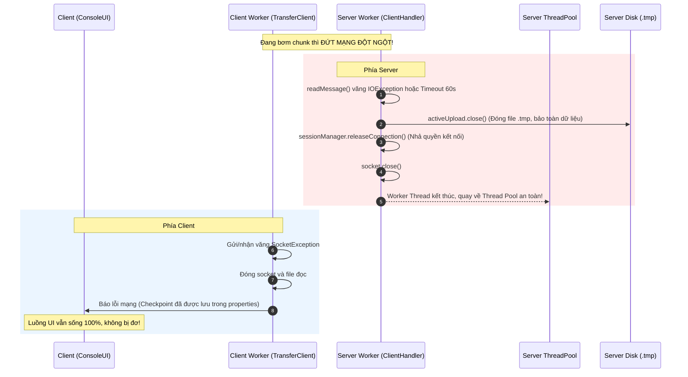

# TỔNG HỢP KIẾN THỨC KỸ THUẬT & TRẢ LỜI VẤN ĐÁP (BTL LTM)

Tài liệu ghi lại các vấn đề chuyên sâu về Đa luồng (Multi-threading), Cơ chế đồng bộ (Synchronization), CAS, Biến nguyên tử (Atomic), Chiến lược phòng chống Deadlock, Tối ưu hóa I/O, và Tính toàn vẹn dữ liệu trong giao thức LFTP.

---

## 1. Worker Thread, Native Thread & Hàng đợi ArrayBlockingQueue

### 1.1. Worker Thread & Thread Pool
* **Worker Thread:** Là luồng công nhân được tạo sẵn và giữ sống liên tục. Thay vì mỗi client kết nối lại tạo một luồng mới rồi hủy đi (gây lãng phí tài nguyên tạo/hủy luồng), Worker Thread sẽ lấy task từ hàng đợi (Queue), xử lý xong lại quay về chờ task tiếp theo.
* **Cấu hình trong dự án (`ConnectionListener.java`):**
  - Số worker tối thiểu (`corePoolSize`): **5**
  - Số worker tối đa (`maximumPoolSize`): **20**
  - Hàng đợi chờ: `ArrayBlockingQueue(20)`
  - Chính sách từ chối (`AbortPolicy`): Khi có quá 40 kết nối (20 luồng đang chạy + 20 task chờ trong queue), server từ chối ngay để chống quá tải (DoS).

### 1.2. Native Thread là gì? So sánh với Virtual/User Thread
* **Native Thread (Luồng bản địa):** Là luồng do chính Hệ điều hành (Kernel OS: Windows, Linux) quản lý và lập lịch thông qua CPU Core.
  - Mỗi Native Thread trong Java ánh xạ 1:1 với 1 Kernel Thread của OS.
  - Chi phí: Chiếm một phần bộ nhớ ngăn xếp (Stack Memory) trên RAM, tốn chi phí chuyển ngữ cảnh (**Context Switch**) giữa User-mode và Kernel-mode.
  - *Lý do không tạo luồng vô hạn:* Nếu số lượng kết nối tăng cao mà cứ mỗi kết nối lại tạo một Native Thread mới không kiểm soát $\rightarrow$ tiêu tốn rất lớn bộ nhớ RAM cho Thread Stack $\rightarrow$ dẫn đến nguy cơ tràn bộ nhớ (`OutOfMemoryError`) và CPU bị nghẽn do Context Switch.
* **User/Virtual Thread (Java 21):** Luồng ảo do máy ảo JVM tự quản lý trên không gian User-mode, rất nhẹ (vài KB), nhiều Virtual Thread có thể chia sẻ cùng một Native Thread (mô hình M:N).

### 1.3. Cơ chế đồng bộ của `ArrayBlockingQueue`
* Hàng đợi chứa task là tài nguyên dùng chung giữa luồng đón kết nối (`ConnectionListener`) và 20 Worker Thread.
* `ArrayBlockingQueue` sử dụng **khóa ReentrantLock** kết hợp 2 điều kiện (**Condition `notEmpty` và `notFull`**):
  - Khi hàng đợi rỗng: 20 Worker Thread sẽ vào trạng thái **ngủ chờ (wait/block)**, không tiêu tốn chu kỳ CPU (khác hoàn toàn với vòng lặp bận `while(true)` gây 100% CPU).
  - Khi có kết nối mới được đưa vào: Tín hiệu `signal()` được phát để đánh thức duy nhất 1 Worker Thread dậy xử lý.

---

## 2. Cơ chế Tạm dừng / Hủy truyền file & Bản chất Từ khóa `volatile`

### 2.1. Kịch bản tải file dung lượng lớn (lên tới 2 GiB theo Protocol.MAX_FILE_BYTES) muốn dừng/hủy
* Client chạy mô hình 2 luồng:
  - **Main Thread (`ConsoleUI`):** Chờ người dùng gõ lệnh (phím bấm, giao diện CLI).
  - **Worker Thread (`TransferClient`):** Chạy ngầm truyền từng chunk qua Socket TCP.
* Để dừng hoặc hủy: Luồng giao diện chỉ cần bật cờ:
  - `pauseRequested = true` (tạm dừng)
  - `cancelRequested = true` (hủy bỏ)
  Worker Thread sau mỗi chunk 64 KB gửi đi sẽ kiểm tra lại 2 cờ này.

### 2.2. Cơ chế đồng bộ với cờ `volatile`
* Các cờ được khai báo:
  ```java
  private volatile boolean pauseRequested = false;
  private volatile boolean cancelRequested = false;
  ```
* **Tại sao không cần `synchronized`?**
  - Đây là mô hình **Single-Writer, Single-Reader** (Chỉ duy nhất Luồng UI ghi cờ, chỉ duy nhất Luồng Mạng đọc cờ).
  - Không có tranh chấp ghi đồng thời (Race Condition giữa các luồng ghi).
  - Dùng `synchronized` trong vòng lặp truyền file sẽ tạo chi phí xin/nhả khóa không cần thiết, làm tụt băng thông mạng.

### 2.3. Bản chất phần cứng: Tại sao 1 luồng đổi ngay mà Đa luồng cần `volatile`?
* **Trong 1 luồng (Single-thread):** CPU và bộ nhớ hoạt động tuần tự trên cùng một ngữ cảnh. Khi gọi `a++`, luồng hiện tại đọc/ghi ngay trên thanh ghi nên luôn thấy giá trị mới nhất.
* **Trong đa luồng (Multi-thread):**
  - Mỗi Core CPU có bộ nhớ đệm riêng siêu nhanh (**L1/L2 Cache, Registers**).
  - Khi không có `volatile`: Luồng A sửa biến trên Core 1, giá trị mới có thể chỉ nằm ở Cache của Core 1 chưa kịp đẩy xuống RAM. Trong khi đó, Luồng B trên Core 2 vẫn tiếp tục đọc giá trị cũ từ Cache của Core 2 (**Stale Data**).
  - Trình biên dịch JIT còn có thể tối ưu hóa vòng lặp (`while(running)`) bằng cách gán cố định biến vào thanh ghi (**Loop Hoisting**), khiến luồng đọc chạy vô tận dù luồng khác đã thay đổi cờ trạng thái.
* **`volatile` giải quyết bằng cách:**
  - **Ghi:** Ép CPU đẩy ngay giá trị mới xuống bộ nhớ chính (Main RAM).
  - **Đọc:** Bắt buộc CPU đọc trực tiếp từ Main RAM, không được dùng giá trị cũ trong Cache.
  - Thiết lập rào cản bộ nhớ (**Memory Barrier**), ngăn chặn CPU và Compiler đảo thứ tự dòng lệnh.

### 2.4. Cái bẫy kinh điển: `volatile` KHÔNG làm cho `a++` an toàn!
* `volatile` chỉ đảm bảo **Tính hiển thị (Visibility)**, hoàn toàn **KHÔNG đảm bảo Tính nguyên tử (Atomicity)**.
* Thao tác `a++` gồm 3 bước riêng biệt: `1. Đọc a` $\rightarrow$ `2. Tăng a + 1` $\rightarrow$ `3. Ghi lại vào a`.
* Nếu 2 luồng cùng thực hiện `a++` trên một biến `volatile int a;`, cả 2 luồng có thể cùng đọc một giá trị cũ rồi cùng ghi đè lên nhau $\rightarrow$ Dẫn đến mất dữ liệu (**Lost Update**).
* Để an toàn với `a++`, bắt buộc phải dùng **`AtomicInteger`** hoặc khối đồng bộ **`synchronized` / `Lock`**.

---

## 3. Cơ chế CAS (Compare-And-Swap) & Biến nguyên tử `AtomicLong`

### 3.1. Bản chất của CAS và `AtomicLong`
* **CAS (Compare-And-Swap):** Là giải thuật và **chỉ lệnh phần cứng ở cấp CPU** (trên x86 là `LOCK CMPXCHG`).
  - Thực hiện nguyên tử thao tác: *"Nếu giá trị ô nhớ hiện tại đúng bằng giá trị kỳ vọng A, hãy thay bằng giá trị mới B; nếu không, từ chối và báo thất bại"*.
  - Toàn bộ diễn ra trong 1 bước không thể bị phân cắt.
* **`AtomicLong`:** Là lớp bọc cấp cao của Java (`java.util.concurrent.atomic`) bao bọc biến `private volatile long value;`. Các hàm như `compareAndSet()`, `addAndGet()`, `incrementAndGet()` gọi trực tiếp chỉ lệnh CAS phần cứng xuống CPU thông qua `VarHandle`.

### 3.2. Đang ghi `addAndGet()`, luồng khác đọc `get()` thì sao?
* **Kết quả:** Luồng đọc **luôn nhận được một giá trị hợp lệ, hoàn chỉnh**: hoặc là toàn bộ giá trị cũ (trước khi cộng), hoặc là toàn bộ giá trị mới (sau khi cộng).
* **Tuyệt đối không bao giờ bị giá trị rác/hỏng (Torn Read):**
  - Với biến `long` 64-bit thông thường trên hệ thống 32-bit: CPU phải ghi làm 2 lần (32-bit thấp, 32-bit cao). Luồng khác chen ngang đọc sẽ dính "nửa cũ nửa mới" (Torn Read).
  - `AtomicLong` đảm bảo thao tác ghi 64-bit là nguyên tử ở cấp phần cứng và có `volatile` ép đồng bộ bộ nhớ Cache (giao thức MESI), triệt tiêu hoàn toàn Torn Read.

---

## 4. Tại sao CAS / AtomicLong Phòng chống được DEADLOCK?

### 4.1. Kịch bản Deadlock nếu dùng khóa thông thường (`synchronized`)
Nếu hàm quản lý Quota trong `FileManager` dùng `synchronized`:
1. **Luồng 1 (Worker Thread đang upload):** Giữ khóa của `SessionManager` $\rightarrow$ gọi `fileManager.reserveSpace()` để xin tiếp khóa của `FileManager`.
2. **Luồng 2 (`ConnectionWatcher` dọn session quá hạn):** Giữ khóa của `FileManager` $\rightarrow$ gọi `sessionManager.removeSession()` để xin khóa của `SessionManager`.
$\implies$ **Khóa chéo (Circular Wait): Luồng 1 giữ A chờ B, Luồng 2 giữ B chờ A $\rightarrow$ Deadlock, server treo vĩnh viễn!**

### 4.2. CAS hóa giải Deadlock như thế nào?
Deadlock chỉ xảy ra khi thỏa mãn đồng thời 4 điều kiện của Coffman. CAS là cơ chế **Không khóa (Lock-free)** nên bẻ gãy 2 điều kiện cốt lõi:
1. **Loại bỏ Mutual Exclusion:** Hàm không khóa cửa, 20 worker thread có thể vào cùng lúc.
2. **Loại bỏ Hold and Wait:** Luồng không "ngậm" ổ khóa nào để chờ ổ khóa khác. Nếu lệnh `compareAndSet` gặp xung đột, nó chỉ việc đọc lại giá trị mới và thử lại trong vòng lặp `while(true)`.
$\rightarrow$ **Không có ổ khóa thì không thể xảy ra Deadlock!**

---

## 5. Các vị trí hiện thực hóa trong Source Code dự án

| File | Thành phần | Cơ chế áp dụng | Mục đích kỹ thuật |
|---|---|---|---|
| [`FileManager.java`](file:///d:/project/BTL%20LTM/codeV2/src/lftp/server/FileManager.java) | `usedBytes`, `reservedBytes` | `AtomicLong` + vòng lặp CAS trong `reserveSpace()` | Quản lý Quota Lock-free, chống Deadlock với SessionManager |
| [`ClientHandler.java`](file:///d:/project/BTL%20LTM/codeV2/src/lftp/server/ClientHandler.java) | `closed` | `AtomicBoolean` + `compareAndSet(false, true)` | Đảm bảo đóng Socket và giải phóng stream chỉ đúng 1 lần (Idempotent Close) |
| [`TransferClient.java`](file:///d:/project/BTL%20LTM/codeV2/src/lftp/client/TransferClient.java) | `requestIdGen` | `AtomicLong.incrementAndGet()` | Tự động sinh ID gói tin request tăng dần an toàn đa luồng, không cần lock |
| [`TransferClient.java`](file:///d:/project/BTL%20LTM/codeV2/src/lftp/client/TransferClient.java) | `pauseRequested`, `cancelRequested` | `volatile boolean` | Đồng bộ trạng thái dừng/hủy giữa Luồng UI và Luồng Truyền tải |
| [`TransferSession.java`](file:///d:/project/BTL%20LTM/codeV2/src/lftp/server/TransferSession.java) | `lastActiveEpochMs`, `activeConnectionId`, `uploadState` | `volatile` | Đảm bảo tính hiển thị trạng thái phiên tức thì giữa các luồng kết nối và luồng dọn rác |
| [`FileStorage.java`](file:///d:/project/BTL%20LTM/codeV2/src/lftp/server/FileStorage.java) | `saveCompletedFile()` | `StandardCopyOption.ATOMIC_MOVE` | Đổi tên file tạm `.tmp` thành file chính `.dat` nguyên tử ở mức Hệ điều hành |

---

## 6. Khóa lồng nhau (Nested Locking) & Chiến lược Triệt tiêu Deadlock

### 6.1. Thế nào là Khóa lồng nhau?
* **Khóa lồng nhau (Lock Nesting):** Xảy ra khi một luồng **đang nắm giữ Khóa A** nhưng bên trong phạm vi đồng bộ đó lại **tiếp tục yêu cầu chiếm giữ thêm Khóa B** trước khi nhả khóa A ra.
* **Nguy cơ:** Dẫn đến **Chờ đợi vòng tròn (Circular Wait)**. Luồng 1 giữ A đòi B; Luồng 2 giữ B đòi A $\rightarrow$ Deadlock, hệ thống tê liệt hoàn toàn.

### 6.2. Chiến lược 1: Thứ bậc lấy khóa nghiêm ngặt (Strict Lock Hierarchy)
Nhóm xác lập thứ bậc khóa một chiều cố định:
$$\mathbf{Level\;1:\;SessionManager} \;\longrightarrow\; \mathbf{Level\;2:\;TransferSession} \;\longrightarrow\; \mathbf{Level\;3:\;FileManager}$$

* **Minh chứng 1 (Chiều từ Level 2 xuống Level 3):**
  Trong [`UploadManager.java`](file:///d:/project/BTL%20LTM/codeV2/src/lftp/server/UploadManager.java#L72-L102), hàm `finishUpload()`:
  - Chiếm khóa `session.lock()` (Level 2).
  - Khi đang giữ Level 2, mới gọi `fileManager.addFile(completedInfo)` và `fileManager.confirmSpace()` (Level 3).
  - Giải phóng khóa ở khối `finally { session.unlock(); }`.
* **Minh chứng 2 (Chiều từ Level 1 xuống Level 2):**
  Trong [`SessionManager.java`](file:///d:/project/BTL%20LTM/codeV2/src/lftp/server/SessionManager.java#L61-L66), hàm `resumeUploadSession()`:
  - Tra cứu session từ `sessions` (Level 1).
  - Sau đó mới gọi `session.lock()` (Level 2).
* **Minh chứng 3 (Bằng chứng cốt tử - Bẻ gãy hoàn toàn vòng lặp):**
  Trong [`FileManager.java`](file:///d:/project/BTL%20LTM/codeV2/src/lftp/server/FileManager.java), class này **hoàn toàn không giữ bất kỳ thuộc tính tham chiếu nào** tới `TransferSession` hay `SessionManager`. 
  $\rightarrow$ Về mặt cú pháp mã nguồn, Level 3 bị tước hoàn toàn quyền gọi ngược lên Level 1 hay Level 2. Khả năng xảy ra vòng chờ đợi Circular Wait là **0%**.

### 6.3. Chiến lược 2: Kỹ thuật Snapshot (Trích xuất rồi buông khóa ngay)
* Không bao giờ vừa giữ khóa của đối tượng này vừa thực hiện các thao tác I/O hoặc gọi đối tượng khác.
* **Áp dụng khi dọn dẹp (`removeExpiredSessions()` trong `SessionManager`):**
  - Bước 1: Khóa bảng session trong tích tắc để lọc và copy các session hết hạn ra một danh sách tạm `List<TransferSession> expiredList`.
  - Bước 2: **Buông khóa bảng session ngay lập tức.**
  - Bước 3: Duyệt danh sách `expiredList` để xóa file tạm và hoàn trả Quota ngoài vùng khóa.

---

## 7. Phân biệt `FileStorage` và `FileManager`

| Tiêu chí | `FileStorage` (Tầng Thao tác Vật lý) | `FileManager` (Tầng Quản lý Danh mục & Quota) |
|---|---|---|
| **Bản chất** | Làm việc trực tiếp với **ổ đĩa cứng** (Disk I/O). | Quản lý **Metadata trên RAM** và đồng bộ ra `catalog.idx`. |
| **Nhiệm vụ chính** | - Mở, đọc, ghi dữ liệu byte thô bằng `RandomAccessFile`.<br>- Quản lý file tạm (`.tmp`) và file hoàn tất (`.dat`).<br>- Đổi tên nguyên tử `StandardCopyOption.ATOMIC_MOVE` khi commit.<br>- Quét và xóa file tạm mồ côi lúc khởi động (`cleanupTempFilesOnStartup`). | - Quản lý danh mục file (`Map<String, FileInfo>`).<br>- Cung cấp danh sách file theo phân trang (**Pagination**) cho client.<br>- Quản lý hạn mức dung lượng lưu trữ (**Storage Quota**): `quotaBytes`, `usedBytes`, `reservedBytes`.<br>- Dành trước (reserve) dung lượng bằng CAS Lock-free qua `AtomicLong`. |
| **Hình tượng hóa** | Là **"Nhà kho vật lý"**: Nơi xếp trực tiếp các thùng hàng byte vào kệ đĩa cứng, dọn rác kho khi mở cửa. | Là **"Thủ thư kiêm Kế toán"**: Nắm sổ sách danh mục xem còn những file nào, còn bao nhiêu dung lượng trống trước khi cho phép nhập hàng. |

---

## 8. Phân biệt `TransferSession` của Upload và Download & Các Usecase

Cả 2 loại đều dùng chung lớp `TransferSession` (phân biệt bằng enum `TransferSession.Type`) để tránh trùng lặp mã nguồn, nhưng có vòng đời và cơ chế rất khác biệt:

| Đặc điểm | `TransferSession` cho Upload (`Type.UPLOAD`) | `TransferSession` cho Download (`Type.DOWNLOAD`) |
|---|---|---|
| **Vòng đời & Quản lý** | **Stateful (Lưu trạng thái dài hạn):** Lưu tập trung trong `SessionManager` (`ConcurrentHashMap`). Nếu đứt kết nối mạng, session **vẫn sống trong 30 phút** trong RAM để chờ kết nối lại. | **Stream/Gắn liền theo TCP:** Được quản lý trực tiếp bởi `DownloadManager` trên kết nối của luồng `ClientHandler`. Đóng kết nối là giải phóng tài nguyên ngay. |
| **Hạn ngạch (Quota)** | **Có:** Phải gọi `fileManager.reserveSpace()` để giữ chỗ trước dung lượng ảo bằng CAS, tránh nhiều client upload cùng lúc gây tràn đĩa. | **Không:** Tải file về không làm tăng dung lượng lưu trữ của Server. |
| **Kiểm tra SHA-256** | **Server tính băm lũy tiến (Streaming Hash):** Giữ đối tượng `MessageDigest` trong RAM, băm từng chunk 64 KiB để chốt commit tức thì trong RAM mà không cần đọc lại đĩa. | **Client tự kiểm tra:** Server chỉ đọc file `.dat` có sẵn ra gửi. Client nhận đủ 100% thì tự băm file tải về và đối chiếu với mã hash do Server gửi kèm lúc bắt đầu. |
| **Bảo mật Resume** | Sử dụng mã bí mật **`resumeToken`** (UUID) để chống kẻ khác chiếm đoạt hoặc can thiệp vào phiên tải dở. | Không cần token phức tạp; Client tự lưu checkpoint cục bộ và yêu cầu Server đọc từ vị trí `offset X`. |

### Các Use Case tương ứng:
1. **Upload Session:**
   - *Usecase 1 (Tải mới):* Client gửi `UPLOAD_INIT` $\rightarrow$ Server kiểm tra Quota (CAS), cấp `uploadId` và `resumeToken`, mở file `.tmp`, nạp `TransferSession` vào RAM.
   - *Usecase 2 (Resume sau đứt mạng):* Client gửi `UPLOAD_RESUME` kèm token $\rightarrow$ Server đối chiếu token, kiểm tra kích thước đĩa thực tế, nạp lại trạng thái băm và cho truyền tiếp.
   - *Usecase 3 (Thu hồi session mồ côi):* Client bỏ rơi quá 30 phút $\rightarrow$ `ConnectionWatcher` quét dọn, xóa file `.tmp` và giải phóng Quota.
2. **Download Session:**
   - *Usecase 1 (Tải file từ đầu):* Client gửi `DOWNLOAD_OPEN` với `offset = 0` $\rightarrow$ `DownloadManager` mở file `.dat`, gửi từng chunk 64 KiB qua `DOWNLOAD_NEXT`.
   - *Usecase 2 (Tải tiếp file dở - Client Resume):* Client rớt mạng khi đã kéo được 1.2 GiB $\rightarrow$ Client gửi `DOWNLOAD_OPEN` với `startOffset = 1.2 GiB` $\rightarrow$ Server dùng `raf.seek(1.2 GiB)` và bơm tiếp các chunk còn lại.

---

## 9. Thuật toán SHA-256 lũy tiến (Streaming Hash) & Cơ chế Đồng bộ lại khi Resume

### 9.1. Bản chất toán học của SHA-256
* Thuật toán SHA-256 tuân theo cấu trúc **Merkle–Damgård**, chia nhỏ dòng dữ liệu thành các khối **512-bit (64 bytes)** và duy trì trạng thái nội bộ 256-bit gồm 8 thanh ghi 32-bit ($H_0 \dots H_7$).
* Nhờ vậy, ta có thể nạp dữ liệu từng mẩu nhỏ qua hàm `MessageDigest.update(chunk)` mà không cần có toàn bộ file cùng một lúc trong bộ nhớ.
* Dữ liệu chunk sau khi băm xong sẽ được giải phóng khỏi RAM, giúp Server tiêu thụ bộ nhớ cực kỳ thấp.

### 9.2. So sánh giải pháp ngây thơ vs. Streaming Hash
* **Cách ngây thơ (Post-transfer Hash):** Nhận trọn file xuống đĩa $\rightarrow$ Lúc nhận lệnh COMMIT mới mở file ra đọc lại từ đầu để tính SHA-256 $\rightarrow$ Gây nghẽn I/O đĩa kéo dài do phải đọc lại toàn bộ dữ liệu, có nguy cơ làm Socket bị quá hạn thời gian chờ (`SocketTimeoutException` theo `Protocol.TIMEOUT_READ_MS = 60s`) và sập kết nối ở vạch đích!
* **Streaming Hash (Nhóm áp dụng):** Chunk 64 KiB từ card mạng vào RAM là được đưa ngay vào `MessageDigest.update()`, đồng thời ghi xuống đĩa $\rightarrow$ Khi xong chunk cuối cùng, mã băm đã hoàn tất $\rightarrow$ Bước `UPLOAD_COMMIT` chỉ cần gọi `digest()` lấy kết quả tức thì trong bộ nhớ RAM mà không tốn thêm bất kỳ thao tác đọc đĩa nào.

### 9.3. Bên gửi (Client) tính mã SHA-256 gửi sang bằng cách nào?
* Trước khi truyền bất kỳ byte nào qua mạng, Client chạy hàm [`HashUtils.calculateFileSha256(file)`](file:///d:/project/BTL%20LTM/codeV2/src/lftp/common/HashUtils.java#L32).
* Client cũng dùng kỹ thuật đọc đệm từng khối 64 KiB trên ổ đĩa cục bộ để tránh lỗi tràn bộ nhớ `OutOfMemoryError`.
* Client đóng gói **32 bytes SHA-256 thô** này vào thông điệp khởi tạo **`OP_UPLOAD_INIT`** như một **"đáp án mẫu" / cam kết trước**. Server lưu 32 byte này vào `TransferSession.fileHash` để đến bước cuối đối chiếu.

### 9.4. Tại sao cần "Đồng bộ lại" trạng thái băm khi Resume (`resumeSha256State`)?
Xuất phát từ 2 nguyên nhân cốt tử:
1. **Ổ đĩa là Nguồn sự thật duy nhất (Single Source of Truth):**
   - Khi rớt mạng đột ngột, một chunk có thể đã nạp vào `MessageDigest` trong RAM nhưng chưa kịp ghi xuống đĩa, hoặc việc gửi gói ACK bị mất khiến Client gửi lại từ một checkpoint thấp hơn.
   - Trạng thái trong RAM và đĩa cứng bị lệch pha.
2. **Hàm băm SHA-256 không có nút "Undo" (Không thể băm lùi):**
   - `MessageDigest` chỉ có chiều tiến tới (`update()`), không có hàm rollback. Chỉ cần lệch **1 byte duy nhất**, toàn bộ mã băm cuối cùng sẽ sai hoàn toàn (**Hiệu ứng tuyết lở - Avalanche Effect**).
   - Vì vậy, khi Resume: Server lấy **kích thước file tạm thực tế trên đĩa (`actualDiskSize`)** làm chuẩn. Hàm `resumeSha256State` đọc lại từ byte 0 đến byte `actualDiskSize` để đưa con trỏ băm về chính xác vạch xuất phát của con trỏ đĩa, đảm bảo 100% tính toàn vẹn.

---

## 10. Hành vi của Luồng & Tài nguyên khi Mất kết nối đột ngột



### 10.1. Phía Server
* Hàm `messageIO.readMessage()` bắt `IOException` (Connection reset) hoặc hết hạn `SocketTimeoutException` (sau 60s).
* Khối `finally` gọi `ClientHandler.close()`:
  - Đóng con trỏ file tạm `activeUpload.close()` $\rightarrow$ **Dữ liệu đã ghi (tính đến byte `actualDiskSize`) nằm nguyên vẹn trên đĩa**.
  - Gọi `sessionManager.releaseConnection()` $\rightarrow$ Đặt `activeConnectionId = null` để kết nối mới sau này có thể nhận lại phiên.
  - Đóng Socket `socket.close()`.
  - Luồng Worker hoàn tất nhiệm vụ và được **trả về `ThreadPoolExecutor`**, không bị rò rỉ luồng hay rò rỉ bộ nhớ.
* Phiên `TransferSession` và dung lượng Quota ảo được giữ nguyên trong **30 phút** chờ Client kết nối lại.

### 10.2. Phía Client
* Luồng truyền ngầm `TransferClient` bắt lỗi `SocketException`, giải phóng socket và đóng con trỏ đọc file nguồn.
* Thông tin phiên (`uploadId`, `resumeToken`, `currentOffset`) đã được `ResumeManager` ghi định kỳ xuống file cấu hình trên đĩa máy client (`.properties`).
* **Luồng giao diện `ConsoleUI` (Main Thread) vẫn chạy bình thường**, in thông báo lỗi kết nối ra màn hình, không bị đóng băng (freeze) và không bị crash ứng dụng. Người dùng chỉ cần cắm lại dây mạng và gõ lệnh resume.

---

## 11. Bản chất của RequestId: Vì sao 2 Client tạo trùng RequestId không gây xung đột?

### 11.1. Phạm vi Cục bộ theo Kết nối (Connection-Scope vs Global-Scope)
* Trong mã nguồn [`TransferClient.java`](file:///d:/project/BTL%20LTM/codeV2/src/lftp/client/TransferClient.java#L23):
  ```java
  private final AtomicLong requestIdGen = new AtomicLong(1);
  ```
  Mỗi Client khởi tạo một biến đếm riêng, bắt đầu từ giá trị `1`. Do đó, khi Client A và Client B cùng khởi động, **cả 2 Client đều sẽ phát sinh `requestId = 1, 2, 3...` hoàn toàn giống nhau**.
* **Điều này KHÔNG bao giờ gây ra xung đột hay nhầm lẫn gói tin**, bởi vì:
  1. `requestId` có **phạm vi cục bộ trên từng kết nối TCP (Connection Scope)**, hoàn toàn KHÔNG phải định danh toàn cục trên toàn hệ thống (Global Scope).
  2. Mỗi Client kết nối tới Server thông qua một cặp Socket riêng biệt, được Tầng Giao vận (Transport Layer - TCP) cô lập bằng bộ định danh 4-tuple duy nhất:
     $$\{ \text{Client IP, Client Port, Server IP, Server Port} \}$$
  3. Server phân công mỗi kết nối TCP cho một luồng [`ClientHandler`](file:///d:/project/BTL%20LTM/codeV2/src/lftp/server/ClientHandler.java) độc lập:
     - Luồng `ClientHandler A` đọc `requestId = 1` từ Socket A, xử lý xong gửi phản hồi kèm `requestId = 1` ngược lại vào đúng Socket A.
     - Luồng `ClientHandler B` đọc `requestId = 1` từ Socket B, xử lý xong gửi phản hồi kèm `requestId = 1` ngược lại vào đúng Socket B.
     - Dữ liệu giữa 2 socket hoàn toàn độc lập ở tầng mạng, không thể xảy ra hiện tượng gói tin của Client A bay sang Socket của Client B.

### 11.2. Mục đích thực sự của RequestId trong Giao thức
1. **Ghép cặp Yêu cầu - Phản hồi (Request-Response Correlation):**
   Client dùng `requestId` để nhận biết gói phản hồi từ Server thuộc về yêu cầu nào vừa gửi đi.
2. **Sẵn sàng cho việc mở rộng Đa ghép kênh (Multiplexing / Pipelining tương lai):**
   Tương tự như `Stream ID` trong giao thức HTTP/2 hoặc HTTP/3, nếu Client gửi nhiều yêu cầu liên tiếp mà không cần đợi phản hồi (Asynchronous / Non-blocking), Client sẽ dùng `requestId` để khớp phản hồi trả về không theo thứ tự vào đúng luồng công việc đang chờ.

### 11.3. Các Định danh đảm bảo Tính Duy nhất Toàn cục (Global Uniqueness)
Để phân biệt giữa các Client và các phiên truyền tải trên toàn bộ hệ thống, nhóm sử dụng các định danh toàn cục độc lập với `requestId`:
* **`connectionId`:** Sinh bằng UUID ngẫu nhiên tại Server khi bắt tay `OP_HELLO` (`"conn-" + UUID.randomUUID()...`), gán cố định cho từng socket.
* **`sessionId` (UploadId):** Sinh bằng UUID ngẫu nhiên khi khởi tạo tải lên `OP_UPLOAD_INIT` (`"up-" + UUID.randomUUID()...`), đảm bảo không bao giờ trùng phiên giữa các client.
* **`resumeToken`:** Chuỗi ngẫu nhiên 128-bit (32 ký tự Hex) để xác thực quyền sở hữu phiên tải lên khi kết nối lại.
* **`fileId`:** Sinh bằng UUID khi hoàn tất file (`"file-" + UUID.randomUUID()...`) đưa vào danh mục `FileManager`.

### 11.4. Tương đồng với các Giao thức Chuẩn Quốc tế
* **HTTP/2 & HTTP/3:** Trình duyệt Chrome, Firefox, Safari khi mở kết nối đến máy chủ đều tự sinh `Stream ID` bắt đầu từ `1, 3, 5, 7...`. Các trình duyệt không cần biết hay đồng bộ `Stream ID` với nhau vì mỗi kết nối TLS/TCP là độc lập.
* **DNS Protocol:** Gói tin DNS dùng trường 16-bit `Transaction ID` do client tự sinh để khớp gói phản hồi UDP.
* **TCP Sequence Number:** Số thứ tự tuần tự trong header TCP chỉ có ý nghĩa trong phạm vi kết nối giữa 2 socket endpoint cụ thể.

### 11.5. Ánh xạ RequestId phục vụ các Use Case cụ thể (UC03 - UC10)
Trường `requestId` nằm trong Header nhị phân cố định 12-byte của mọi khung tin giao thức LFTP/1 qua TCP, trực tiếp phục vụ các Use Case sau:
1. **UC03 (Bắt tay Handshake - OP_HELLO):** Khớp xác nhận đàm phán cấu hình thành công từ Server với yêu cầu kết nối ban đầu của Client.
2. **UC04 (Xem danh mục có phân trang - OP_LIST_FILES):** Đảm bảo phản hồi danh mục tệp trả về đúng với yêu cầu trang (`pageIndex`) mà Client vừa gửi.
3. **UC05 & UC07 (Tải lên tệp trọn vẹn & Resume Upload):**
   - Vòng lặp `OP_UPLOAD_CHUNK`: Mỗi chunk 64 KiB gửi lên được gán một `requestId` tăng dần (`1, 2, 3...`). Server ghi đĩa và phản hồi xác nhận mang đúng `requestId` đó kèm `nextOffset`. Client nhờ đó xác thực Server đã ghi thành công chunk đó trước khi nạp tiếp chunk mới.
   - Bước `OP_UPLOAD_COMMIT`: Khớp xác nhận kiểm tra mã băm SHA-256 hoàn tất.
4. **UC08 (Tải về tệp - OP_DOWNLOAD_OPEN, OP_DOWNLOAD_CHUNK, OP_DOWNLOAD_CLOSE):** Mỗi yêu cầu lấy chunk dữ liệu tải về được đánh số tuần tự để quản lý luồng dữ liệu chính xác.
5. **UC10 (Đóng kết nối lịch sự - OP_BYE):** Khớp gói tin xác nhận Server đã chuẩn bị đóng tài nguyên an toàn trước khi hủy kết nối socket.

---

## 12. Cơ chế Lưu vết Kết quả Hoàn tất (Completed State Retention & Idempotency)

### 12.1. Bài toán "Đứt mạng ở vạch đích" (The Last-Mile Commit Disconnection)
* **Kịch bản sự cố:**
  1. Client gửi đầy đủ 100% dữ liệu file qua các gói `OP_UPLOAD_CHUNK`.
  2. Client gửi thông điệp chốt hạ: **`OP_UPLOAD_COMMIT`**.
  3. **Phía Server:** Nhận được commit $\rightarrow$ Đối chiếu SHA-256 trong RAM khớp $\rightarrow$ Đổi tên file tạm `.tmp` thành file chính thức $\rightarrow$ Thêm file vào danh mục `FileManager` $\rightarrow$ Cập nhật Quota từ `reserved` sang `used` $\rightarrow$ Đánh dấu `session.markCompleted(fileId)`.
  4. **Đúng tích tắc này, mạng bị đứt (rút dây mạng hoặc mất Wifi):**
     - Phía Server: File **đã được lưu hoàn tất thành công**.
     - Phía Client: Socket văng ngoại lệ `IOException/SocketException`. Client **chưa nhận được gói phản hồi thành công và không biết `fileId`**.
* **Hậu quả nếu Server xóa phiên ngay khi commit:**
  - Client tưởng rằng lượt truyền trước đó bị lỗi hoặc hủy bỏ.
  - Khi có mạng lại, Client buộc phải **tải lại toàn bộ 100% dữ liệu file từ đầu**, gây lãng phí băng thông mạng, tốn thời gian và làm Server bị trùng lặp file.

### 12.2. Giải pháp Lưu vết & Xử lý trong Source Code
Hệ thống áp dụng kỹ thuật **Lưu vết trạng thái hoàn tất (Completed State Retention)**:
1. **Tại Server:**
   - Trong [`UploadManager.java`](file:///d:/project/BTL%20LTM/codeV2/src/lftp/server/UploadManager.java#L121) và [`TransferSession.java`](file:///d:/project/BTL%20LTM/codeV2/src/lftp/server/TransferSession.java#L121-L126): Đổi trạng thái phiên thành `Protocol.UPLOAD_STATE_COMPLETED` và lưu lại `completedFileId`.
   - Phiên này **vẫn được giữ lại trong bộ nhớ RAM của `SessionManager` trong 24 giờ**, hoàn toàn không bị xóa bởi tác vụ quét dọn định kỳ `removeExpiredSessions()`.
2. **Khi Client kết nối lại:**
   - Client đọc cấu hình checkpoint còn lưu trong máy và gửi lệnh **`OP_UPLOAD_RESUME`** kèm `uploadId` và `resumeToken`.
   - Tại [`ClientHandler.java`](file:///d:/project/BTL%20LTM/codeV2/src/lftp/server/ClientHandler.java#L226-L231): Server kiểm tra `session.getUploadState() == Protocol.UPLOAD_STATE_COMPLETED`, lập tức trả lời gói tin phản hồi kèm mã `completedFileId` đã lưu sẵn.
   - Tại [`TransferClient.java`](file:///d:/project/BTL%20LTM/codeV2/src/lftp/client/TransferClient.java#L185-L189): Client nhận được `completedFileId`, xóa checkpoint và kết thúc thành công tức thì mà **không cần phải tải lại dù chỉ 1 byte**.

### 12.3. Tại sao phân biệt: 30 phút (lượt dở) vs 24 giờ (kết quả hoàn tất)?
* **Lượt tải dở dang (`IN_PROGRESS` - Giữ 30 phút):** File tạm `.tmp` đang nằm trên đĩa cứng và đang **ngậm dung lượng Quota ảo (`reservedSpace`)**. Nếu Client bỏ rơi không truyền tiếp, Server bắt buộc phải dọn dẹp sau 30 phút để xóa file tạm và hoàn trả Quota cho hệ thống.
* **Lượt đã hoàn tất (`COMPLETED` - Giữ 24 giờ):** File tạm đã chuyển thành file chính thức và Quota đã ghi nhận hợp lệ vào `usedSpace`. Bản thân Session trong RAM lúc này chỉ là một đối tượng metadata cực nhẹ (vài chục byte lưu `{sessionId, resumeToken, completedFileId}`). Giữ nó trong 24 giờ **hoàn toàn không tốn tài nguyên ổ đĩa**, giúp Client có thể hỏi lại kết quả bất kỳ lúc nào trong ngày.
* **Thuật ngữ chuyên ngành:** Đây là việc hiện thực hóa tính chất **Idempotency (Tính lũy đẳng / Bất biến khi gọi lại)** trong hệ thống phân tán.

---

## 13. Cơ chế Ghi Dữ liệu & Đóng gói Khung Nhị phân của MessageIO

### 13.1. Kiến trúc Chuỗi xếp tầng Stream (Decorator Pattern)
Mỗi kết nối TCP Socket được bao bọc qua 3 tầng Stream trong [`MessageIO.java`](file:///d:/project/BTL%20LTM/codeV2/src/lftp/common/MessageIO.java#L14-L20):
$$\text{Socket I/O Stream} \;\longrightarrow\; \text{Buffered Stream (64 KiB RAM)} \;\longrightarrow\; \text{Data Stream (Big-Endian)}$$
1. **`Socket.getOutputStream()` / `InputStream`:** Tầng I/O thô giao tiếp trực tiếp với Socket hệ điều hành. Ghi trực tiếp từng byte nhỏ vào đây sẽ gây ra vô số lời gọi hệ thống (System Call), làm mạng bị nghẽn và gián đoạn.
2. **`BufferedOutputStream` / `BufferedInputStream` (64 KiB buffer):** Tạo bộ đệm RAM để gom dữ liệu lại và đọc/ghi theo từng khối lớn tương ứng với `Protocol.CHUNK_SIZE`, tối ưu hóa hiệu năng truyền tải.
3. **`DataOutputStream` / `DataInputStream`:** Cung cấp các API chuyển đổi kiểu dữ liệu nguyên thủy của Java (`int`, `long`, `short`, `byte`) sang dòng byte nhị phân theo chuẩn **Big-Endian (Network Byte Order)**.

### 13.2. Quy trình 5 bước ghi dữ liệu của phương thức `writeMessage()`
Mọi thông điệp gửi đi đều phải tuân theo cấu trúc khung nhị phân cố định:
$$\underbrace{\text{[frameLength: 4B]}}_{\text{Tiền tố độ dài}} \;+\; \underbrace{\text{[version: 1B]} \;+\; \text{[opcode: 1B]} \;+\; \text{[requestId: 8B]} \;+\; \text{[status: 2B]}}_{\text{Header cố định 12B}} \;+\; \underbrace{\text{[body: nB]}}_{\text{Dữ liệu Payload}}$$

Nội dung phương thức `writeMessage(Message message)`:
1. **Bước 1 (Validate):** Kiểm tra độ dài khung $12 \le \text{frameLength} \le 131.072$ (tối đa 128 KiB). Ngăn chặn kẻ xấu gửi kích thước ảo làm tràn RAM (Heap Overflow).
2. **Bước 2 (Length-Prefix):** `dos.writeInt(frameLength)`. Ghi trước 4 byte độ dài khung. Phía nhận chỉ cần đọc 4 byte này trước là biết chính xác cả khung dài bao nhiêu byte để đọc nốt $\implies$ **Triệt tiêu hoàn toàn lỗi dính gói / xé gói trong TCP (Packet Boundary Problem)**.
3. **Bước 3 (Fixed Header):** Ghi tuần tự `version` (1B), `opcode` (1B), `requestId` (8B), `status` (2B).
4. **Bước 4 (Payload Body):** Bơm mảng byte thô của nội dung (`dos.write(body)`).
5. **Bước 5 (Flush):** `dos.flush()` ép toàn bộ dữ liệu từ vùng đệm RAM ra thẳng card mạng (NIC), không để đọng lại trong bộ nhớ đệm Java.

### 13.3. Kỹ thuật đóng gói Body động & Chuẩn hóa chuỗi UTF-8
* **Đóng gói Body động bằng `ByteArrayOutputStream`:**
  Khi cần gửi dữ liệu phức tạp (như tên file, kích thước, hash), các module dùng `ByteArrayOutputStream` và `DataOutputStream` để serialize vào RAM trước khi rút mảng byte `baos.toByteArray()` nạp vào `Message`.
* **Khắc phục hạn chế của `DataOutputStream.writeUTF()` bằng `writeString()`:**
  - Nhóm tự xây dựng phương thức [`MessageIO.writeString()`](file:///d:/project/BTL%20LTM/codeV2/src/lftp/common/MessageIO.java#L120-L124) và [`readString()`](file:///d:/project/BTL%20LTM/codeV2/src/lftp/common/MessageIO.java#L129-L137):
    + Ghi 4 byte độ dài chuỗi (`dos.writeInt(bytes.length)`).
    + Ghi mảng byte mã hóa theo chuẩn quốc tế `StandardCharsets.UTF_8`.
  - **Lý do không dùng `writeUTF()` có sẵn của Java:**
    1. `writeUTF()` dùng chuẩn *Modified UTF-8* không hoàn toàn tương thích quốc tế.
    2. `writeUTF()` dùng 2 byte unsigned short để lưu độ dài chuỗi $\rightarrow$ **Bị giới hạn trần ở 65.535 byte (64 KiB)**. Chuỗi dài hơn sẽ lập tức văng `UTFDataFormatException`. Với cách tự thiết kế 4 byte `int`, hệ thống hỗ trợ độ dài chuỗi tới hàng trăm Megabyte an toàn tuyệt đối.

---

## 14. Cơ chế UDP Broadcast Tự Động Tìm Kiếm Server & Giới Hạn Mạng

### 14.1. Cách thức hoạt động
* **Mục đích:** Giúp người dùng khi mở Client không cần phải gõ tay địa chỉ IP và Port của Server (tương tự cơ chế mDNS hoặc DHCP Discovery trong mạng máy tính).
* **Quy trình 3 bước:**
  1. Client mở một `DatagramSocket`, bật cờ `socket.setBroadcast(true)` và cài đặt thời gian chờ `socket.setSoTimeout(3000)` (3 giây).
  2. Client gửi gói tin UDP chứa thông điệp `"LFTP_DISCOVER"` tới địa chỉ broadcast toàn mạng `255.255.255.255` tại cổng `5001`.
  3. Server có luồng `DiscoveryServer` chạy thường trực lắng nghe cổng UDP 5001. Khi nhận được gói tin, Server lấy thông tin tên máy chủ và cổng TCP rồi gửi ngược lại gói UDP `"LFTP_OFFER <ServerName> <TcpPort>"`. Client nhận gói phản hồi, bóc tách IP nguồn (`packet.getAddress().getHostAddress()`) và tự động kết nối TCP tới cổng đó.

### 14.2. Tại sao UDP Broadcast bị chặn và cơ chế dự phòng (Fallback)?
* **Lý do bị chặn:**
  - Gói tin phát thanh `255.255.255.255` thuộc về miền quảng bá cục bộ (Broadcast Domain - Layer 2/3). Các Router mạng tiêu chuẩn luôn **chặn (drop)** gói tin broadcast để tránh gây bão mạng trên diện rộng (Broadcast Storm). Do đó broadcast không thể đi qua Router Internet hay giữa các subnet khác nhau.
  - Trong môi trường Docker, nếu Client và Server chạy trên các cầu mạng ảo (bridge) khác nhau mà không bật chế độ host network, Docker cũng cô lập các gói tin broadcast.
* **Cơ chế dự phòng (Fallback):**
  - Trong code `DiscoveryClient.java`, sau 3 giây nếu không nhận được phản hồi (`SocketTimeoutException`), Client in thông báo hướng dẫn người dùng chuyển sang cơ chế nhập IP/Port thủ công qua lệnh: `connect <ip> [port]`.

---

## 15. Thao tác Đổi tên Nguyên tử (Atomic Move) trên Hệ Điều Hành

### 15.1. Bản chất của `Files.move(..., StandardCopyOption.ATOMIC_MOVE)`
* Khi client tải lên file lớn, dữ liệu được ghi vào file tạm có đuôi `.tmp` (ví dụ: `<uploadId>.tmp`).
* Khi upload hoàn tất và băm SHA-256 khớp 100%, server gọi lệnh:
  ```java
  Files.move(tempFile.toPath(), completedFile.toPath(), 
      StandardCopyOption.ATOMIC_MOVE, StandardCopyOption.REPLACE_EXISTING);
  ```
* **Bản chất cấp thấp trên hệ điều hành (OS File System):**
  - Trên các hệ thống tệp hiện đại (NTFS của Windows, ext4/XFS của Linux), việc đổi tên trên cùng một phân vùng đĩa không hề sao chép lại từng khối dữ liệu byte.
  - Hệ điều hành chỉ thực hiện cập nhật lại con trỏ thư mục (Directory Entry / Inode Table) trong một thao tác nguyên tử duy nhất (Atomic Operation).
  - **Lợi ích:** Các tiến trình khác (hoặc các client khác đang gọi `LIST_FILES` hay `DOWNLOAD_OPEN`) chỉ có thể thấy: hoặc là file chưa tồn tại, hoặc là file đã hoàn chỉnh 100%. Tuyệt đối không bao giờ xảy ra tình trạng đọc phải file đang ghi dở dang.

---

## 16. Cơ chế Cập nhật Thanh Tiến trình Tại chỗ bằng Ký tự `\r` (Carriage Return)

* **Vấn đề trên Console:** Nếu mỗi lần cập nhật tiến độ (ví dụ 10%, 20%, 30%) ta lại dùng lệnh `System.out.println()`, terminal sẽ in hàng nghìn dòng mới liên tục, khiến màn hình bị trôi cuộn mất kiểm soát và gây tốn CPU để vẽ lại cửa sổ terminal.
* **Giải pháp với `\r` (Carriage Return - ASCII 13):**
  - Trong phương thức `renderProgressBar()` của `TransferProgress.java`:
    Chuỗi bắt đầu bằng ký tự `\r`: `sb.append("\r[======>    ] 50% | 12 MB/s");`
    Và in bằng lệnh `System.out.print()` (không có `ln`).
  - Ký tự `\r` điều khiển con trỏ văn bản của terminal quay trở lại vị trí đầu tiên của **chính dòng hiện tại** mà không nhảy xuống dòng mới.
  - Chuỗi tiến trình mới lập tức ghi đè lên các ký tự cũ của dòng đó, tạo ra hiệu ứng thanh tiến trình chuyển động mượt mà tại chỗ như các công cụ chuyên nghiệp (`curl`, `wget`).

