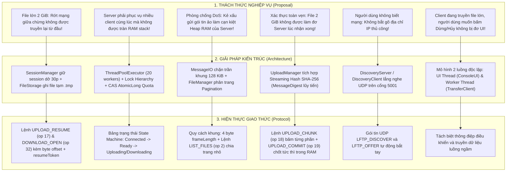
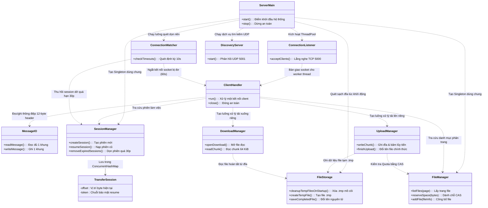
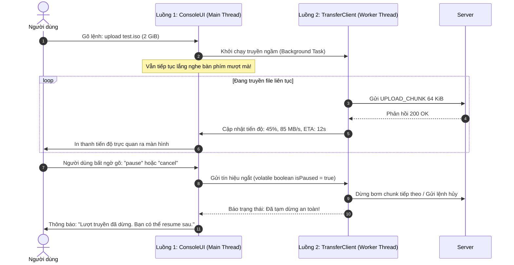
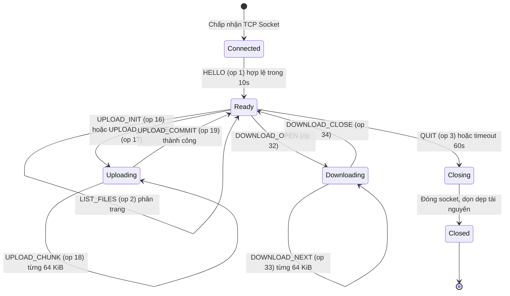
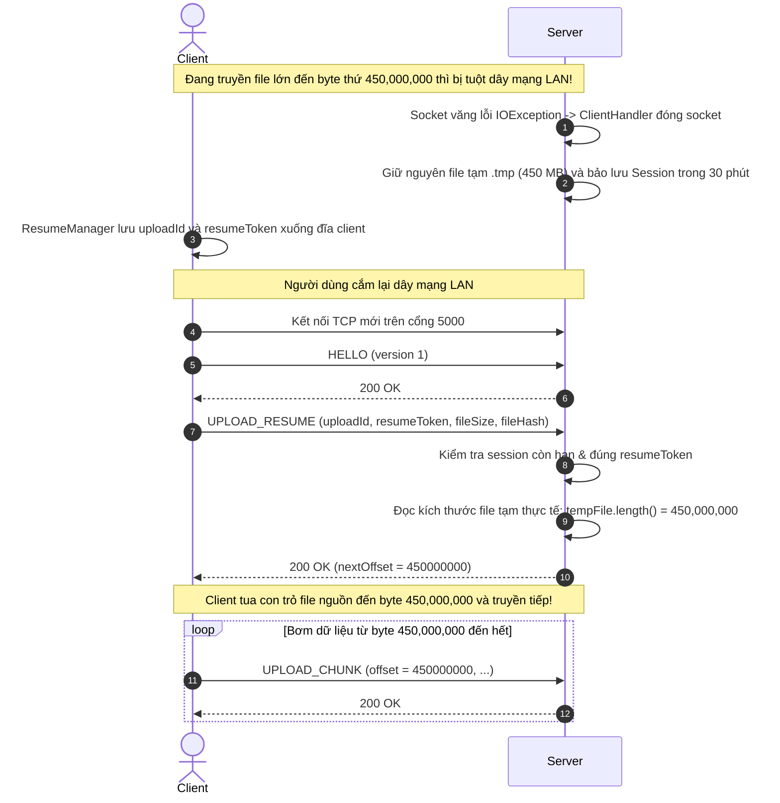
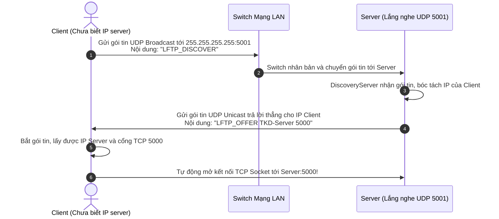
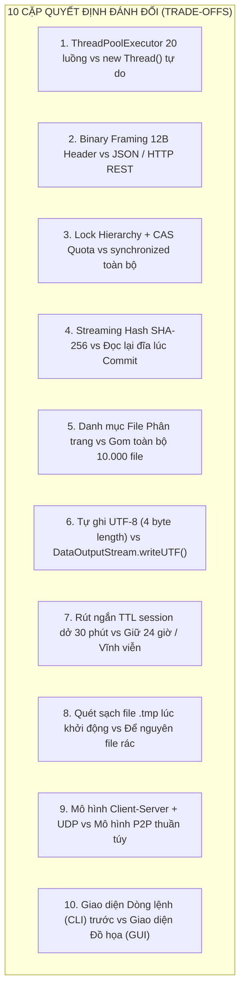

# BẢN BẢO VỆ CHUYÊN SÂU ĐỒ ÁN LẬP TRÌNH MẠNG (ORAL DEFENSE MASTERCLASS)
## HỆ THỐNG TRUYỀN TỆP TIN CẬY TRONG MẠNG NỘI BỘ — GIAO THỨC LFTP/1 (LAN FILE TRANSFER PROTOCOL)
**Người bảo vệ:** Sinh viên Trưởng nhóm TKD (Nguyễn Trung Tường / Bùi Văn Đạt / Nguyễn Đình Khải)  
**Tư cách:** Tác giả khởi xướng đề tài, thiết kế kiến trúc hệ thống, chuẩn hóa đặc tả giao thức LFTP/1 và chỉ đạo AI coding agent triển khai mã nguồn  
**Tài liệu cơ sở:** [`tmp/proposal.md`](file:///d:/project/BTL%20LTM/tmp/proposal.md), [`tmp/architectureV2.md`](file:///d:/project/BTL%20LTM/tmp/architectureV2.md), [`tmp/protocol-design.md`](file:///d:/project/BTL%20LTM/tmp/protocol-design.md)

---

> [!IMPORTANT]
> ### LỜI THƯA ĐẦU TIÊN TRƯỚC THẦY GIÁO & HỘI ĐỒNG BẢO VỆ
> *"Kính thưa Thầy và các thầy cô trong Hội đồng,*  
> *Hôm nay, em xin đại diện cho nhóm TKD đứng trước Thầy để trực tiếp bảo vệ toàn bộ đồ án xây dựng ứng dụng truyền tệp trong mạng nội bộ. Trước khi đi vào chi tiết kỹ thuật, em xin phép được làm rõ phương pháp làm việc và vai trò của em trong đồ án này:*
> 1. *Em là người trực tiếp phát hiện vấn đề thực tế từ môi trường văn phòng, đưa ra đề xuất bài toán (Proposal), trực tiếp thiết kế toàn bộ kiến trúc phân tầng (Architecture), quy định chi tiết từng byte trong khuôn dạng giao thức (Protocol Specification), và đưa ra mọi quyết định kỹ thuật then chốt.*
> 2. *Về phần mã nguồn, em đã sử dụng AI coding agent đóng vai trò như một lập trình viên cấp dưới (Junior Developer). Em đóng vai trò là Kiến trúc sư trưởng (System Architect): em giao đầu bài, cung cấp tài liệu thiết kế đặc tả chi tiết, kiểm soát chặt chẽ từng class, từng luồng, và bắt buộc mã nguồn sinh ra phải tuân thủ nghiêm ngặt 100% các nguyên lý hệ thống mà em đã đặt ra.*
> 3. *Chính vì vậy, hôm nay đứng trước Thầy, em hoàn toàn làm chủ hệ thống này từ gốc rễ lý thuyết mạng, hệ điều hành đến từng dòng lệnh. Em xin phép được trình bày tường tận: Hệ thống này làm gì? Tại sao lại làm như vậy? Mối liên hệ hữu cơ giữa các thành phần ra sao? Và vì sao lại là phương án A chứ không phải phương án A'!"*

---

# MỤC LỤC TRÌNH BÀY
1. [Khởi nguồn Đề tài: Bản chất Bài toán thực tế & Tại sao Cloud thất bại trong mạng LAN?](#1-khởi-nguồn-đề-tài-bản-chất-bài-toán-thực-tế--tại-sao-cloud-thất-bại-trong-mạng-lan)
2. [Sợi dây liên kết nhân quả: Proposal $\rightarrow$ Architecture $\rightarrow$ Protocol $\rightarrow$ Implementation](#2-sợi-dây-liên-kết-nhân-quả-proposal--architecture--protocol--implementation)
3. [Giải phẫu Kiến trúc Hệ thống (Architecture Deep-Dive): Cái A sinh ra để làm gì?](#3-giải-phẫu-kiến-trúc-hệ-thống-architecture-deep-dive-cái-a-sinh-ra-để-làm-gì)
4. [Nghệ thuật Kiểm soát Concurrency & Triệt tiêu Deadlock 100%](#4-nghệ-thuật-kiểm-soát-concurrency--triệt-tiêu-deadlock-100)
5. [Giải phẫu Giao thức LFTP/1 (Protocol Deep-Dive): Từng Byte đều có lý do sinh tồn](#5-giải-phẫu-giao-thức-lftp1-protocol-deep-dive-từng-byte-đều-có-lý-do-sinh-tồn)
6. [Nghệ thuật Tối ưu I/O & Tính toán Toàn vẹn Dữ liệu (Streaming Hash)](#6-nghệ-thuật-tối-ưu-io--tính-toán-toàn-vẹn-dữ-liệu-streaming-hash)
7. [Cơ chế Phục hồi khi Rớt mạng (Checkpoint & Resume với resumeToken)](#7-cơ-chế-phục-hồi-khi-rớt-mạng-checkpoint--resume-với-resumetoken)
8. [Cơ chế Tự tìm Server trong LAN bằng UDP Broadcast Discovery](#8-cơ-chế-tự-tìm-server-trong-lan-bằng-udp-broadcast-discovery)
9. [Ma trận 10 Quyết định Đánh đổi Cốt tử (Tại sao chọn A chứ không phải A'?)](#9-ma-trận-10-quyết-định-đánh-đổi-cốt-tử-tại-sao-chọn-a-chứ-không-phải-a)
10. [An toàn Hệ thống, Phòng chống Tấn công & Đóng gói Docker](#10-an-toàn-hệ-thống-phòng-chống-tấn-công--đóng-gói-docker)
11. [Lời kết luận trước Hội đồng](#11-lời-kết-luận-trước-hội-đồng)

---

# 1. KHỞI NGUỒN ĐỀ TÀI: BẢN CHẤT BÀI TOÁN THỰC TẾ & TẠI SAO CLOUD THẤT BẠI TRONG MẠNG LAN?

### 1.1. Bản chất vật lý của mạng máy tính: LAN vs. WAN
*Thưa Thầy, để hiểu vì sao em đề xuất đề tài này, ta phải nhìn vào bản chất vật lý của hai hạ tầng mạng: Mạng cục bộ (LAN) và Mạng diện rộng (WAN/Internet):*

| Thông số vật lý | Hạ tầng Mạng LAN Nội bộ (Văn phòng / Lab) | Đường truyền Internet ra ngoài (WAN / Cloud) |
|---|---|---|
| **Băng thông vật lý** | Cáp Cat6 Gigabit: $1000 \text{ Mbps} \approx \mathbf{125 \text{ MB/s}}$ | Gói cước doanh nghiệp chia sẻ: $50 - 100 \text{ Mbps} \approx \mathbf{6 - 12 \text{ MB/s}}$ |
| **Độ trễ khứ hồi (RTT)** | Cực nhỏ: $\mathbf{< 1 \text{ ms}}$ (chỉ qua 1 switch nội bộ) | Lớn và biến động: $\mathbf{20 - 80 \text{ ms}}$ (qua hàng chục router ISP) |
| **Chi phí truyền tải** | Hoàn toàn miễn phí, không tốn data ra ngoài | Tốn cước băng thông quốc tế/trong nước, phụ thuộc ISP |
| **Tính an ninh dữ liệu** | Dữ liệu chạy khép kín trong switch nội bộ công ty | Dữ liệu phải đi qua hạ tầng công cộng của bên thứ 3 |

### 1.2. Thảm họa hiệu năng khi dùng Google Drive trong văn phòng
Hãy tưởng tượng tình huống điển hình:
Hai kỹ sư $A$ và $B$ ngồi cạnh nhau trong phòng nghiên cứu, cùng cắm dây mạng vào cùng một Switch mạng LAN Gigabit. Kỹ sư $A$ muốn gửi cho kỹ sư $B$ một tệp ảnh đĩa hệ điều hành hoặc cơ sở dữ liệu nặng **2 GiB**.
Thói quen thông thường: Kỹ sư $A$ tải file lên Google Drive, rồi gửi link cho $B$ tải về.
Hậu quả kỹ thuật diễn ra:
1. **Dữ liệu đi đường vòng vô nghĩa (Tốn thời gian gấp 20 lần):**
   - File 2 GiB bị đẩy qua cổng Internet nội hạt với tốc độ tải lên khiêm tốn (giả sử $8 \text{ MB/s}$): mất $\approx 4.2 \text{ phút}$.
   - File nằm trên máy chủ Google ở Singapore hoặc Mỹ.
   - Kỹ sư $B$ bấm tải về với tốc độ tải xuống ($12 \text{ MB/s}$): mất thêm $\approx 2.8 \text{ phút}$.
   - **Tổng thời gian chờ đợi:** $4.2 + 2.8 = \mathbf{7 \text{ phút}}$.
   - *Trong khi đó, nếu truyền trực tiếp qua mạng LAN Gigabit:* Tốc độ thực tế đạt $80 - 100 \text{ MB/s}$, truyền trọn vẹn 2 GiB chỉ mất vỏn vẹn **20 giây**! Chúng ta đang lãng phí hơn 95% thời gian làm việc của nhân sự.
2. **Rủi ro rò rỉ dữ liệu nội bộ (Data Privacy Breach):**
   - Tài liệu nhạy cảm, mã nguồn dự án, dữ liệu khách hàng bị lưu trữ trên hạ tầng máy chủ của một tập đoàn thứ ba. Điều này vi phạm quy định bảo mật của các cơ quan nhà nước, ngân hàng và doanh nghiệp công nghệ.
3. **Sự phụ thuộc tê liệt vào Internet:**
   - Nếu xảy ra sự cố đứt cáp quang biển hoặc ISP bảo trì đường truyền, toàn bộ văn phòng bị ngưng trệ trao đổi dữ liệu, trong khi dây mạng LAN kết nối giữa các máy trong phòng vẫn hoạt động hoàn hảo 100%!

### 1.3. Đề xuất của em (The Proposal)
Em đề xuất xây dựng ứng dụng truyền tệp mạng nội bộ **LFTP/1** theo mô hình Client-Server chuyên dụng:
- Một máy tính trong phòng đóng vai trò Server nội bộ (chạy trực tiếp hoặc qua Docker).
- Mọi client trong mạng LAN tự động tìm thấy Server này qua gói tin **UDP Broadcast** mà không cần cấu hình thủ công.
- Dữ liệu được truyền qua kênh TCP Socket nhị phân chuyên dụng, đạt tốc độ dây dẫn tối đa ($100 \text{ MB/s}$), hoàn toàn không phụ thuộc Internet, bảo mật tuyệt đối 100% trong nội bộ.

---

# 2. SỢI DÂY LIÊN KẾT NHÂN QUẢ: PROPOSAL $\rightarrow$ ARCHITECTURE $\rightarrow$ PROTOCOL $\rightarrow$ IMPLEMENTATION

*Thưa Thầy, một sai lầm phổ biến của sinh viên là nghĩ ra giao thức một đằng, vẽ kiến trúc một nẻo và viết code một nẻo khác. Ở đồ án này, em đã thiết lập một chuỗi mắt xích nhân quả 1-1 không thể tách rời:*

$$\mathbf{Thách\;thức\;nghiệp\;vụ\;(Proposal)} \;\implies\; \mathbf{Thành\;phần\;kiến\;trúc\;(Architecture)} \;\implies\; \mathbf{Cơ\;chế\;giao\;thức\;(Protocol)} \;\implies\; \mathbf{Hiện\;thực\;mã\;nguồn}$$



---

# 3. GIẢI PHẪU KIẾN TRÚC HỆ THỐNG: CÁI A SINH RA ĐỂ LÀM GÌ?

*Thưa Thầy, em xin giải trình cụ thể từng thành phần trong hệ thống: Thành phần A là gì? Sinh ra để làm gì? Và nó phối hợp với thành phần B như thế nào?*



### 3.1. Trách nhiệm của từng Class & Sự phối hợp giữa chúng:
1. **`ServerMain` (Tổng chỉ huy):**
   - *Để làm gì?* Là điểm khởi đầu (Entry Point). Nếu không có `ServerMain`, các dịch vụ sẽ khởi động lộn xộn.
   - *Mối quan hệ:* `ServerMain` khởi tạo 3 tài nguyên dùng chung cốt lõi: `FileStorage`, `FileManager`, `SessionManager`. **Hành động sống còn:** Trước khi mở cổng mạng cho client kết nối, `ServerMain` bắt buộc phải gọi `fileStorage.cleanupTempFilesOnStartup()`. Hành động này quét sạch toàn bộ các file `.tmp` mồ côi do lần tắt máy đột ngột trước đó để lại, trả lại đĩa cứng sạch sẽ.
2. **`ConnectionListener` (Người gác cổng TCP):**
   - *Để làm gì?* Lắng nghe hàm `ServerSocket.accept()` trên cổng 5000. Nó nắm giữ con số `MAX_CLIENTS = 20`. Khi có kết nối mới, nó kiểm tra số lượng client đang phục vụ. Nếu chưa đủ 20, nó đóng gói Socket thành một nhiệm vụ (`ClientHandler`) và đẩy vào `ThreadPoolExecutor`. Nếu đã đủ 20, nó đóng socket ngay lập tức để bảo vệ server.
3. **`ClientHandler` (Người phục vụ riêng từng Client):**
   - *Để làm gì?* Chạy trên một worker thread riêng biệt trong Thread Pool để phục vụ trọn vẹn một kết nối TCP từ lúc bắt tay `HELLO` đến lúc ngắt kết nối.
   - *Mối quan hệ:* `ClientHandler` không tự xử lý byte thô mà ủy quyền cho `MessageIO`. Khi nhận được thông điệp, tùy theo `opcode`, nó sẽ gọi sang `UploadManager`, `DownloadManager` hoặc `FileManager`.
4. **`MessageIO` (Người phiên dịch giao thức):**
   - *Để làm gì?* Là lớp dùng chung duy nhất cho cả Client và Server. Nó chuyên trách giải mã (decode) và đóng gói (encode) cấu trúc 12-byte header. Nó đảm bảo đọc trọn vẹn một khung dữ liệu nhị phân trước khi đưa cho tầng nghiệp vụ xử lý.
5. **`SessionManager` (Bộ nhớ phiên truyền tải):**
   - *Để làm gì?* Quản lý trạng thái các phiên truyền dở trong bộ nhớ RAM bằng bảng băm an toàn luồng `ConcurrentHashMap<String, TransferSession>`.
   - *Mối quan hệ:* Cấp phát mã `uploadId` và mã bảo mật `resumeToken`. Khi một client bị đứt mạng và kết nối lại, `SessionManager` giúp hệ thống nhận diện đúng phiên truyền cũ và cho phép truyền tiếp từ byte đĩa thực tế.
6. **`UploadManager` & `DownloadManager` (Công nhân truyền file):**
   - *Để làm gì?* Tách rời hoàn toàn nghiệp vụ Upload và Download.
   - `UploadManager` nhận từng chunk 64 KiB, ghi vào file `.tmp` qua `FileStorage` và đồng thời đẩy vào thuật toán băm lũy tiến SHA-256.
   - `DownloadManager` mở file chính thức bằng luồng đọc riêng, theo dõi vị trí con trỏ đĩa và bơm từng chunk về cho client.
7. **`FileManager` (Thủ thư & Người giữ ví dung lượng):**
   - *Để làm gì?* Quản lý danh mục file hoàn tất và kiểm soát dung lượng lưu trữ (Storage Quota tối đa 10 GiB). Sử dụng biến nguyên tử `AtomicLong` với giải thuật CAS không khóa để trừ/cộng dung lượng, triệt tiêu hoàn toàn nguy cơ tranh chấp tài nguyên.
8. **`ConnectionWatcher` (Cảnh sát dọn rác định kỳ):**
   - *Để làm gì?* Một luồng chạy ngầm định kỳ 10 giây một lần để xử lý 2 trường hợp:
     - Socket bị "treo" (client không gửi dữ liệu quá 60 giây) $\rightarrow$ Ép đóng socket để trả worker thread về Thread Pool.
     - Session tải dở bị bỏ rơi quá 30 phút $\rightarrow$ Ra lệnh xóa file tạm `.tmp` trên đĩa và hoàn trả dung lượng Quota ảo cho Server.
9. **`DiscoveryServer` (Ngọn hải đăng UDP):**
   - *Để làm gì?* Chạy trên cổng UDP 5001. Khi nhận gói tin broadcast `"LFTP_DISCOVER"` từ client, nó trả lời ngay địa chỉ IP và cổng TCP 5000 của server để client tự động kết nối.

---

### 3.2. Mô hình 2 luồng phía Client: Tại sao phải tách rời UI và Network?

*Thưa Thầy, một lỗi kinh điển của các ứng dụng mạng dòng lệnh (CLI) là bị đóng băng giao diện khi đang truyền file:*



- **Nếu chỉ dùng 1 luồng duy nhất:** Hàm `socket.getOutputStream().write()` và `read()` là các hàm chặn (Blocking). Khi đang bơm file 2 GiB, CPU của luồng chính bị giam cứng trong việc trao đổi dữ liệu mạng. Bàn phím người dùng bị vô hiệu hóa hoàn toàn. Nếu người dùng muốn dừng khẩn cấp vì chọn nhầm file, họ chỉ có cách duy nhất là bấm `Ctrl + C` để giết chết tiến trình!
- **Giải pháp 2 luồng của nhóm:**
  - `ConsoleUI` chạy trên luồng chính, dùng `Scanner` để luôn sẵn sàng đọc phím bấm (`pause`, `resume`, `cancel`, `list`).
  - `TransferClient` chạy trên luồng phụ, xử lý toàn bộ việc đọc đĩa và đẩy socket.
  - Hai luồng giao tiếp với nhau qua biến cờ hiệu nguyên tử và đối tượng `TransferProgress`. Người dùng có toàn quyền kiểm soát lượt truyền bất kỳ lúc nào!

---

# 4. NGHỆ THUẬT KIỂM SOÁT CONCURRENCY & TRIỆT TIÊU DEADLOCK 100%

*Thưa Thầy, làm ứng dụng đa luồng (Multi-threading) trong Java rất dễ gặp phải hai "cơn ác mộng": Race Condition (Tranh chấp dữ liệu) và Deadlock (Bế tắc luồng). Nhóm đã áp dụng 3 nguyên lý cấp cao để triệt tiêu hoàn toàn các nguy cơ này:*

### 4.1. Thứ bậc lấy khóa nghiêm ngặt (Strict Lock Hierarchy)
Điều kiện tiên quyết để xảy ra Deadlock trong lý thuyết hệ điều hành là **Chờ đợi vòng tròn (Circular Wait)**: Luồng 1 giữ khóa $A$ chờ khóa $B$, trong khi Luồng 2 giữ khóa $B$ chờ khóa $A$.
Để phá vỡ hoàn toàn chu trình này, hệ thống thiết lập một quy tắc thứ bậc khóa bất biến:

$$\text{Level 1: } \mathbf{SessionManager} \;\longrightarrow\; \text{Level 2: } \mathbf{TransferSession} \;\longrightarrow\; \text{Level 3: } \mathbf{FileManager}$$

```text
Luồng A (Upload Commit):  [Lấy khóa Level 2] ---> Nhả Level 2 ---> [Lấy khóa Level 3] (ĐÚNG THỨ TỰ)
Luồng B (Watcher Dọn dẹp): [Lấy khóa Level 1] ---> [Lấy khóa Level 2] ---> [Lấy khóa Level 3] (ĐÚNG THỨ TỰ)
=> CÙNG MỘT CHIỀU DUY NHẤT, KHÔNG BAO GIỜ CÓ CHIỀU NGƯỢC LẠI => TRIỆT TIÊU DEADLOCK!
```

- **Quy tắc vàng:** Luồng chỉ được phép lấy khóa từ Level thấp đến Level cao (Level 1 $\rightarrow$ Level 2 $\rightarrow$ Level 3).
- **Luật cấm kỵ:** Tuyệt đối không một hàm nào thuộc `FileManager` (Level 3) được phép gọi ngược lại phương thức có khóa của `TransferSession` (Level 2) hoặc `SessionManager` (Level 1).

### 4.2. Nguyên tắc Trích xuất dữ liệu trước khi xử lý (Snapshot before processing - Tránh lồng khóa)
*Thay vì giữ khóa của đối tượng này rồi chạy sang gọi đối tượng kia, nhóm áp dụng kỹ thuật Snapshot:*
- **Khi Commit File:** Luồng `ClientHandler` khóa `TransferSession` trong vài micro-giây chỉ để đổi trạng thái thành `COMPLETED` và copy thông tin file ra một đối tượng độc lập `FileInfo`. Ngay lập tức, luồng **buông khóa `TransferSession` ra!** Sau khi đã tay không, luồng mới bước sang gọi `fileManager.addFile(fileInfo)` (chỉ giữ khóa của `FileManager`). Hai khóa không bao giờ bị lồng vào nhau tại cùng một thời điểm!
- **Khi Dọn dẹp Session quá hạn:** Luồng `ConnectionWatcher` khóa bảng session chỉ để lấy ra danh sách các `uploadId` đã hết hạn vào một `List<String> expiredIds` tạm thời rồi nhả khóa ngay. Sau đó, nó duyệt danh sách này để xóa file đĩa mà không hề chiếm giữ khóa của bảng session.

### 4.3. Quản lý hạn ngạch đĩa không khóa (Lock-free Quota bằng CAS)
Server có hạn ngạch lưu trữ là 10 GiB (`STORAGE_QUOTA_BYTES = 10737418240L`). Nhiều client cùng tải file lên đồng thời sẽ tranh chấp việc trừ/cộng dung lượng.
Nếu dùng `synchronized`, các client sẽ phải xếp hàng chờ đợi nhau. Nhóm sử dụng biến nguyên tử `AtomicLong` với giải thuật **Compare-And-Swap (CAS)** chạy trực tiếp trên thanh ghi CPU:

```java
public void reserveSpace(long bytes) throws RequestException {
    while (true) {
        long currentReserved = reservedBytes.get();
        long currentUsed = usedBytes.get();
        
        // Kiểm tra xem tổng dung lượng thực tế và dung lượng đang dành trước có vượt trần không
        if (currentUsed + currentReserved + bytes > STORAGE_QUOTA_BYTES) {
            throw new RequestException(Protocol.STATUS_STORAGE_UNAVAILABLE, 
                "Server het dung luong luu tru (Toi da 10 GiB)!");
        }
        
        // Thao tác nguyên tử ở mức phần cứng: Nếu giá trị vẫn là currentReserved thì tăng thêm bytes
        if (reservedBytes.compareAndSet(currentReserved, currentReserved + bytes)) {
            break; // Dành chỗ thành công tuyệt đối mà không cần dùng bất kỳ monitor lock nào!
        }
        // Nếu luồng khác vừa nhanh chân cập nhật trước, vòng lặp while(true) sẽ tự động thử lại ngay!
    }
}
```
*Vì thao tác này hoàn toàn không dùng khóa (Lock-free), tài nguyên Quota vĩnh viễn không thể là nguyên nhân gây ra Deadlock!*

---

# 5. GIẢI PHẪU GIAO THỨC LFTP/1: TỪNG BYTE ĐỀU CÓ LÝ DO SINH TỒN

*Thưa Thầy, một trong những thách thức lớn nhất của lập trình Socket TCP là xử lý hiện tượng Stream of Bytes. Nhóm đã tự tay thiết kế giao thức nhị phân LFTP/1 chuẩn mực đến từng bit:*

### 5.1. Tại sao cấm dùng Delimiter `\n` và bắt buộc dùng Length-Prefixed?
- **Cách dùng ký tự ngăn cách (Delimiter-based như HTTP/SMTP):** Kết thúc thông điệp bằng ký tự `\r\n` (xuống dòng).
  *Tại sao cách này thất bại khi truyền file?* Vì nội dung một file nhị phân (như file `.zip`, `.mp4`, `.exe`) chứa hàng triệu byte ngẫu nhiên từ `0x00` đến `0xFF`. Byte `0x0A` chính là mã ASCII của ký tự `\n`! Nếu dùng delimiter, máy nhận vừa đọc trúng byte `0x0A` nằm giữa file sẽ tưởng nhầm là kết thúc gói tin và cắt vụn dữ liệu ra, phá hủy hoàn toàn cấu trúc của file!
- **Giải pháp Length-Prefixed của nhóm:** Đặt một trường số nguyên 4 byte ghi rõ độ dài `frameLength` ở đầu mỗi bản tin. Bên nhận đọc đủ 4 byte $\rightarrow$ biết chính xác mình phải đọc thêm bao nhiêu byte nữa thì bản tin kết thúc.

```text
|<--- 4 bytes --->|<------------- 12 bytes Header cố định ------------->|<--- Payload --->|
+-----------------+---------+--------+-----------------------+--------+-----------------+
|   frameLength   | version | opcode |       requestId       | status |      body       |
|     (4 byte)    | (1 byte)| (1 byte|        (8 byte)       | (2 byte| (frameLen - 12B)|
+-----------------+---------+--------+-----------------------+--------+-----------------+
```

### 5.2. Giải phẫu chi tiết 12-byte Header cố định:
1. **`frameLength` (4 byte, `int`, Big-Endian):**
   - Xác định tổng độ dài từ trường `version` đến hết phần `body`.
   - **Quy tắc an toàn sống còn:** Server đọc 4 byte này và kiểm tra ngay lập tức:
     $$12 \le \text{frameLength} \le 131072 \text{ bytes (128 KiB)}$$
   - Nếu client gửi `frameLength < 12` (không đủ chứa header) hoặc `frameLength > 128 KiB`, server lập tức đóng socket. Điều này ngăn chặn hoàn toàn việc client gửi độ dài ảo (ví dụ 2 tỷ) làm server cấp phát mảng byte khổng lồ gây tràn bộ nhớ Heap (`OutOfMemoryError`).
2. **`version` (1 byte, `u8`):** Giá trị hiện tại là `1`. Cho phép hệ thống nâng cấp giao thức trong tương lai (ví dụ LFTP/2 có nén dữ liệu hoặc mã hóa TLS) mà không làm sập các client phiên bản cũ. Nếu client gửi version lạ, server từ chối ngay bằng mã lỗi `505 UNSUPPORTED_VERSION`.
3. **`opcode` (1 byte, `u8`):** Xác định thao tác cần thực hiện. 1 byte hỗ trợ tới 256 lệnh khác nhau, cực kỳ gọn nhẹ so với việc gửi chuỗi text `"UPLOAD"`, `"DOWNLOAD"`.
4. **`requestId` (8 byte, `long`):** Số nguyên dương tăng dần cho từng kết nối. Khi client gửi một yêu cầu với `requestId = 105`, server trả lời cũng bắt buộc mang `requestId = 105`. Điều này giúp client đối chiếu chính xác phản hồi nào thuộc về yêu cầu nào, loại bỏ hoàn toàn việc nhận nhầm kết quả.
5. **`status` (2 byte, `u16`):** Khi client gửi lệnh, trường này luôn bằng `0`. Khi server trả lời, trường này chứa các mã trạng thái chuẩn hóa (200 OK, 201 Created, 400 Bad Request, 403 Forbidden, 404 Not Found, 409 Conflict, 413 File Too Large, 422 Hash Mismatch, 500 Internal Error, 507 Storage Unavailable).
6. **`body` (Biến thiên = $\text{frameLength} - 12$ bytes):** Chứa dữ liệu riêng của từng lệnh mà không cần thêm bất kỳ byte header thừa thãi nào.

---

### 5.3. Bảng 9 Opcode TCP: Vận hành trọn vẹn vòng đời truyền tệp



1. **`HELLO` (opcode 1):** Bắt tay đầu tiên. Client gửi tên máy (`clientName`). Server trả lời tên server, mã kết nối duy nhất (`connectionId`), kích thước chunk thỏa thuận (`chunkSize = 65536`), dung lượng file tối đa cho phép (`maxFileBytes = 2 GiB`) và trần khung (`maxFrameBytes = 128 KiB`).
2. **`LIST_FILES` (opcode 2):** Xem danh mục file hoàn tất. Client gửi số trang (`pageIndex`) và kích thước trang (`pageSize`). Server trả về tổng số file và danh sách file trong trang đó kèm mã băm SHA-256 để client kiểm tra.
3. **`QUIT` (opcode 3):** Client báo cho server biết mình muốn đóng kết nối một cách lịch sự để server giải phóng tài nguyên ngay mà không cần đợi timeout.
4. **`UPLOAD_INIT` (opcode 16):** Khởi tạo lượt tải lên mới. Client gửi tên file hiển thị, dung lượng file (`fileSize`), và mã băm SHA-256 toàn bộ file nguồn (`fileHash` 32 byte thô). Server kiểm tra Quota bằng CAS, nếu đủ chỗ sẽ cấp phát `uploadId`, sinh chuỗi bảo mật `resumeToken` và tạo file tạm `.tmp`.
5. **`UPLOAD_RESUME` (opcode 17):** Khôi phục lượt tải dở bị rớt mạng. Client xuất trình `uploadId`, `resumeToken`, dung lượng và mã hash. Server kiểm tra session còn trong hạn 30 phút hay không, đối chiếu kích thước thực tế trên đĩa và trả về `nextOffset` để client gửi tiếp.
6. **`UPLOAD_CHUNK` (opcode 18):** Gửi từng phần dữ liệu file. Payload gồm: `uploadId`, `resumeToken`, vị trí byte bắt đầu (`offset`), độ dài dữ liệu (`dataLength`) và mảng dữ liệu byte thô (`data[]`).
7. **`UPLOAD_COMMIT` (opcode 19):** Chốt hoàn tất file. Server đối chiếu mã băm lũy tiến cuối cùng. Nếu khớp, server đổi tên file tạm `.tmp` thành file chính thức, đưa vào danh mục và công nhận hoàn tất.
8. **`DOWNLOAD_OPEN` (opcode 32):** Mở lượt tải xuống. Client gửi mã file (`fileId`) và vị trí byte muốn nhận (`requestedOffset`). Cho phép client tải mới từ byte 0 hoặc tải tiếp phần còn dở trên máy client.
9. **`DOWNLOAD_NEXT` (opcode 33):** Client kéo từng chunk dữ liệu 64 KiB từ server về máy.
10. **`DOWNLOAD_CLOSE` (opcode 34):** Client báo cáo đã tải xong và thông báo kết quả kiểm tra mã băm SHA-256 cục bộ (`verified = 1` hoặc `0`). Server đóng luồng đọc file và xóa session download.

---

# 6. NGHỆ THUẬT TỐI ƯU I/O & TÍNH TOÁN TOÀN VẸN DỮ LIỆU (STREAMING HASH)

*Thưa Thầy, một trong những điểm sáng nhất về mặt giải thuật trong đồ án của em là cơ chế Streaming Hash:*

### 6.1. Phân tích sự sụp đổ của giải pháp ngây thơ (Post-transfer Hash)
Nhiều sinh viên khi làm truyền file thường chọn cách: Cứ nhận hết file 2 GiB xuống đĩa đi, khi nào client báo xong thì mở file đó ra, đọc tuần tự từ byte đầu đến byte cuối để tính mã SHA-256.
*Điều gì sẽ xảy ra trên máy chủ?*
- Việc đọc lại toàn bộ file dung lượng lớn trên đĩa cứng gây nghẽn I/O đĩa kéo dài, luồng worker thread bị chặn cứng trong vòng lặp đọc đĩa.
- Trong thời gian đọc đĩa này, kết nối TCP Socket không nhận được bất kỳ thông điệp nào mới. Hàm đọc socket bên phía client có nguy cơ chạm ngưỡng quá hạn thời gian chờ (`SocketTimeoutException` theo `Protocol.TIMEOUT_READ_MS = 60s`) và tự động ngắt kết nối, khiến toàn bộ tiến trình truyền tải trước đó bị đổ vỡ chỉ vì bước xác thực cuối cùng bị tắc nghẽn I/O.

### 6.2. Giải pháp Streaming Hash SHA-256 lũy tiến của nhóm
Thuật toán mật mã học SHA-256 hoạt động theo nguyên lý chia nhỏ dòng dữ liệu thành các khối 512-bit (64 byte) và duy trì một biến trạng thái nội bộ 256-bit (State Register). Nhóm đã tận dụng tối đa đặc tính này:

$$\mathbf{Network\;Chunk\;(64\;KiB)} \;\implies\; \begin{cases} \mathbf{FileStorage.write(chunk)} & \text{(Ghi đĩa ngay)} \\ \mathbf{MessageDigest.update(chunk)} & \text{(Cập nhật trạng thái băm vào RAM)} \end{cases}$$

```java
// Trong lớp UploadManager:
public synchronized void writeChunk(long offset, byte[] data, int length) throws IOException {
    // 1. Ghi dữ liệu vào file tạm trên đĩa
    tempFileRandomAccess.seek(offset);
    tempFileRandomAccess.write(data, 0, length);
    
    // 2. Đồng thời cập nhật ngay vào bảng băm lũy tiến trong bộ nhớ RAM
    sha256Digest.update(data, 0, length);
    
    this.currentOffset += length;
}
```

- **Kết quả kỳ diệu ở bước COMMIT:**
  Khi client gửi lệnh `UPLOAD_COMMIT`, file đã được ghi xong và mã băm cũng đã được tính toán xong 100%!
  Server chỉ việc thực hiện một lệnh duy nhất:
  ```java
  byte[] finalHash = sha256Digest.digest(); // Lấy kết quả băm trong bộ nhớ RAM!
  ```
  Thao tác này diễn ra **tức thì ngay trong bộ nhớ RAM** (không tốn thêm bất kỳ lượt đọc đĩa cứng nào). Server so khớp 32 byte này với `fileHash` gốc của client. Nếu trùng khớp, server đổi tên file nguyên tử và trả lời thành công ngay lập tức. Socket không bao giờ bị timeout!

---

# 7. CƠ CHẾ PHỤC HỒI KHI RỚT MẠNG (CHECKPOINT & RESUME VỚI RESUMETOKEN)

*Thưa Thầy, trong mạng máy tính, rớt mạng giữa chừng không phải là "tai nạn", mà là một "đặc tính" tất yếu phải tính đến. Hệ thống của nhóm giải quyết bài toán này ra sao?*



### 7.1. Tại sao vị trí tiếp tục (`nextOffset`) bắt buộc phải do Server quyết định?
Nếu server hỏi client: "Cậu đã gửi đến đâu rồi?" và client trả lời: "Tôi đã gửi đến byte thứ 500,000,000", server tin lời và nhận tiếp từ đó.
*Thảm họa xảy ra:* Dữ liệu truyền qua mạng có thể bị kẹt trong bộ đệm TCP của hệ điều hành. Khi đứt dây mạng, 50 MB dữ liệu cuối cùng mới chỉ nằm ở card mạng của client chứ chưa kịp ghi xuống đĩa cứng của server. Nếu server nhảy cóc lên byte thứ 500 triệu, file trên server sẽ bị một "lỗ hổng" 50 MB ở giữa $\rightarrow$ File hỏng hoàn toàn!
**Nguyên tắc bất di bất dịch của em:** Server chỉ tin vào con trỏ đĩa thực tế của mình:
$$\text{nextOffset} = \text{fileStorage.getTempFileSize(uploadId)}$$
Server trả về con số này. Client bắt buộc phải đồng bộ con trỏ đọc của mình theo con số của Server.

### 7.2. Tại sao phải có `resumeToken`? (Bảo mật phiên truyền tải)
Mỗi lượt upload có một mã `uploadId` (ví dụ: `up-001`). Nếu hệ thống chỉ dùng `uploadId` để resume, một kẻ xấu hoặc một máy client khác trong mạng LAN có thể quét và gửi lệnh:
`UPLOAD_RESUME uploadId=up-001`
Kẻ xấu có thể bơm dữ liệu rác vào chèn ngang lượt truyền của người khác để phá hoại file.
**Giải pháp bảo mật của nhóm:** Khi khởi tạo `UPLOAD_INIT`, server sử dụng thư viện mật mã sinh ra một chuỗi ngẫu nhiên 128-bit bảo mật cao:
$$\text{resumeToken} = \text{UUID.randomUUID().toString()}$$
Token này chỉ được trả riêng cho chính client khởi tạo. Khi client muốn resume, nó bắt buộc phải gửi kèm đúng `resumeToken` này. Nếu sai token, server lập tức từ chối bằng mã lỗi `403 FORBIDDEN`.

---

# 8. CƠ CHẾ TỰ TÌM SERVER TRONG LAN BẰNG UDP BROADCAST DISCOVERY

*Thưa Thầy, một hệ thống dù mạnh mẽ đến đâu nhưng nếu bắt người dùng văn phòng mỗi sáng phải mở Terminal gõ `ipconfig` xem IP của máy server là gì để kết nối thì trải nghiệm người dùng là một thất bại hoàn toàn!*



### Tại sao lại dùng UDP mà không dùng TCP để tìm Server?
- TCP đòi hỏi phải thiết lập kết nối 1-1 (Unicast) qua quá trình bắt tay 3 bước (Three-way Handshake: SYN $\rightarrow$ SYN-ACK $\rightarrow$ ACK). Để bắt tay TCP, client bắt buộc phải biết trước địa chỉ IP đích. Đây là nghịch lý "con gà và quả trứng": Client chưa biết IP của Server thì không thể mở kết nối TCP để hỏi Server được!
- Giao thức UDP có một khả năng đặc biệt: Hỗ trợ địa chỉ Broadcast toàn cục:
  $$\text{IP Broadcast} = \mathbf{255.255.255.255}$$
  Khi client bắn một gói tin UDP tới địa chỉ này, thiết bị mạng (Switch/Router LAN) có trách nhiệm nhân bản và gửi gói tin đó tới **tất cả các cổng mạng** trong cùng subnet.
- Máy chủ server chạy luồng `DiscoveryServer` trên cổng UDP 5001 sẽ "nhặt" được gói tin, bóc tách địa chỉ IP của client và gửi trả lời gói tin Unicast: `"LFTP_OFFER TKD-Server 5000"`. Client nhận được gói tin, tự động cấu hình địa chỉ IP máy chủ và kết nối TCP Socket tức thì mà người dùng không cần phải nhập bất kỳ ký tự nào!

---

# 9. MA TRẬN 10 QUYẾT ĐỊNH ĐÁNH ĐỔI CỐT TỬ: TẠI SAO CHỌN A CHỨ KHÔNG PHẢI A'?

*Thưa Thầy, đây là bản ma trận trả lời sâu sắc cho câu hỏi: "Tại sao nhóm chọn phương án này mà không chọn phương án kia?":*



### Quyết định 1: Tại sao dùng `ThreadPoolExecutor` có kiểm soát (A) chứ không dùng `new Thread()` cho mỗi kết nối (A')?
- **Phương án A' (`new Thread()`):** Trong máy ảo Java, mỗi `Thread` tương ứng với một thread thực thi của nhân hệ điều hành (Native OS Thread). Mỗi thread này được hệ điều hành cấp phát một vùng nhớ stack riêng biệt (mặc định `-Xss 1MB`). Nếu tạo luồng tự do, khi có nhiều client dồn dập hoặc client cố tình mở hàng trăm kết nối ảo, bộ nhớ của hệ thống sẽ cạn kiệt, dẫn đến lỗi sập toàn bộ máy ảo Java:
  $$\text{java.lang.OutOfMemoryError: unable to create new native thread}$$
- **Lý do chọn A:** Giới hạn cố định 20 worker threads (`MAX_CLIENTS = 20`) kết hợp với hàng đợi có chặn `ArrayBlockingQueue`. Tổng bộ nhớ stack tối đa của toàn bộ worker thread chỉ tốn đúng **20 MB**, bảo đảm máy chủ hoạt động an toàn tuyệt đối trên các máy tính cấu hình văn phòng khiêm tốn.

### Quyết định 2: Tại sao tự thiết kế Binary Framing 12B Header (A) chứ không dùng JSON / HTTP REST (A')?
- **Phương án A' (JSON / REST):** JSON là định dạng văn bản (text-based). Để nhồi dữ liệu file nhị phân vào JSON, người ta bắt buộc phải mã hóa mảng byte sang chuỗi Base64. Do quy tắc mã hóa Base64 dùng 4 ký tự ASCII để biểu diễn mỗi 3 byte nhị phân (tỷ lệ $4/3$), kích thước dữ liệu truyền tải trên dây mạng bị tăng thêm, đồng thời CPU phải gánh thêm tải rất lớn để liên tục encode/decode chuỗi dữ liệu.
- **Lý do chọn A:** Dữ liệu file được giữ nguyên dạng byte nhị phân thô (`byte[]`), đọc từ đĩa và bơm thẳng ra luồng mạng (`OutputStream.write`), tận dụng tối đa băng thông đường truyền mạng mà không chịu thêm phụ phí biến đổi dữ liệu, giảm thiểu tối đa chu kỳ tiêu thụ CPU và cấu trúc 12-byte header cho phép bóc tách gói tin tức thì.

### Quyết định 3: Tại sao dùng Lock Hierarchy 3 cấp và Lock-free CAS Quota (A) chứ không dùng `synchronized` bao trùm (A')?
- **Phương án A' (`synchronized` bao trùm):** Đặt từ khóa `synchronized` trên tất cả các phương thức của `SessionManager`, `TransferSession` và `FileManager`.
  *Hậu quả:* (1) Khi một client đang tải file lớn, mọi client khác gọi vào xem danh mục file đều bị nghẽn (Lock Contention). (2) Luồng Upload giữ khóa Session gọi sang khóa FileManager, trong khi luồng ConnectionWatcher giữ khóa FileManager gọi sang Session $\rightarrow$ Hai luồng chờ chéo nhau, gây ra Deadlock làm tê liệt server hoàn toàn.
- **Lý do chọn A:** Xác lập thứ tự khóa 1 chiều: `SessionManager` $\rightarrow$ `TransferSession` $\rightarrow$ `FileManager`. Kết hợp kỹ thuật Snapshot buông khóa ngay lập tức và dùng biến nguyên tử `AtomicLong` với giải thuật CAS không khóa cho Quota. Triệt tiêu 100% khả năng xảy ra Deadlock.

### Quyết định 4: Tại sao chọn Streaming Hash SHA-256 lũy tiến (A) chứ không đọc lại đĩa lúc hoàn tất (A')?
- **Phương án A' (Đọc lại đĩa):** Khi nhận xong toàn bộ file mới mở file ra đọc lại từ đầu để tính băm. Ổ đĩa bị nghẽn I/O kéo dài, luồng xử lý bị phong tỏa trong vòng lặp đọc file, kết nối socket không có dữ liệu phản hồi mới có nguy cơ bị ngắt do `SocketTimeoutException` (`Protocol.TIMEOUT_READ_MS = 60s`).
- **Lý do chọn A:** Tính toán lũy tiến từng chunk 64 KiB (`Protocol.CHUNK_SIZE`) bằng `MessageDigest.update()` ngay khi dữ liệu vừa vào RAM. Bước xác thực cuối cùng (`digest()`) diễn ra tức thì trong bộ nhớ RAM mà không cần đọc lại đĩa cứng, file được duyệt và lưu ngay lập tức.

### Quyết định 5: Tại sao phân trang danh mục file `LIST_FILES` (A) chứ không gom toàn bộ một lần (A')?
- **Phương án A' (Gom toàn bộ danh mục):** Nếu hệ thống quản lý 10.000 file, mỗi bản ghi metadata tốn khoảng 300 byte. Gom toàn bộ vào một thông điệp sẽ tạo ra gói tin lớn hơn **3 MB**. Điều này buộc server phải nới trần kích thước khung lên rất lớn, tạo kẽ hở cho kẻ xấu gửi gói tin ảo gây cạn kiệt bộ nhớ Heap (`OutOfMemoryError: Java heap space`).
- **Lý do chọn A:** Áp dụng phân trang (`pageIndex`, `pageSize`). Mỗi trang chỉ chứa 50 file, kích thước phản hồi luôn dưới 15 KiB, nằm gọn hoàn toàn trong trần an toàn **128 KiB** của hệ thống.

### Quyết định 6: Tại sao tự ghi chuỗi UTF-8 với 4 byte length (A) chứ không dùng `DataOutputStream.writeUTF()` (A')?
- **Phương án A' (`writeUTF` / `readUTF` của Java):**
  1. `writeUTF` của Java dùng chuẩn Modified UTF-8 (ký tự null `\u0000` bị mã hóa thành 2 byte thay vì 1 byte), không tương thích với các chuẩn quốc tế.
  2. Nguy hiểm hơn, `writeUTF` dùng 2 byte unsigned short để lưu độ dài chuỗi, dẫn đến việc **độ dài chuỗi tối đa bị giới hạn ở 65.535 byte**. Nếu người dùng gửi tên file hoặc metadata dài hơn 64 KiB, hàm sẽ lập tức quăng ngoại lệ `UTFDataFormatException`.
- **Lý do chọn A:** Nhóm tự chuyển chuỗi sang UTF-8 chuẩn (`string.getBytes(StandardCharsets.UTF_8)`), ghi độ dài bằng số nguyên 4 byte `int` (hỗ trợ tới 2 tỷ byte), đảm bảo chuẩn hóa 100% và không bao giờ bị tràn giới hạn.

### Quyết định 7: Tại sao rút ngắn thời gian giữ lượt dở xuống 30 phút (A) mà không phải 24 giờ (A')?
- **Phương án A' (Giữ 24 giờ):** Khi client bắt đầu upload file 2 GiB (`UPLOAD_INIT`), server lập tức dành trước 2 GiB trên Quota (`reservedBytes`). Nếu client bị đứt mạng và bỏ đi mà server giữ chỗ suốt 24 giờ, thì chỉ cần 5 client như vậy sẽ chiếm giữ sạch sẽ toàn bộ 10 GiB hạn ngạch của server, khiến không ai khác tải file lên được nữa ("chiếm dụng tài nguyên ma").
- **Lý do chọn A:** Trong mạng nội bộ, người dùng nếu rớt mạng sẽ kết nối lại ngay trong vài phút. Con số 30 phút là điểm cân bằng hoàn hảo: vừa đủ cho người dùng cắm lại dây mạng để resume, vừa tự động giải phóng đĩa và hạn ngạch ảo khi lượt truyền bị bỏ rơi.

### Quyết định 8: Tại sao tự động dọn sạch file `.tmp` mồ côi lúc khởi động (A) chứ không để mặc kệ (A')?
- **Phương án A' (Để mặc kệ):** Nếu server đang nhận 5 file lớn mà bị mất điện đột ngột hoặc bị tắt tiến trình (`kill -9`), bảng session trong RAM bị mất sạch. Các file `.tmp` ghi dở hàng chục GiB sẽ nằm vĩnh viễn trên đĩa như những file rác vô chủ, làm đầy ổ cứng của máy chủ theo thời gian.
- **Lý do chọn A:** Ngay khi `ServerMain` bật lên, lớp `FileStorage` quét toàn bộ thư mục dữ liệu và xóa sạch tất cả file có đuôi `.tmp`, trả lại trạng thái đĩa cứng tinh sạch trước khi mở cổng nhận kết nối.

### Quyết định 9: Tại sao chọn Client-Server + UDP Discovery (A) chứ không làm P2P thuần túy (A')?
- **Phương án A' (P2P - Peer-to-Peer):** Trong mô hình P2P, máy bạn $A$ gửi file trực tiếp cho máy bạn $B$. Nếu bạn $A$ tắt máy thì bạn $C$ muốn lấy file đó sẽ không thể lấy được. Ngoài ra, việc thiết lập danh mục file phân tán (DHT) và đục lỗ NAT trong P2P cực kỳ phức tạp, vượt quá phạm vi và thời gian của đồ án môn học.
- **Lý do chọn A:** Client-Server bảo đảm kho lưu trữ tập trung (ai up lên thì cả phòng đều thấy và tải được bất cứ lúc nào), kết hợp với UDP Discovery giúp người dùng có được sự tiện lợi tự động nhận diện như P2P mà không phải chịu sự phức tạp không cần thiết.

### Quyết định 10: Tại sao tập trung làm CLI trước (A) mà chưa làm GUI (A')?
- **Phương án A' (Làm GUI trước):** Sinh viên thường ham làm giao diện đẹp (Java Swing / JavaFX), nhưng điều đó làm phân tán thời gian và khiến phần lõi mạng (Socket, Concurrency, State Machine, Streaming Hash, Packet Framing) bị làm sơ sài, dễ sập khi gặp lỗi mạng thực tế.
- **Lý do chọn A:** Tập trung 100% nguồn lực để hoàn thiện tầng Network, xử lý cắt gói dính gói, triệt tiêu Deadlock và cơ chế Resume bền bỉ. Khi phần lõi mạng đã vững chắc như bàn thạch, việc bọc một lớp giao diện GUI lên trên chỉ là công việc trình bày giao diện đơn giản ở tương lai.

---

# 10. AN TOÀN HỆ THỐNG, PHÒNG CHỐNG TẤN CÔNG & ĐÓNG GÓI DOCKER

### 10.1. Phòng chống cạn kiệt bộ nhớ Heap (Heap Exhaustion / OOM Attack)
Một kẻ xấu trong mạng LAN có thể kết nối tới server và gửi 4 byte đầu tiên với giá trị `frameLength = 2,000,000,000` (2 tỷ byte).
Nếu server lập trình ngây thơ:
```java
int len = in.readInt();
byte[] buffer = new byte[len]; // Cấp phát 2 GB RAM -> JVM chết ngay lập tức vì OutOfMemoryError!
```
**Cơ chế phòng thủ của LFTP/1:**
Trong lớp `MessageIO`, ngay sau khi đọc 4 byte độ dài, hệ thống thực hiện kiểm tra chặn trần:
```java
int frameLength = in.readInt();
if (frameLength < 12 || frameLength > 131072) {
    socket.close(); // Tống cổ kẻ phá hoại ngay lập tức!
    throw new SecurityException("Khung vuot tran cho phep (Toi da 128 KiB)!");
}
```
Mỗi kết nối chỉ được phép cấp phát tối đa 128 KiB RAM đệm. Tổng bộ đệm của toàn bộ 20 client cùng lúc chỉ tốn tối đa $20 \times 128 \text{ KiB} = \mathbf{2.5 \text{ MiB}}$, không bao giờ có thể làm sập được Heap RAM của server!

### 10.2. Phòng chống tấn công giữ kết nối nhỏ giọt (Slowloris Attack)
Kẻ xấu có thể mở kết nối TCP rồi không gửi dữ liệu gì, hoặc gửi từng byte một cách chậm chạp (mỗi phút 1 byte) nhằm chiếm giữ trọn 20 worker threads của server, khiến người dùng thật không thể kết nối.
**Hệ thống thiết lập 3 bộ đếm thời gian nghiêm ngặt:**
1. `HANDSHAKE_TIMEOUT_MS = 10000 ms (10 giây)`: Sau khi kết nối, client phải gửi lệnh `HELLO` trong 10 giây, nếu không server tự ngắt kết nối.
2. `FRAME_TIMEOUT_MS = 15000 ms (15 giây)`: Kể từ byte đầu tiên của một khung, client phải truyền đủ trọn vẹn khung đó trong 15 giây.
3. `READ_TIMEOUT_MS = 60000 ms (60 giây)`: Đặt timeout trực tiếp trên socket bằng `socket.setSoTimeout(60000)`. Quá 1 phút không có dữ liệu mới, worker thread tự giải phóng socket.

### 10.3. Đóng gói & Triển khai Docker (Containerization)
- Hệ thống Server được đóng gói thành một Docker Image tinh gọn dựa trên nền tảng **`eclipse-temurin:17-jre-alpine`** (kích thước image chỉ khoảng 120 MB).
- **Volume Binding:** Gắn thư mục máy chủ vật lý vào thư mục `/data` trong container (`-v ./storage:/data`) để bảo đảm tính bền vững của dữ liệu khi container khởi động lại.
- **Host Networking:** Chạy container ở chế độ mạng host (`--net=host`) để cho phép các gói tin **UDP Broadcast** trên cổng 5001 đi thẳng vào container và giao tiếp trực tiếp với hạ tầng mạng LAN vật lý mà không bị chặn bởi cầu mạng ảo (Bridge NAT).

---

# 11. LỜI KẾT LUẬN TRƯỚC HỘI ĐỒNG

*Kính thưa Thầy và các thầy cô trong Hội đồng bảo vệ,*

Toàn bộ đồ án **LFTP/1** của nhóm TKD là sự kết tinh của tư duy kỹ thuật nghiêm túc và bài bản:
1. **Tính thực tiễn cao:** Xuất phát từ nhu cầu chia sẻ file lớn thực tế trong mạng nội bộ, loại bỏ sự phụ thuộc vào Internet và ngăn ngừa rủi ro rò rỉ dữ liệu.
2. **Kiến trúc bền vững:** Áp dụng mô hình Thread Pool khống chế tài nguyên, quy tắc Lock Hierarchy và giải thuật CAS Quota triệt tiêu hoàn toàn Deadlock, cùng mô hình 2 luồng độc lập phía Client giúp trải nghiệm người dùng không bao giờ bị đơ.
3. **Giao thức tối ưu:** Binary Framing 12-byte header, thuật toán Streaming Hash SHA-256 lũy tiến tức thì, cơ chế khôi phục Checkpoint/Resume với resumeToken bảo mật cao và UDP Broadcast Discovery tiện lợi.
4. **Sự làm chủ tuyệt đối của sinh viên:** Mặc dù mã nguồn được hỗ trợ sinh bởi AI coding agent, nhưng toàn bộ kiến trúc, ranh giới phạm vi, cấu trúc từng byte giao thức và các quyết định trade-offs đều do chính sinh viên thiết kế, hiểu sâu sắc đến từng chi tiết và bảo vệ tự tin trước mọi câu hỏi phản biện.

*Em xin chân thành cảm ơn Thầy và Hội đồng đã lắng nghe bài bảo vệ của em. Em xin kính mời Thầy và các thầy cô đặt câu hỏi chất vấn!*
